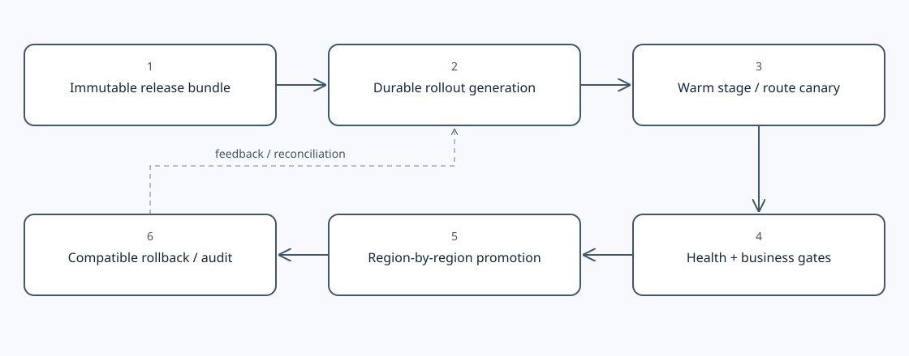

# W289. Design a Release Deployment Workflow with Staged Rollout

**Priority group:** Third 100 — broader practice

**Category:** ML infrastructure and distributed training

**Study position:** 289 of 547

[Group list](../THIRD_100.md) · [All categories](../ALL_CATEGORIES.md) · [Chapter guide](../README.md)

## Question

Design a release deployment workflow with staged rollout, rollback, health checks, and multi-region coordination.

## Worked solution

### Immutable release and durable rollout state

A release is a bundle of image/artifact digests, config/feature schema, migration plan and compatibility metadata. `POST /releases` registers it; `POST /rollouts` takes release, target regions, idempotency key, stage policy and expected deployment generation; status/pause/abort/rollback APIs expose operations. Store Release, Rollout(id,state,generation,previous_release), Stage(region,traffic_fraction,gate,state), Deployment(desired,observed) and append-only gate/audit events. A transaction changes desired state plus outbox, and leased reconcilers resume after restart.

The diagram's artifact registry feeds staged controllers, which provision healthy capacity before changing routing, then consult metrics/gates and record progress. Stages might be test→one-region 1% canary→10%→50%→full region→other regions; percentages/dwell times are explicit policy assumptions. Health includes startup/readiness, synthetic business checks, error/latency and domain quality, not merely a running process. Compare the canary against matched control traffic and minimum sample counts; missing/stale monitoring pauses promotion rather than counts as success.

### Multi-region safety and rollback

Serialize global rollout intent with generations and enforce local fencing so an old controller cannot undo a newer abort. Limit simultaneous regions/unavailable replicas and reserve failover/surge capacity. One region failing a gate stops subsequent promotions while healthy regions remain on known versions. Use region-local routing pointers with acknowledged applied generation; an API timeout reconciles observed deployment instead of launching another rollout. Avoid rolling all replicas in all regions simultaneously, especially if one region must absorb another's traffic.

Rollback switches routing to a still-warm previous **compatible bundle** and verifies readiness/metrics. Database migrations use expand→dual-compatible operation→contract after rollback window. Irreversible data changes or new feature schemas may make simple image rollback unsafe; require a tested restore/forward-fix plan before deployment. Drain connections/tasks, honor idempotent requests and checkpoint long-running work before termination. Approval, if required by the organization, gates a concrete stage rather than replacing automatic health validation.

### Example, capacity and checks

Assume each of three regions serves 10,000 RPS with ten instances at 1,000 RPS safe capacity. A 20% surge adds two instances/region for overlap, but does not provide one-region failover: surviving regions would each need 15 instances for 30,000 total RPS. Capacity promises must include both rollback warm capacity and failure headroom. This is illustrative, not a supplied workload.

Example: region A's 10% canary increases payment failures while liveness stays green. Record failed gate, stop progression, revert compatible routing and reconcile any uncertain in-flight requests by idempotency key. Outbox-based notifications survive controller failure. Test controller death between provisioning/routing, duplicate rollout, stale approval/generation, telemetry outage, incompatible schema rollback and region loss mid-canary. Monitor stage age, observed/desired divergence, business guardrails, version skew and rollback completion; a successful deployment API call is not evidence of a healthy global rollout.

<!-- architecture:W289:start -->

Read the numbered flow as Immutable release bundle → Durable rollout generation → Warm stage / route canary → Health + business gates → Region-by-region promotion → Compatible rollback / audit. The dashed return represents the feedback/reconciliation described above; it does not replace the stated durability, authority or failure contract.
<!-- architecture:W289:end -->

[Batch behavior checks](../test_review_251_300.py). Capacity/SLO estimates are design calculations, not measured production results.

### Further study

- [F087: Design an online model rollout with rollback.](../09_ml_system_design.md#f087)
- [F039: Design a fair GPU job scheduler.](../04_serving_and_training_systems.md#f039)
