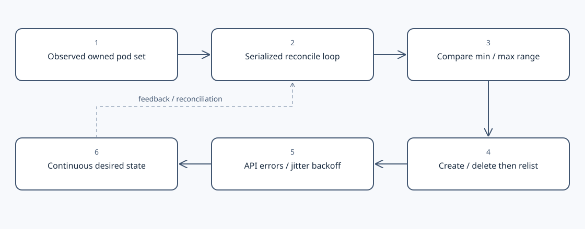

# W290. Kubernetes Controller for Pod Balance

**Priority group:** Third 100 — broader practice

**Category:** ML infrastructure and distributed training

**Study position:** 290 of 547

[Group list](../THIRD_100.md) · [All categories](../ALL_CATEGORIES.md) · [Chapter guide](../README.md)

<span class="practice-page"></span>

## Question

Implement a Kubernetes-style controller that keeps the number of running pods within a target range, then answer two follow-up questions about controllers and API-server failure.

### Requirements

1. You are given a base class that wraps the cluster API. Assume it exposes at least list_pods() -&gt; list[Pod], create_pod() -&gt; Pod and delete_pod(name: str) -&gt; None, and that any of these calls can fail when the API server is unreachable.
2. Implement a controller with a reconcile() method that observes the current pods, compares their count with the desired range [min_pods, max_pods], and creates or deletes pods to bring the count back into range.
3. Run reconciliation as a separate, continuous loop (observe, compare, act, repeat) rather than as a one-off script.
4. Every action must be safe to repeat: running reconcile() twice on the same state must not overshoot the target.
5. Handle API errors with retry and backoff instead of assuming every request succeeds; a failed pass must not crash the loop.
Input
The base class instance (the cluster API).
min_pods and max_pods (integers, 0 ≤ min_pods ≤ max_pods).
Output / deliverable
The controller class and its loop. After each successful pass, the pod count lies in [min_pods, max_pods].
Spoken answers to the follow-up questions.
Example

With min_pods = 2, max_pods = 4: 0 running pods → the pass creates 2; 6 running pods → the pass deletes 2; 3 running pods → no action.

Follow-up questions
1. What does a Kubernetes controller do?
2. What happens if the API server is down, both to the controller and to pods that are already running?

## Worked solution

### Minimal controller and honest API assumptions

The supplied base API has no operation ID, resource version, ownership selector or named create. Therefore guaranteed repeat-safe creation after an ambiguous timeout needs assumptions: one serialized controller, authoritative list results, and list counting successfully created/provisioning owned pods before another create. Under those assumptions re-list after each mutation; if create times out after succeeding, abort this pass and the next list discovers it. Never retry the same create blindly inside the catch block. Unrelated pods must already be excluded by the supplied wrapper.

```python
"""Minimal serialized reconciliation, with explicit API consistency assumptions."""
import random
import threading

class PodController:
    def __init__(self,api,min_pods,max_pods):
        if not 0<=min_pods<=max_pods:raise ValueError('invalid range')
        self.api,self.min_pods,self.max_pods=api,min_pods,max_pods
        self.lock=threading.Lock()

    def reconcile(self):
        # Single writer; list is authoritative and counts created-but-starting pods.
        with self.lock:
            pods=self.api.list_pods()
            while len(pods)<self.min_pods:
                self.api.create_pod()
                pods=self.api.list_pods()
            while len(pods)>self.max_pods:
                self.api.delete_pod(pods[-1].name)
                pods=self.api.list_pods()
            return len(pods)

    def run(self,stop,interval=1.,max_backoff=30.,on_error=None):
        backoff=interval
        while not stop.is_set():
            try:
                self.reconcile();backoff=interval;delay=interval
            except Exception as exc:
                if on_error:on_error(exc)
                delay=backoff*random.uniform(.8,1.2)
                backoff=min(max_backoff,backoff*2)
            stop.wait(delay)
```

Run the loop in a separate thread with `threading.Thread(target=controller.run,args=(stop_event,))`, then signal/join for shutdown. An API exception aborts the pass, reaches the loop's exponential backoff with jitter, and does not crash the loop. Each successful pass returns a count inside [min,max] under the stated abstraction; a second pass makes no changes. The examples 0→2, 6→4 and 3→3 follow directly for min=2,max=4. Deletion uses a concrete observed name and re-lists before another mutation.

### Real-cluster refinements and follow-ups

A Kubernetes controller repeatedly observes actual state, compares it with declared desired state and reconciles differences. It is level-triggered: missed events are repaired by later observation, rather than require every event to be delivered exactly once. A watch drives prompt reconciliation and a periodic resync repairs gaps. Real APIs distinguish Pending, Running, Ready and Terminating; deciding from only Running can create a storm while earlier pods start. Count owned nonterminating desired replicas including pending reservations, expose readiness separately, use deterministic create names/idempotency plus resource-version preconditions, and elect one leader or use CAS for competing replicas. The minimal wrapper does not provide those stronger capabilities, so they cannot be honestly invented in code.

If the API server is down, list/create/delete fail; the controller backs off and reports stale observation/failed reconciliation, never interprets a failed list as zero pods. Already-running pods normally keep executing on their nodes under kubelet/container runtime control; the control plane cannot schedule/reconcile new desired changes, and operations requiring API data may degrade. “Pods keep running” is not a guarantee that every application dependency remains available, nor that failed nodes can receive replacement pods while scheduling is unavailable.

Test lower/upper/in-range boundaries, zero range, invalid bounds, repeated reconciliation, list failure and create/delete that applies then raises a timeout. Verify the following pass re-observes and does not overshoot. If lists are eventually consistent or another scaler mutates the same set, the promised no-overshoot guarantee is impossible with only these methods; extend the API or weaken the contract. Monitor error/backoff, observed age, pending age and action rate to detect oscillation. This distinguishes a runnable solution under explicit base assumptions from unsupported production guarantees.

<!-- architecture:W290:start -->


Read the numbered flow as Observed owned pod set → Serialized reconcile loop → Compare min / max range → Create / delete then relist → API errors / jitter backoff → Continuous desired state. The dashed return represents the feedback/reconciliation described above; it does not replace the stated durability, authority or failure contract.
<!-- architecture:W290:end -->

[Runnable W290 implementation](../review_w290_implementation.py).

[Batch behavior checks](../test_review_251_300.py). Capacity/SLO estimates are design calculations, not measured production results.

### Further study

- [F087: Design an online model rollout with rollback.](../09_ml_system_design.md#f087)
- [F039: Design a fair GPU job scheduler.](../04_serving_and_training_systems.md#f039)
