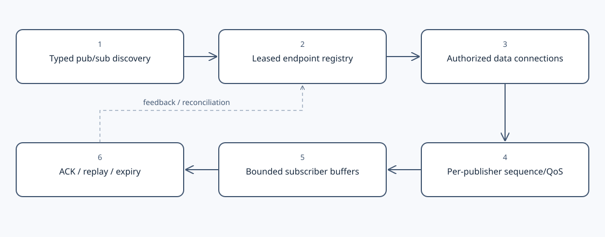

# W293. Design a ROS-like Pub/Sub System

**Priority group:** Third 100 — broader practice

**Category:** Messaging and collaborative systems

**Study position:** 293 of 547

[Group list](../THIRD_100.md) · [All categories](../ALL_CATEGORIES.md) · [Chapter guide](../README.md)

## Question

Design a ROS-like publish/subscribe messaging system. Support topics, publishers, and subscribers, and reason about delivery guarantees (at-most-once, at-least-once, exactly-once), ordering, and how the system scales as the number of topics and clients grows.

Cover the discovery mechanism (how publishers and subscribers find each other), the transport, backpressure, and failure handling.

## Worked solution

### Discovery and transport are separate

Assume robotics-style typed topics, many publishers/subscribers, local/LAN low latency and configurable reliability. A discovery registry stores Node(identity,endpoint,lease), Topic(name,schema/version,QoS) and endpoints/subscriptions. Nodes register/heartbeat, discover compatible peers and renew leases; registry replication avoids one discovery failure stopping new connections. Existing direct data connections may continue through temporary discovery outage. Multicast peer discovery is an alternative for small trusted LANs but harder across subnets/large fleets.

The diagram separates discovery/control from publisher→subscriber transport. TCP/QUIC or reliable middleware can carry acknowledged messages; UDP/multicast can favor freshness for high-rate sensor data. Envelope includes topic/schema, publisher_id,boot_id,sequence,event_time and optional key/deadline. Authenticate/encrypt peers and authorize topic publish/subscribe; discovery does not grant unrestricted actuator access. Schema/QoS compatibility is checked before connection.

### Delivery and ordering contracts

At-most-once drops unacknowledged/lost messages rather than retry, useful for stale sensor frames. At-least-once retains a bounded replay log and ACK cursor and resends after reconnect, so subscribers deduplicate (publisher,boot,sequence). Exactly-once **processing effects** require atomic consumer-offset+effect commit or an idempotent sink; network ACK alone does not establish them. An in-memory publisher cannot promise replay across its own crash without persistence. Latched/durable last-value topics support new subscribers, with timestamps so old control state is not mistaken for fresh action.

Guarantee ordering per publisher/topic stream, not a global order across independent publishers. A subscriber buffers bounded sequence gaps if reliability requires; deadlines may discard stale data and emit a gap marker. Multiple publishers needing one total order require a sequencer/partition log with added coordination/latency. Time synchronization helps correlate sensors but is not a replacement for sequence/causal ordering.

### Backpressure and scaling

Use bounded per-subscriber queues, separate delivery workers and QoS: drop-oldest/latest-only for camera frames; throttle/reject/persist commands where loss is unacceptable. A slow subscriber must not stall unrelated consumers or exhaust publisher RAM. Reliable replay has a retention horizon; a consumer beyond it receives an explicit resync requirement, not a silent incomplete history. Retries back off, node leases expire and reconnect uses a cursor.

Scale is unspecified. Assume 1,000 cameras at 10 MB/s: 10 GB/s publisher output before subscriber fanout, making centralized relaying expensive. Direct/multicast transport can reduce broker bottlenecks, while durable broker partitions simplify replay/audit; choose by topic type. Shard registry/topic metadata, isolate high-bandwidth topics and control subscription fanout. Monitor per-topic queue age, loss/gaps, deadline misses and discovery churn. Test publisher restart/sequence reset, duplicate replay, incompatible schema, slow subscriber, discovery loss and late actuator command expiry. Reliable bytes do not prove timely or safe physical execution.

<!-- architecture:W293:start -->

Read the numbered flow as Typed pub/sub discovery → Leased endpoint registry → Authorized data connections → Per-publisher sequence/QoS → Bounded subscriber buffers → ACK / replay / expiry. The dashed return represents the feedback/reconciliation described above; it does not replace the stated durability, authority or failure contract.
<!-- architecture:W293:end -->

[Batch behavior checks](../test_review_251_300.py). Capacity/SLO estimates are design calculations, not measured production results.

### Further study

- [F169: Explain backpressure in a multi-stage data pipeline.](../17_distributed_systems_depth.md#f169)
- [F162: Design a durable work queue with retries and leases.](../17_distributed_systems_depth.md#f162)
