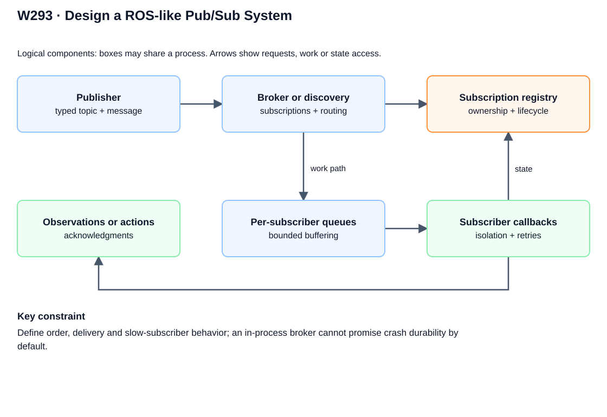

# W293. Design a ROS-like Pub/Sub System

**Priority group:** Third 100 — broader practice

**Category:** Messaging and collaborative systems

**Study position:** 293 of 547

[Group list](../THIRD_100.md) · [All categories](../ALL_CATEGORIES.md) · [Chapter guide](../README.md)

## Question

Design a ROS-like publish/subscribe messaging system. Support topics, publishers, and subscribers, and reason about delivery guarantees (at-most-once, at-least-once, exactly-once), ordering, and how the system scales as the number of topics and clients grows.

Cover the discovery mechanism (how publishers and subscribers find each other), the transport, backpressure, and failure handling.

## Worked solution

<!-- architecture:W293:start -->
### Architecture and request flow

[Open the diagram at full size](../diagrams/W293_architecture.svg). This is a baseline component diagram for this question. The boxes describe responsibilities; they do not require a separate microservice for every box.

- **Request and state:** Publisher — typed topic + message → Broker or discovery — subscriptions + routing. That component consults or updates **Subscription registry — ownership + lifecycle** under the required access and consistency rules.
- **Work and result:** the work path passes through **Per-subscriber queues — bounded buffering** and **Subscriber callbacks — isolation + retries**, producing **Observations or actions — acknowledgments**. Bound waiting and retries where a slow dependency can stall this path.
- **Correctness point:** Define order, delivery and slow-subscriber behavior; an in-process broker cannot promise crash durability by default.

When explaining the drawing, trace one normal request first, then a duplicate request, an unavailable dependency and recovery from saved state. If the question requires stricter guarantees or a different scope, state the change explicitly rather than treating this baseline as the only possible design.
<!-- architecture:W293:end -->

### Solution outline

1. Define topics, subscription lifetime, ordering, delivery semantics and callback behavior. Keep subscription state separate from the message payload.
2. For an in-process broker, update the subscriber registry under a lock, snapshot recipients, then invoke callbacks outside that lock so handlers cannot deadlock publication or mutate the iteration.
3. Use bounded per-subscriber queues or an explicit synchronous policy; specify slow-consumer and handler-exception behavior. Distributed robotics messaging additionally needs time synchronization, QoS, replay/latching and sensor freshness contracts.
4. Test subscribe/unsubscribe during publication, duplicate delivery, cancellation and shutdown; a local broker is not automatically durable messaging.

### Understand why the approach works

#### Define order, persistence and conflict resolution independently

A connection carries messages but is not the durable conversation. Give each operation a stable id and a per-conversation/document version or sequence. After reconnect, a client needs a snapshot/cursor and a way to ignore duplicate replay.

A server can promise order within one partition or conversation without promising a universal global order. Explain which component assigns that order and what happens during failover. Presence is usually an expiring approximation, distinct from durable membership and access rights.

For collaborative text or cells, specify the operation model and conflict rule. Operational transformation and CRDTs need compatible operations and transformation/merge semantics; merely selecting the acronym does not define convergence. A spreadsheet also needs formula dependency tracking and cycle behavior.

Walk through two concurrent changes, one disconnect and a duplicate delivery. Every replica should reach the declared result under the chosen rule, while old snapshots retain their stated version. Deletion and media authorization need consistent serving rules; an offline cache must not silently defeat revocation. Bounded queues and slow-subscriber policy prevent one client from stalling the entire broadcast path.

### Work a small example

A handler that unsubscribes itself should not corrupt the current recipient iteration or block unrelated subscribers forever.

### Edge cases and common mistakes

Holding the registry mutex while executing arbitrary subscriber code.

### Check your reasoning on related cases

**Explain backpressure in a multi-stage data pipeline.** A producer at 1000 items/s feeding a sustained 800 items/s consumer adds 200 queued items every second.

What should an overload response include? A clear retry policy or status, rather than silent loss or indefinite waiting.

**Design a durable work queue with retries and leases.** If a worker completes a side effect and crashes before acknowledgment, the task can be delivered again.

How do fencing tokens help? They allow downstream systems to reject writes from an expired owner.

### Further study

- [F169: Explain backpressure in a multi-stage data pipeline.](../17_distributed_systems_depth.md#f169)
- [F162: Design a durable work queue with retries and leases.](../17_distributed_systems_depth.md#f162)

### Explain it back

Close the answer. State the main invariant or equation, work the example with changed inputs, and explain which assumption would make your solution fail. For a design, walk through a retry or partial failure; for a derivative, check a shape and a finite-difference case.
