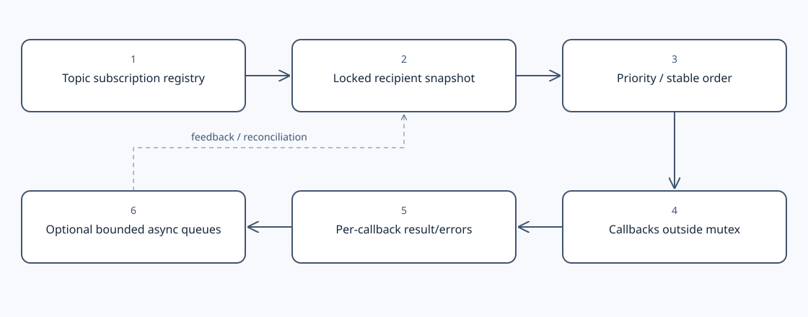

# W294. Design an In-Process Pub-Sub Messaging Broker (OOD)

**Priority group:** Third 100 — broader practice

**Category:** Messaging and collaborative systems

**Study position:** 294 of 547

[Group list](../THIRD_100.md) · [All categories](../ALL_CATEGORIES.md) · [Chapter guide](../README.md)

<span class="practice-page"></span>

## Question

Object-oriented design for an in-process publish/subscribe broker.

Functional:

subscribe(subscriber, topic) and unsubscribe(subscriber, topic) register interest in a named channel.
publish(topic, message) broadcasts the payload to every current subscriber of that topic.
Support multiple topics, multiple subscribers per topic, and a subscriber on more than one topic.
A variant adds per-subscription priority — higher-priority subscribers receive a message first.

Non-functional follow-ups:

Concurrency: publishers and subscribers run on different threads; describe a locking strategy that keeps the subscriber list consistent without serializing every publish.
Delivery semantics: at-most-once vs at-least-once; what happens when a subscriber callback throws.
Memory: how to bound the broker when one slow subscriber lags behind publishers.

## Worked solution

### Snapshot subscriptions and call outside the lock

Define “current subscribers” at publication's registry-snapshot instant. Subscribe/unsubscribe lock only the topic registry; publish copies the subscription tuples, releases the lock and invokes callbacks in descending priority then stable registration order. Thus a callback may subscribe/unsubscribe/publish recursively without corrupting iteration or deadlocking the registry. An unsubscribe affects later snapshots, not a message already being delivered. The runnable implementation is:

```python
import threading

class Broker:
    def __init__(self):
        self._lock = threading.Lock()
        self._topics = {}
        self._sequence = 0

    def subscribe(self, subscriber, topic, priority=0):
        with self._lock:
            entries = self._topics.setdefault(topic, {})
            if subscriber in entries:
                _, order = entries[subscriber]
                entries[subscriber] = (priority, order)
            else:
                self._sequence += 1
                entries[subscriber] = (priority, self._sequence)

    def unsubscribe(self, subscriber, topic):
        with self._lock:
            entries = self._topics.get(topic)
            if entries is not None:
                entries.pop(subscriber, None)
                if not entries:
                    self._topics.pop(topic, None)

    def publish(self, topic, message):
        with self._lock:
            snapshot = list(self._topics.get(topic, {}).items())
        snapshot.sort(key=lambda pair: (-pair[1][0], pair[1][1]))
        errors = []
        for subscriber, _ in snapshot:
            try:
                subscriber(message)
            except Exception as exc:
                errors.append((subscriber, f'{type(exc).__name__}: {exc}'))
        return errors
```

Subscribers are hashable callbacks. Duplicate subscribe updates priority rather than adding delivery copies; one callback can register on many topics. Callback exceptions are returned while others still run. Payload is shared as read-only by contract; if mutation is permitted, copy/serialize per subscriber and account for its cost. Concurrent publications may interleave on a subscriber, because no callback lock serializes them; add a per-subscription queue/worker if ordered single-threaded callbacks are required. Priority means callback **start order for one publish**, not completion order across threads.

### Delivery and memory trade-offs

This synchronous version retains only a snapshot of subscribers and calls each at most once per publish invocation, but a slow callback blocks that publisher. It has no crash durability or automatic retries. Repeating a callback after an exception can duplicate effects already performed before the exception; at-least-once needs message IDs, bounded retry queues and idempotent subscribers. Process crash loses in-memory messages regardless of registry locking.

The diagram's asynchronous extension uses bounded per-subscription queues and isolated delivery workers. Choose reject/drop-oldest/disconnect/backpressure explicitly when a queue fills; there is no way to guarantee lossless unbounded publish throughput with finite memory and an indefinitely slow consumer. Unsubscribe must specify drain versus discard and shutdown must resolve pending messages. With assumed 1,000 subscribers, queue depth 100 and 1 KB copied messages, buffering is about 100 MB plus overhead; references reduce copies but keep payloads alive.

Tests cover duplicate/multi-topic subscription, priority/tie order, self-unsubscribe, throwing callback, concurrent registry changes and reentrant publication. Registry locks do not serialize callback work, though one snapshot per publish is O(subscriber count) and can be expensive at huge fanout. This is an in-process OOD solution, not an unstated distributed durable broker.

<!-- architecture:W294:start -->


Read the numbered flow as Topic subscription registry → Locked recipient snapshot → Priority / stable order → Callbacks outside mutex → Per-callback result/errors → Optional bounded async queues. The dashed return represents the feedback/reconciliation described above; it does not replace the stated durability, authority or failure contract.
<!-- architecture:W294:end -->

[Runnable W294 implementation](../review_w294_implementation.py).

[Batch behavior checks](../test_review_251_300.py). Capacity/SLO estimates are design calculations, not measured production results.

### Further study

- [F169: Explain backpressure in a multi-stage data pipeline.](../17_distributed_systems_depth.md#f169)
- [F162: Design a durable work queue with retries and leases.](../17_distributed_systems_depth.md#f162)
