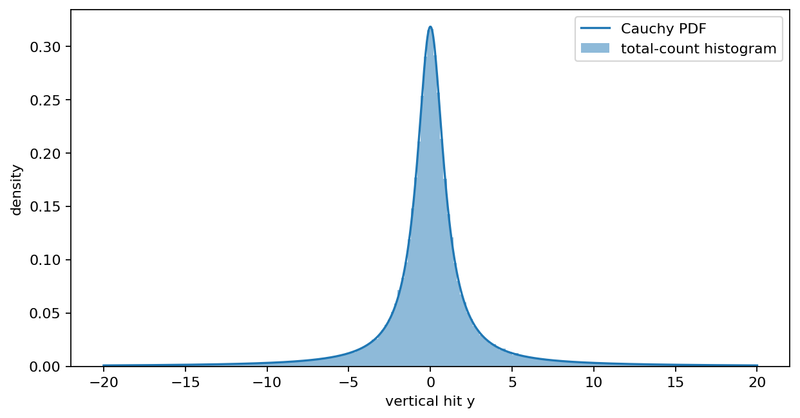

# W302. Simulating Particle Hits on an Infinite Screen

**Priority group:** Fourth 100 — role-dependent depth

**Category:** Probability and statistical reasoning

**Study position:** 302 of 547

[Group list](../FOURTH_100.md) · [All categories](../ALL_CATEGORIES.md) · [Chapter guide](../README.md)

<span class="practice-page"></span>

## Question

Simulating Particle Hits on an Infinite Screen

A point source at the origin emits particles toward the vertical line x = d, where d &gt; 0. Each direction angle is sampled uniformly from the open interval (-pi/2, pi/2), and a particle travels in a straight line. Derive the distribution of its vertical hit position and verify the result with a simulation whose plotted density uses the total sample count.

Geometry and distribution
1. Derive the hit position y as a function of the angle theta and distance d.
2. Derive the CDF and PDF of y, name the distribution, and state how d changes it.
3. Explain why the interval is open and why using a narrower angular interval would not cover the entire screen.

### What to implement

Implement these functions (matplotlib is imported inside plot_simulation only):

sample_hit_positions(n: int, screen_x: float = 1.0, rng=None) -&gt; np.ndarray, which returns n independent hit positions. rng is either None (use np.random.default_rng()) or a numpy.random.Generator; draw the angles with any of its methods (for example rng.uniform or rng.random). The tests pass only real, seeded Generator objects and check determinism and the distribution.
cauchy_pdf(y, scale: float = 1.0), which evaluates the theoretical density.
density_histogram(hits, limit: float = 20.0, n_bins: int = 200) -&gt; tuple[np.ndarray, np.ndarray], which returns the n_bins + 1 equally spaced bin edges over [-limit, limit] and the bar heights count / (len(hits) * bin_width), where the denominator uses the total number of hits, including those outside the window. n_bins must be an integer &gt;= 1 and hits must be non-empty, otherwise ValueError.
plot_simulation(n: int = 200_000, screen_x: float = 1.0, limit: float = 20.0, seed: int = 42), which plots a fixed-range histogram and overlays the PDF. It draws the hits from sample_hit_positions(n, screen_x, np.random.default_rng(seed)), draws the histogram with exactly one plt.bar(left_edges, heights, width=bin_width, align="edge", ...) call using the heights from density_histogram(hits, limit), overlays the density with exactly one plt.plot(grid, cauchy_pdf(grid, screen_x), ...) call, and ends with plt.show(). The tests replace matplotlib.pyplot with a recording stub, so the bar heights and the plotted curve are checked directly.

The histogram must be scaled by the total number of generated samples, not renormalized to the subset inside the visible range. cauchy_pdf must stay accurate for very large abs(y) and very small scale (for example y = 1e150, scale = 1e-6), where the density is a tiny positive number and must not collapse to zero by overflow. sample_hit_positions, cauchy_pdf, density_histogram and plot_simulation raise ValueError for invalid arguments (see Constraints).

### Examples

```python
theta = 0.0
d = 3.0
y = d * np.tan(theta)  # 0.0
```

A particle aimed along the positive x-axis hits the center of the screen.

cauchy_pdf(np.array([0.0]), scale=2.0)

```python
# array([0.15915494])  (equal to 1 / (2 * pi))
```

Moving the screen to x = 2 makes the distribution's scale equal to 2.

Discussion requirements
1. Explain the heavy tail and why the population mean does not exist, so sample means need not converge.
2. Identify the numerical risk near +/-pi/2 (huge hit values that dominate means and automatic plot limits) and the visualization trade-offs caused by extreme hits.
3. Describe an empirical-CDF comparison with F(y) = 1/2 + arctan(y / d) / pi.

### Constraints

n is a positive integer (a Python int or a NumPy integer, not a bool); screen_x, scale and limit are finite and strictly positive; otherwise ValueError is raised.
Sample in (-pi/2, pi/2); floating-point endpoints must not be used.
The implementation uses NumPy for sampling and Matplotlib for plotting.
Sampling takes O(n) time and O(n) output space; PDF evaluation is linear in the number of evaluation points.

## Worked solution

### Uniform angle produces a Cauchy hit distribution

Geometry gives $Y=d\tan\Theta$. Since tangent is increasing on the open forward-facing interval,

$$F_Y(y)=\tfrac12+\frac1\pi\arctan(y/d),\qquad f_Y(y)=\frac{d}{\pi(d^2+y^2)}.$$

This is a location-zero Cauchy with scale d; moving the screen twice as far doubles every hit coordinate, not its location. The endpoints are parallel rays with no finite intersection. Any narrower angular interval produces bounded hit positions and cannot cover the infinite screen. The tails decay as $d/(\pi y^2)$, so the absolute first moment diverges and the population mean is undefined; sample means need not stabilize.

```python
import numpy as np
from numbers import Real

def _positive(value):
    if not isinstance(value,Real) or isinstance(value,(bool,np.bool_)) or not np.isfinite(value) or value<=0:
        raise ValueError('finite positive scalar required')
    return float(value)

def _integer(value):
    if not isinstance(value,(int,np.integer)) or isinstance(value,(bool,np.bool_)) or value<1:
        raise ValueError('positive integer required')
    return int(value)

def sample_hit_positions(n: int, screen_x: float=1., rng=None):
    n,screen_x=_integer(n),_positive(screen_x)
    rng=np.random.default_rng() if rng is None else rng
    angle=rng.uniform(-np.pi/2,np.pi/2,size=n)
    angle=np.clip(angle,np.nextafter(-np.pi/2,0),np.nextafter(np.pi/2,0))
    return screen_x*np.tan(angle)

def cauchy_pdf(y, scale: float=1.):
    scale=_positive(scale)
    y=np.asarray(y,dtype=float)
    if np.isnan(y).any(): raise ValueError('NaN evaluation position')
    a=np.abs(y);result=np.empty_like(a)
    near=a<=scale
    result[near]=((1/scale)/np.pi)/(1+(a[near]/scale)**2)
    result[~near]=((scale/a[~near])/a[~near])/np.pi/(1+(scale/a[~near])**2)
    return result

def density_histogram(hits, limit: float=20., n_bins: int=200):
    limit,n_bins=_positive(limit),_integer(n_bins)
    hits=np.asarray(hits,dtype=float)
    if hits.ndim!=1 or hits.size==0 or np.isnan(hits).any():
        raise ValueError('nonempty one-dimensional hits required')
    edges=np.linspace(-limit,limit,n_bins+1)
    counts,_=np.histogram(hits,bins=edges)
    return edges,counts/(hits.size*(edges[1]-edges[0]))

def plot_simulation(n: int=200000,screen_x: float=1.,limit: float=20.,seed: int=42):
    import matplotlib.pyplot as plt
    hits=sample_hit_positions(n,screen_x,np.random.default_rng(seed))
    edges,heights=density_histogram(hits,limit)
    width=edges[1]-edges[0]
    plt.bar(edges[:-1],heights,width=width,align='edge',alpha=.5,label='total-count histogram')
    grid=np.linspace(-limit,limit,1000)
    plt.plot(grid,cauchy_pdf(grid,screen_x),label='Cauchy PDF')
    plt.xlabel('vertical hit y');plt.ylabel('density');plt.legend();plt.show()
```

The PDF uses separate near/far formulas to avoid squaring huge y or forming y/scale when that ratio overflows. At y=1e150, scale=1e-6, it returns about $3.1831\times10^{-307}$, a representable positive value. Endpoint clipping uses nextafter so a generated floating-point angle is strictly inside the interval. Extremely large finite d can still produce unrepresentable hit coordinates; infinity naturally lies outside any finite plot window.

Histogram heights divide by **all** n samples, including offscreen hits, so visible bar area estimates $P(|Y|\le L)=2\arctan(L/d)/\pi$, not one. At L=20,d=1 this is about .9682. The plot deliberately fixes the visible range instead of letting one extreme hit flatten the central density. Compare the empirical CDF at fixed quantiles or with a sup-norm discrepancy against F, rather than using sample means. Tests use seeded Generators, validate arguments and tiny tail density, check visible histogram mass, and record exactly one bar, one plot and one show call with a plotting stub. Sampling/PDF cost is linear in output size.



The plotted bar area intentionally excludes offscreen mass rather than renormalizing it.

### Further study

- [F124: Map a random direction to a hit on a vertical screen.](../13_probability_and_statistics.md#f124)
