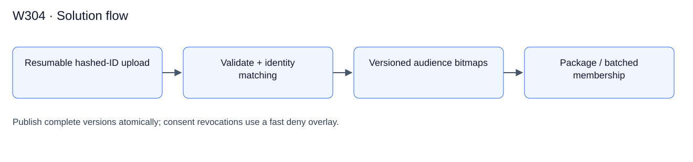

# W304. Ads Audience Targeting / Custom Audience System

**Priority group:** Fourth 100 — role-dependent depth

**Category:** Production ML and product design

**Study position:** 304 of 547

[Group list](../FOURTH_100.md) · [All categories](../ALL_CATEGORIES.md) · [Chapter guide](../README.md)

<span class="practice-page"></span>

## Question

Design an Ads Audience Targeting / Custom Audience system for Netflix (200M+ users).

Advertisers upload lists of first-party data (their own email/phone/customer-ID lists). The system must group these users into segments, let advertisers combine segments with AND/OR/NOT rules into packages, and answer membership checks ("is this user in this audience?") in under 10ms during ad serving.

Functional requirements
1. Advertisers upload large files (CSV/JSON) with millions of hashed user IDs (10M+ IDs, up to 1GB).
2. Match uploaded identifiers (email/phone hashes) to the internal user base.
3. Combine audiences using AND/OR/NOT rule expressions (packages).
4. Ad server checks membership in &lt;10ms.
5. Track upload progress, match rate, and errors; resume failed uploads.

Non-goals (nice-to-have): lookalike audiences, real-time updates.

Scale / targets

Process 10M rows in &lt; 30 min (throughput matters for uploads).
Sub-10ms membership lookup (latency matters for serving).
100K audience groups, avg 200K users/group → ~20B membership links.
100K ad requests/sec, 500K–1M membership lookups/sec.

```text
99.9% uptime; hashed IDs only for privacy.
```

Define the schema, ingestion pipeline, and serving path.

## Worked solution

### Separate a resumable build from an immutable serving version

Use `Audience(id,advertiser,status,active_version)`, `Upload(id,object_key,checksum,parts,cursor,error_counts)`, `AudienceVersion(audience,version,match_count,bitmap_uri)` and `Package(id,advertiser,expression_ast,version,dependency_versions)`. Upload through multipart signed object-store URLs, then `POST /uploads/{id}/complete` verifies size/checksum and enqueues processing. `GET /uploads/{id}` exposes bytes/rows processed, matched/unmatched/invalid counts and resumable partition checkpoints. Uploaded hashes are still sensitive and guessable; use access control, encryption, limited retention and a controlled identifier-matching service, not “hashed means anonymous.”

Workers stream/decode/validate/deduplicate the 10M identifiers, normalize only under an agreed hashing contract, and batch joins against an internal consented hash → user-ID index. Matching differently normalized email hashes is impossible without the same normalization/version; never fuzzy-match a hash. At 10M rows/30 minutes the minimum is about 5,556 rows/s, so provision and benchmark at least 10K–20K/s per concurrent upload with provider/tenant quotas. Quarantine bad rows and retain checkpoints by immutable file chunk so retries do not double-count progress.

Materialize each audience as a compressed bitmap of dense internal integer user IDs. AND/OR are bitmap intersections/unions; NOT must mean complement within an explicitly versioned eligible/consented user universe, not all possible integers. Validate package AST depth/cycles/tenant access, compile frequently used packages and atomically publish a complete version. A failed build leaves the old version active.

At 100K groups × 200K members there are 20B links: naive 4-byte IDs occupy 80 GB before indexes/replicas. A dense bitset for every audience over 200M users needs 25 MB/group or 2.5 TB, so compressed sparse/adaptive bitmaps matter. Replicate hot audience/package bitmaps across regional serving shards, route batched `Contains(user,[audience_ids])` checks and keep the request path memory-resident. 500K–1M lookups/s needs a benchmarked pool and hot-package replication; do not fetch remote database rows per link under a 10-ms target. A user-centric packed membership index is an alternative for many group checks at once, at greater update/rebuild cost.

Updates/deletions publish new versions and invalidate caches by version. Consent revocation uses a fast deny/tombstone overlay until the next build; stale data must not target a revoked user. Track match rate by identifier type, ingestion lag, lookup p99, stale-version rate and tenant isolation. Scale asynchronously on ingestion while preserving a small deterministic serving path.

### Follow the diagram



Read left to right: Resumable hashed-ID upload → Validate + identity matching → Versioned audience bitmaps → Package / batched membership. Publish complete versions atomically; consent revocations use a fast deny overlay.

### Further study

- [F063: Choose metrics for ranking and recommendation.](../07_evaluation_and_data.md#f063)
- [F082: Design a recommendation system from candidate generation to ranking.](../09_ml_system_design.md#f082)
- [F166: Design a token-bucket rate limiter.](../17_distributed_systems_depth.md#f166)
