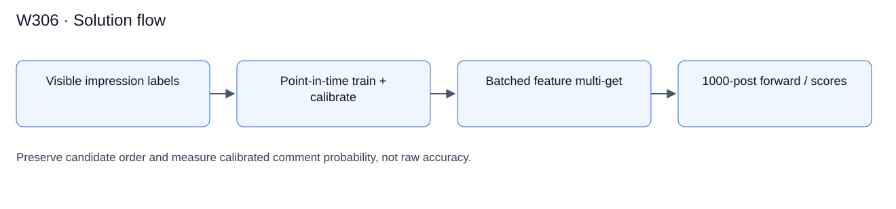

# W306. Comment-Prediction ML System

**Priority group:** Fourth 100 — role-dependent depth

**Category:** Production ML and product design

**Study position:** 306 of 547

[Group list](../FOURTH_100.md) · [All categories](../ALL_CATEGORIES.md) · [Chapter guide](../README.md)

## Question

Staff-level MLE system design: build an end-to-end ML system exposing will_user_comment_on_posts(user_id, [post_ids]) -&gt; [float,...] that scores each post by the probability the user would comment, used as one signal in home-feed ranking (~1,000 candidate posts per request under tight latency).

Covers
Modeling: binary classification / CVR framing, heavy class imbalance (commenting is rare), calibration since the score is blended with other heads.
Features: user (history, subreddit affinity), post (subreddit, author, content embedding, age), user x post cross; freshness and storage per group.
Serving: batch ~1,000 posts into one forward pass, fetch user features once and post features in a batched multi-get (feature-store online/offline split).
End-to-end: offline training pipeline, logging features/scores/outcomes, A/B testing, cold start.
Role-dependent scope: for non-MLE roles, treat the model as a black box and focus on the feature store and serving path.

## Worked solution

### Predict comments conditional on exposure

The contract returns one calibrated probability per input post, in the same order, including duplicate IDs. Define the label as a comment within a fixed horizon after a visible impression, for example 24 hours; unshown candidates are not negatives. Log impression ID, user/post IDs, timestamp, feature/model versions, displayed position, score and delayed outcome. Split by time with a label-maturity gap and consider exposure/position bias when using a policy-selected training sample.

Start with logistic/gradient-boosted baselines, then a shared user/post network with cross features if the data and latency justify it. Optimize binary cross-entropy on natural prevalence or correct any negative sampling weights. A rare comment rate makes accuracy misleading: evaluate PR-AUC, log loss, calibration and recall at a ranking budget, with community/user-tenure slices. Calibrate on held-out production-like traffic before blending this head with clicks/dwell; weighted loss alone does not preserve probabilities.

Use user history/subreddit affinity, post community/author/age/content representation and user×community/author interactions. Offline storage retains point-in-time feature histories; online stores serve fresh aggregates and immutable embeddings. The request flow is auth → fetch user features once + batched multi-get for ~1,000 post features → assemble `[1000,d]` feature rows → one batched forward pass → ordered `[1000]` scores. Cache post features and fetch only missing IDs; fallback priors preserve shape/order. No thousand-RPC loop or per-post model request belongs in the hot path.

Assume 10K ranking requests/s and 1,000 candidates each: 10M pair scores/s. At 200 bytes of uncached features/pair that is 2 GB/s of raw feature movement before overhead; local caches/compression and shared feature reuse are capacity requirements. A hypothetical 30-ms stage budget might allocate 10 ms feature reads, 10 ms batch inference and 10 ms network/margin, verified at tail load rather than assumed from GPU FLOPS.

Cold users get population/community priors; cold posts use content/author features. Monitor feature age, missingness, score/calibration drift, p99 and delayed label joins. A/B test overall feed utility with guardrails for spam, toxic comments and displaced positive interactions; maximizing any-comment count can reward conflict. Roll back a stale feature/model version independently and use deterministic priors on outage. Staff-level depth is the target/exposure contract and end-to-end measurement, not naming a large model.

### Follow the diagram

Read left to right: Visible impression labels → Point-in-time train + calibrate → Batched feature multi-get → 1000-post forward / scores. Preserve candidate order and measure calibrated comment probability, not raw accuracy.

### Further study

- [F081: Structure an ML system-design answer.](../09_ml_system_design.md#f081)
- [F064: Design an A/B test for a new ML ranking model.](../07_evaluation_and_data.md#f064)
- [F137: Separate correlation, prediction and causation.](../14_regression_and_experiment_depth.md#f137)
