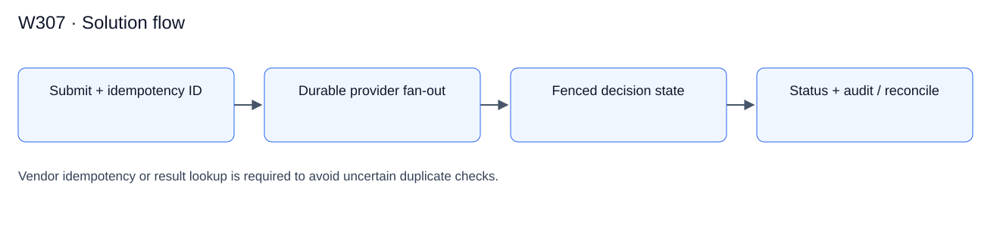

# W307. Design a Credit-Approval Risk Engine

**Priority group:** Fourth 100 — role-dependent depth

**Category:** Production ML and product design

**Study position:** 307 of 547

[Group list](../FOURTH_100.md) · [All categories](../ALL_CATEGORIES.md) · [Chapter guide](../README.md)

## Question

Design a credit-approval risk engine. It accepts an application, returns a decision id instantly, fans out to several slow external providers (credit bureau, KYC, fraud, income) asynchronously, then combines their signals into approve / deny / manual-review.

Functional requirements: (1) Submit application, get an ID back instantly. (2) Collect risk data from external providers in the background. (3) Decide approved/denied/manual_review via rules + scores. (4) Status checks for users and support agents. (5) Reliability — safe retries; never double-charge or double-check.

Non-functional: zero duplicate apps/checks (money and law involved); user response &lt;10s, full decision &lt;5 min; 99.95% uptime; full audit history (banking law); handle traffic spikes. Scale: ~2M applications/day (~23 req/s avg), 4-8 external calls per app (2K-4K external calls/s peak), ~12 TB/year. Discussion centers on returning fast while deciding in the background, three-layer idempotency, a single-writer decision state machine, circuit-breakers on flaky vendors, and an append-only audit trail.

## Worked solution

### Return an ID, then run a durable decision state machine

`POST /applications` authenticates, validates, and transactionally creates `Application(id,user,idempotency_key,request_hash,state,version)` plus an outbox event; return 202 with ID and status URL well under the 10-second bound. The same key/body returns the same ID; the same key with different data returns conflict. `GET /applications/{id}` and privileged support endpoints enforce ownership and redact provider PII.

A durable workflow fans out `ProviderCheck(application,provider,check_type,key,state,attempt,reference,deadline)`, four to eight per application. Three idempotency layers are needed: submission key, unique workflow/check row, and stable vendor request key. A queue is at-least-once; consumers claim/fence check attempts. After a timeout, query the vendor by reference before retrying. **Zero duplicate external checks/charges is impossible to guarantee if a vendor neither honors idempotency nor exposes result lookup**; quarantine an uncertain check for reconciliation instead of confidently sending it again.

One application owner advances a versioned state machine `submitted -> collecting -> evaluating -> approved/denied/manual_review`. Only valid transitions commit with compare-and-swap or row locking. Record the rule/model versions and input evidence versions. A late provider callback cannot reopen or overwrite a finalized decision; policy determines whether a new revision/manual review is required. Missing or conflicting signals reach manual review at a bounded deadline, not silent approval. Provider circuit breakers, independent bulkheads, rate budgets and jittered bounded retries contain outages.

At 2M/day, application arrival is 23.15/s average. Six checks gives 139/s average; a 20× peak gives about 2,778 checks/s, matching the stated 2K–4K range. At 2 KB/check raw response, six calls/application gives roughly 24 GB/day before application/audit overhead, around 8.8 TB/year; 12 TB/year is a plausible planning envelope but retention/replication increase physical storage. Set per-stage deadlines summing below five minutes and reserve manual-review time; a fast submission response is not a completed credit decision.

Commit append-only restricted audit events with each state transition using an outbox, including actor, reason codes, timestamps, input/model versions and vendor references. Encrypt credentials/PII with scoped access, retain only under an agreed policy and separate user-facing explanations from raw risk data. Test duplicate submissions, duplicate/out-of-order callbacks, crash after vendor acceptance, contradictory signals and deadline expiry. Track decision latency, uncertain checks, duplicate suppression, vendor errors and manual-review rate, with reconciliation against vendor invoices.

### Follow the diagram

Read left to right: Submit + idempotency ID → Durable provider fan-out → Fenced decision state → Status + audit / reconcile. Vendor idempotency or result lookup is required to avoid uncertain duplicate checks.

### Further study

- [F140: Design a credit-model business evaluation without confusing accuracy and profit.](../14_regression_and_experiment_depth.md#f140)
- [F068: Check calibration and choose a decision threshold.](../07_evaluation_and_data.md#f068)
