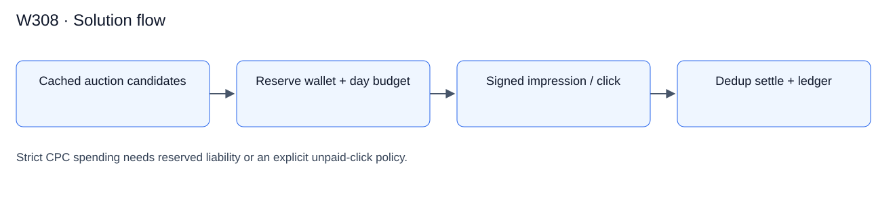

# W308. Design a Scalable Ad Marketplace System

**Priority group:** Fourth 100 — role-dependent depth

**Category:** Production ML and product design

**Study position:** 308 of 547

[Group list](../FOURTH_100.md) · [All categories](../ALL_CATEGORIES.md) · [Chapter guide](../README.md)

## Question

Design a scalable ad marketplace connecting publisher websites with advertisers. The system must handle: ad requests (a site asks for an ad to show), click tracking, budget management (each ad has a daily budget that decreases on clicks and resets daily), ad bidding (advertisers compete; system picks the best bid), and fund management (advertiser account balances).

Requirements: real-time ad selection, competitive bidding, stop serving when daily budget hits zero, daily budget reset (across time zones), add-money/refund flows, and global scale.

Assumptions: ~10,000 active advertisers, ~100,000 ad requests/sec (peak ~300k), ~2,000 clicks/sec (2% CTR), 3-5 global regions, ad-selection p99 &lt; 50ms.

Address: real-time budget tracking without errors, the race when 1,000 people click as budget hits zero, preventing overspend, first- vs. second-price auctions, caching for fast selection, time-zone budget resets, click fraud, and latency guarantees.

## Worked solution

### Separate auction speed from authoritative money movement

Use `Campaign(id,advertiser,budget,timezone,bid_policy,status)`, per-day `Budget(campaign,period,spent,reserved)`, `Wallet(advertiser,available,reserved)` and append-only double-entry ledger entries keyed by event/request ID. `POST /ad-requests` returns a signed impression/click token; `POST /clicks` validates/deduplicates it; funding/refund APIs require idempotency keys and verified payment-provider status. Payment callbacks and ad clicks cannot directly mutate a cached float balance.

At 100K requests/s and a 50-ms p99 target, serve targeting/creative/bid candidates from regional caches, compute eligible auction scores locally and reserve a bounded liability at the campaign's budget authority. In a simplified CPC auction, first price charges the winning bid; second price charges the next competing score converted into the winner's price under the actual quality rule. State the exact auction/payment rule rather than assuming bids and charges coincide. Regionally leased budget partitions keep total reserved+spent within the global daily and wallet limits; a region cannot refill a lease independently during a partition.

The hard CPC race is that impressions create potential future clicks. To guarantee no overspend, reserve the maximum payable click liability before serving and hold it through the valid click-attribution window, releasing unused liability on expiry. This is conservative and can underdeliver severely for low-CTR ads. Alternatively reserve only at click time and stop **charging** at zero, accepting unpaid clicks already served; that does not guarantee “no future ad displayed after depletion.” State which product promise is required. A cached remaining balance alone cannot guarantee either strict global spending limit.

For 1,000 near-simultaneous clicks at the last dollar, unique click IDs and an atomic wallet+campaign reservation/settlement allow only payable debits; duplicates return their previous result. Never subtract then repair an overdraft asynchronously. Reject suspected fraud before billing where possible; later reversals use compensating ledger entries, not rewriting history. Keep event logs for audit/reconciliation.

Use immutable budget-period IDs with timezone-derived UTC boundaries; a new day creates a new row, and changing timezone must not reset spend mid-period. Pace by comparing spend/reservation trajectory to the planned time curve and adjusting participation/bid multipliers; pacing is not the correctness boundary. At 2K clicks/s average, ledger writes are much lower than 100K auction reads/s, but peak 300K reads and hot advertisers require capacity testing. Return no-ad/house-ad on exhausted authority or unsafe state, and isolate regional feed/cache outages. Funds added/refunded become available only after durable ledger state, with provider reconciliation for ambiguous payment results.

### Follow the diagram

Read left to right: Cached auction candidates → Reserve wallet + day budget → Signed impression / click → Dedup settle + ledger. Strict CPC spending needs reserved liability or an explicit unpaid-click policy.

### Further study

- [F063: Choose metrics for ranking and recommendation.](../07_evaluation_and_data.md#f063)
- [F082: Design a recommendation system from candidate generation to ranking.](../09_ml_system_design.md#f082)
- [F166: Design a token-bucket rate limiter.](../17_distributed_systems_depth.md#f166)
