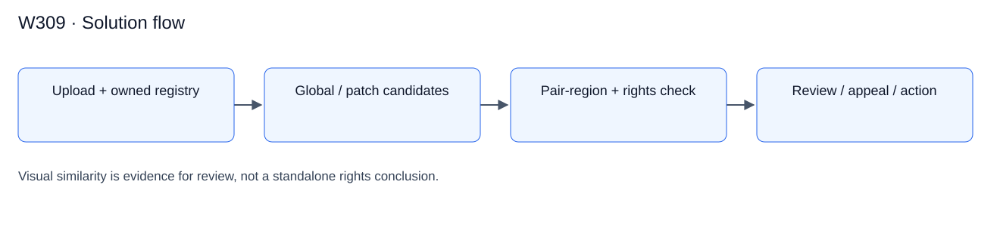

# W309. Design Image Copyright-Violation Detection

**Priority group:** Fourth 100 — role-dependent depth

**Category:** Production ML and product design

**Study position:** 309 of 547

[Group list](../FOURTH_100.md) · [All categories](../ALL_CATEGORIES.md) · [Chapter guide](../README.md)

## Question

Design a system that decides whether a user-uploaded image infringes any image in a copyrighted-image registry.

Be ready for follow-ups: how you'd fine-tune the VLM; a 3×3 collage where only one cell infringes; adversarial text overlaid on the image; the user re-photographs a copyrighted work with a phone. Also cover ownership checks, registry updates, and human review. Expect pressure to defend a single-model design.

## Worked solution

### Detect visual reuse; adjudicate rights with evidence

Similarity is not by itself proof of infringement: licenses, ownership and permitted usage are separate inputs. Build a system that returns `clear / possible_match / human_review` with registry candidate IDs, matched regions and confidence, while a rights policy/human reviewer decides enforcement. Store `RegistryWork(id,claimant,ownership_evidence,license,status,version)`, immutable image assets and descriptors; validate claimant authority and support disputes/removal. Upload and registry endpoints require identity/tenant checks and an audit trail.

The flow is upload → safe decode/normalize → global plus patch/region embeddings → ANN candidate retrieval → pair/region verifier → rights check → review/action. A single expensive model cannot compare an upload against an unbounded registry under a small latency budget. One shared visual encoder can generate both global/patch representations and train with contrastive/pair objectives, but candidate retrieval and geometric/evidence verification remain distinct operations. Defend model reuse without pretending whole-image classification solves localization.

Train/fine-tune on licensed positive pairs with crops, compression, color changes, perspective/rephotography, partial occlusion and overlaid text; use visually similar unrelated hard negatives and split by original work/creator. A contrastive encoder separates matching/nonmatching works; a pair head can localize regions with labeled correspondence/bounding boxes. Treat overlaid instructions as pixels, never instructions to a VLM tool. For a 3×3 collage, encode overlapping tiles/multiple scales and verify the one matching cell; a global embedding can dilute it. For phone rephotography, perspective/lighting augmentation and local correspondences matter; there is no guarantee on arbitrary distortion.

Assume 100M registry works with 768 float16 descriptors: raw global vectors alone are about 154 GB, multiplied by patch descriptors/index/replicas. Shard ANN and rerank a bounded candidate set, cache hot work descriptors and queue expensive uncertain cases. New registry versions build atomically; deleted/disputed claims invalidate caches/actions promptly. A model outage or ambiguous ownership goes to review, not automatic punishment.

Evaluate candidate recall under transformations, verifier precision at the enforcement threshold, localization overlap, false accusations and review overturn rate by slice. Online measure time to resolution, creator/user appeals and reviewer load as well as automated throughput. False positives have asymmetric cost, so high-confidence retrieval is a triage aid and uncertainty is surfaced. No personal/company detection accuracy or legal conclusion is claimed from unavailable data.

### Follow the diagram

Read left to right: Upload + owned registry → Global / patch candidates → Pair-region + rights check → Review / appeal / action. Visual similarity is evidence for review, not a standalone rights conclusion.

### Further study

- [F189: Detect possible image copyright violations as a retrieval problem.](../19_product_ml_case_studies.md#f189)
