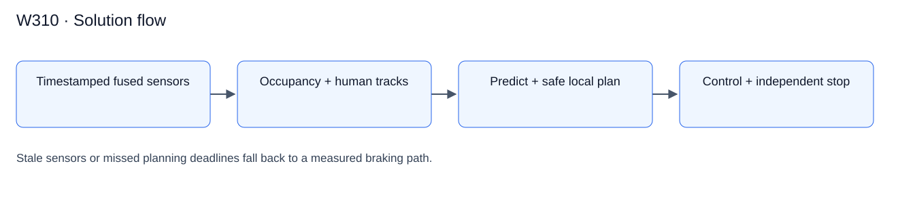

# W310. Design Robot Human-Avoidance (Open-Ended)

**Priority group:** Fourth 100 — role-dependent depth

**Category:** Production ML and product design

**Study position:** 310 of 547

[Group list](../FOURTH_100.md) · [All categories](../ALL_CATEGORIES.md) · [Chapter guide](../README.md)

## Question

Robotics-team open-ended design discussion (pseudocode + architecture sketch, not a compiled solution): "How would you make a warehouse robot detect and avoid humans?"

Drive through three explicit decision axes:

Sensor selection (cameras, depth/LiDAR, ultrasonics) and the latency-vs-accuracy tradeoff.
Data structure for the local world model — occupancy grid vs object list vs trajectory buffer.
Decision loop — perception → planning → actuation, including how often each tier runs.

Treat it as a guided design dialogue; ask the interviewer which axis they want depth on.

## Worked solution

### Use a safety loop independent of learned perception

State the environment first: indoor warehouse, speed/vehicle mass, people carrying pallets, occlusion, braking capability and allowed stopping distance. For an illustrative robot at 1 m/s with .2 s sensing-to-brake delay and 1 m/s² braking deceleration, ideal stopping distance is $.2+1^2/(2\times1)=.7$ m before localization/error margin. A 1-m protective zone is a planning example, not a validated safety specification; measure worst-case latency and braking on the actual platform.

Use LiDAR/depth for geometry and range, cameras for human semantics, wheel/IMU odometry for motion. Cameras are inexpensive but sensitive to lighting/occlusion; LiDAR costs more and can miss some materials/geometry; ultrasonics are short-range backup, not a complete human detector. Timestamp/calibrate sensors and monitor missing/stale frames. A geometric obstacle stop path should remain active if the human classifier fails.

Keep a rolling local occupancy grid with free/occupied/unknown probabilities for collision checking, plus a tracked object list `(id,pose,velocity,covariance,last_seen)` for humans and short trajectory buffers for motion prediction. A grid captures arbitrary obstacles but does not inherently preserve identity/velocity; an object list is compact but can miss unclassified obstacles. Fuse them rather than forcing one representation to do both jobs. Treat unknown/occluded regions conservatively.

An example tiered loop is sensor/fusion 20–30 Hz, local trajectory planning 10–20 Hz, motion control 100 Hz and an independently budgeted emergency-stop watchdog. Predict short-horizon human occupancy with uncertainty, reject trajectories intersecting inflated space, and choose a stop if no safe path remains. Pseudocode: `if stale_sensor or imminent_collision: brake; else fuse; predict; plan_safe_trajectory; track_with_limits`. Planner deadlines expire to braking, never “keep last velocity forever.”

Test replay, simulation, controlled human/occlusion scenarios and hardware stop-distance drills, with independent safety review and staged speed/geofence limits. Measure missed detections at critical distance, false stops, worst-case end-to-end delay, clearance and near misses; aggregate detector accuracy alone is insufficient. Ask which axis the interviewer wants next—sensor trade-offs, world-model updates or control timing—and use that answer to deepen the same design.

### Follow the diagram

Read left to right: Timestamped fused sensors → Occupancy + human tracks → Predict + safe local plan → Control + independent stop. Stale sensors or missed planning deadlines fall back to a measured braking path.

### Further study

- [F190: Classify viewers using movie completion behavior.](../19_product_ml_case_studies.md#f190)
- [F070: Explain uncertainty without confusing it with confidence.](../07_evaluation_and_data.md#f070)
