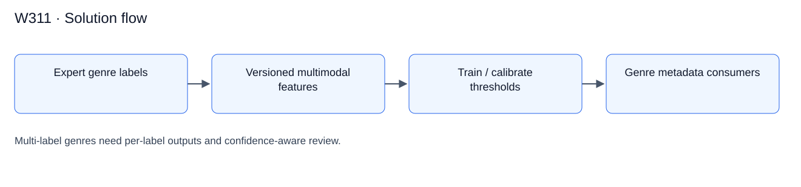

# W311. ML System Design: Game Genre Classification From Scratch

**Priority group:** Fourth 100 — role-dependent depth

**Category:** Production ML and product design

**Study position:** 311 of 547

[Group list](../FOURTH_100.md) · [All categories](../ALL_CATEGORIES.md) · [Chapter guide](../README.md)

## Question

Design a system to classify each game on the platform into a fixed genre taxonomy, from scratch. Cover label collection, feature pipelines, model choice for a multi-modal item, training/refresh cadence, and downstream consumption (search, browse, recommendations).

## Worked solution

### Define labels before picking a multimodal model

A fixed genre taxonomy still needs definitions, hierarchy and a multi-label policy: a game may be both puzzle and adventure. Assume multi-label genre assignment with a human-reviewed canonical ID set; if the product requires one primary genre, train/evaluate that separately. Collect developer labels as noisy seeds, expert annotations on descriptions/gameplay, user corrections and adjudication with agreement checks. Split by franchise/developer/time so sequel assets do not leak across train/test.

Represent text descriptions/tags, screenshots/video snippets and optional gameplay metadata separately. Begin with text TF-IDF plus one-vs-rest logistic regression and an approved metadata baseline; add pretrained text/vision encoders with a fusion head only after proving incremental value. Missing modalities get explicit masks/defaults, not a fabricated image. Train per-label binary cross-entropy with class-aware sampling/weights, then calibrate thresholds on held-out natural prevalence. Avoid a softmax if labels are not mutually exclusive.

The ingestion flow is game publish/edit → immutable content snapshot → safe media extraction → feature/model worker → versioned `GameGenre(game,genre,score,evidence,model_version,content_version)` → serving metadata index. A batch job backfills the catalog; content edits enqueue incremental scoring. Publish only when the content version still matches, so an old job cannot overwrite an edited description. Keep low-confidence/contradictory classifications for human review and allow developer appeal. Search/browse/recommendation consume versioned genre metadata rather than invoking media inference per request.

Assume 10M games with four 768-dimensional float16 modality vectors: about 61 GB raw features before video/frame expansion and indexes. If 100K games change/day, average inference is about 1.16 games/s; videos determine peak GPU cost, so cap sampled frames and separate high-priority new releases from backfills. Use daily incremental processing and periodic taxonomy/calibration refresh rather than retraining on every edit.

Measure per-label precision/recall, macro-F1, calibration, rare-genre coverage and human disagreement; evaluate product impact with search refinement success and browse satisfaction, guarding misclassification/appeals. Creator-added keyword spam, niche genres and modality conflict are failure slices. A feature outage preserves last known valid metadata with freshness; new unknown games receive a visible provisional label or review, not arbitrary popular genres.

### Follow the diagram

Read left to right: Expert genre labels → Versioned multimodal features → Train / calibrate thresholds → Genre metadata consumers. Multi-label genres need per-label outputs and confidence-aware review.

### Further study

- [F181: Predict the category of a newly listed item.](../19_product_ml_case_studies.md#f181)
