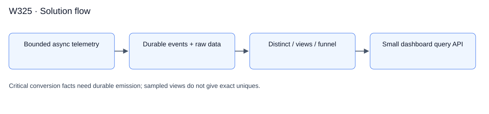

# W325. DAU / MAU Internal Analytics System

**Priority group:** Fourth 100 — role-dependent depth

**Category:** SQL, data modeling and pipelines

**Study position:** 325 of 547

[Group list](../FOURTH_100.md) · [All categories](../ALL_CATEGORIES.md) · [Chapter guide](../README.md)

## Question

Design an internal analytics system that reports DAU/MAU, most-viewed pages, and the subscription funnel conversion rate for PMs and data scientists — then handle the wrinkle that the new instrumentation must not noticeably slow down the product.

### Requirements

Build an analytics system whose consumers are internal users (PMs, data scientists), surfacing at least:
Daily active users (DAU) and monthly active users (MAU).
Most commonly viewed pages, keyed by URL.
Subscription funnel success rate, e.g. users who complete a subscription purchase / users who start a purchase.
Key decision point: what if adding this instrumentation makes the app much slower? Discuss async / non-blocking event emission, sampling, buffering, and moving aggregation off the request path (offline/batch or streaming pipeline).
Notes
The interviewer often plays the PM and grades requirement clarification heavily — one candidate was failed specifically for not confirming requirements before designing, so spend real time scoping who reads the dashboard and which metrics matter.
Keep the design proportionate. Pulling a full textbook system-design template (one candidate ran the entire Alex Xu chapter-6 playbook) was judged over-complicated and got dinged — favor a clean event-ingestion -&gt; aggregation -&gt; query-for-internal-dashboard flow and justify each piece.
Treat the three metrics as the functional core: define the event schema, the aggregation windows (rolling daily/monthly distinct-user counts), and how funnel steps are correlated per user.

## Worked solution

### Define the three metrics, then keep logging off the product path

Ask who uses the dashboard, required freshness, timezone, bot/internal-user exclusions, retention and whether MAU means calendar month or rolling 30 days. Choose UTC DAU, rolling-30-day MAU, canonicalized page URL views and a seven-day subscription attempt funnel. The denominator is unique eligible purchase attempts started; numerator is those same attempts completed within seven days. If product instead wants unique users, define attribution across multiple attempts explicitly. Pending cohorts are not final failures.

Emit `Event(event_id,user_id,session_id,attempt_id,type,event_time,received_at,url,schema_version)` with no unnecessary PII/query-string secrets. The flow is bounded nonblocking client/server buffer → batched collector → durable log/raw storage → scheduled or streaming aggregation → small analytical store → authenticated dashboard API. A minimal system might use queued batches plus hourly warehouse jobs; add a streaming engine only if minute-level freshness is required. For an assumed 10M events/day at 200 bytes each, raw volume is about 2 GB/day before replication, not a reason alone for dozens of services.

On the product request path, enqueue to a bounded memory buffer with a millisecond budget, never synchronously wait for a warehouse query. Flush asynchronously, compress batches and retry with stable event IDs. If full, count drops and shed low-value view telemetry; purchase completion should originate from a durable transactional outbox because losing it biases revenue/funnel data. Sampling page views can estimate popular pages, but naive event sampling biases distinct users and conversion cohorts; retain unsampled critical events and document any estimators.

Deduplicate event IDs, aggregate views by canonical URL/time and user presence by day. Rolling uniques require unionable user sets/bitmaps or HLL with an explicit error, not a sum of daily counts. Correlate starts/completions by attempt ID, handle retries and late arrival, and publish metric version/watermark. Backfill recomputes affected partitions from raw events, then swaps them atomically. Instrument logging overhead, drops, ingestion lag and reconciliation against billing totals. The validation goal is unchanged product latency plus trustworthy metrics, not merely a dashboard that loads quickly.

### Follow the diagram

Read left to right: Bounded async telemetry → Durable events + raw data → Distinct / views / funnel → Small dashboard query API. Critical conversion facts need durable emission; sampled views do not give exact uniques.

### Further study

- [F179: Define label windows for click-through-rate analysis.](../18_data_and_sql.md#f179)
- [F177: Design an ETL job that can safely rerun.](../18_data_and_sql.md#f177)
