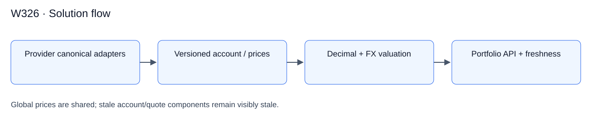

# W326. Design a Financial Dashboard Backend

**Priority group:** Fourth 100 — role-dependent depth

**Category:** SQL, data modeling and pipelines

**Study position:** 326 of 547

[Group list](../FOURTH_100.md) · [All categories](../ALL_CATEGORIES.md) · [Chapter guide](../README.md)

<span class="practice-page"></span>

## Question

Design a financial dashboard that shows each user their account balances and stock holdings, valued in one currency and kept current. The data comes from outside: stock market data APIs, cryptocurrency exchange APIs and the user's linked accounts. The system must ingest that data, aggregate it and calculate the figures a dashboard shows.

What to design

A backend service and its data pipeline. A client application calls it to render, for one signed-in user, a summary page and a detail view per account. Describe the components, the data they exchange and how they behave when a provider is slow, wrong or down.

### Requirements

1. Show the user's accounts with their balances, and the user's holdings (instrument, quantity) across stock brokerage accounts and cryptocurrency exchange accounts.
2. Show for each holding its current market value, and for the whole portfolio the total value, the change since the previous close (for 24/7 crypto, the price at the 00:00 UTC cutoff), and the allocation by instrument and by account.
3. Show a portfolio value chart over time (day, month, year).
4. Ingest data from several external providers, each with its own format, rate limits, error behavior and update frequency. Adding a provider must not require changes to the dashboard code.
5. Show how fresh each figure is. Never show a number as current when its source has been silent longer than the freshness target.
6. Calculations must be correct: no rounding drift in sums, and a repeated or out-of-order provider message must not change a balance twice.
7. A user may see only their own data. Provider credentials are stored and used securely.
Assumptions to size against

```text
10 million registered users, 2 million of them active on a day, and an active user opens the dashboard 5 times a day.
```

Peak traffic is 5 times the daily average.
A user has on average 3 linked accounts and 12 holdings.
There are 20,000 tradable instruments (stocks and crypto pairs) and each can change price once per second.
Prices should be at most 5 seconds old, and balances and positions at most 15 minutes old for users who are active.

### Constraints

Provider APIs limit request rates, and some bill per call.
Prices are global; balances and holdings are per user and need the user's authorization at each provider.
Answer in 45 to 60 minutes: pick the parts that matter most and state your trade-offs.

## Worked solution

### Normalize external facts and show their timestamps

Use provider adapters that emit canonical `AccountSnapshot(user,account,version,as_of,currency,cash)`, `PositionSnapshot(account,version,instrument,quantity)` and `Price(instrument,quote_currency,source_seq,as_of,price)`. Maintain instrument/FX reference data and provider mappings centrally; dashboard code consumes the canonical model, so adding a provider changes an adapter. Store linked-account credentials in an encrypted secrets service with scoped tokens, rotation and access audit. Every account/read query derives the user from the authenticated session.

The flow is global price feeds → normalized deduplicated price cache/time buckets; authorized account polling/webhooks → immutable snapshots → portfolio materializer; dashboard API → user positions plus shared current prices/FX → valued response. `GET /portfolio?currency=USD` returns total, per-account/instrument allocations, change, source timestamps/stale flags and a consistency watermark. `GET /accounts/{id}` checks ownership; `GET /portfolio/history?range=...` serves sampled stored valuations, not an expensive replay per page.

Use exact Decimal/fixed-point prices, quantities and FX, aggregate unrounded products and round only display totals under a defined currency policy. Value a holding as quantity×price×FX into the display currency, and include cash exactly once. Define change as current holdings' marked-price change versus previous stock close/crypto 00:00 UTC and label it; a true portfolio P&L/change needs cash-flow/trade history to avoid calling a deposit a gain. Snapshot/as-of historical valuations or event-time holdings are necessary for a truthful chart; revaluing today's holdings at old prices is a different metric. Align instrument reference price cutoffs and FX policy and surface missing quotes rather than silently valuing them at zero.

**Sizing.** 2M active users×5 opens/day =10M reads/day≈116/s average, 579/s peak. Active users have 6M accounts and 24M holdings. Polling each active account every 15 minutes requires up to 6M/900≈6,667 account refreshes/s while all are active; partner limits/cost may make this infeasible without webhooks, batch endpoints and demand-aware refresh. Global 20K instruments×1 tick/s is 20K price updates/s. One global price fetch serves many users; never poll per portfolio holding.

Compare source sequence/version before applying a snapshot; do not add an absolute balance update twice. Trades/cash deltas require unique event IDs and ordered durable application. A partial position snapshot must not delete missing pages until its complete version publishes. At >5-second quote age or >15-minute active-account age, explicitly mark affected figures stale with as_of; a total can be mixed-freshness, which must also be disclosed. Circuit breakers/backoff/jitter and per-provider pools contain outages; preserve last-known values with age, not false freshness. Reconcile snapshots, FX coverage and totals, test duplicate/out-of-order messages and property-check that allocations sum to the unrounded total.

### Follow the diagram



Read left to right: Provider canonical adapters → Versioned account / prices → Decimal + FX valuation → Portfolio API + freshness. Global prices are shared; stale account/quote components remain visibly stale.

### Further study

- [F067: Build an LLM evaluation harness.](../07_evaluation_and_data.md#f067)
- [F169: Explain backpressure in a multi-stage data pipeline.](../17_distributed_systems_depth.md#f169)
- [F179: Define label windows for click-through-rate analysis.](../18_data_and_sql.md#f179)
