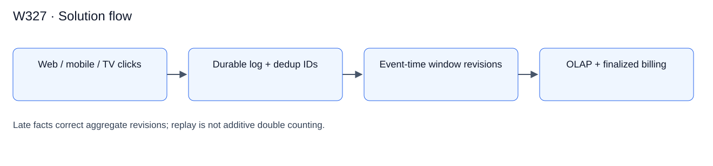

# W327. Design an Ad Click Aggregation Pipeline

**Priority group:** Fourth 100 — role-dependent depth

**Category:** SQL, data modeling and pipelines

**Study position:** 327 of 547

[Group list](../FOURTH_100.md) · [All categories](../ALL_CATEGORIES.md) · [Chapter guide](../README.md)

## Question

Design a click aggregation system for ads. The version emphasizes multiple data sources (web, mobile, TV) and click-count accuracy.

Functional requirements:
1. Ingest click events from web, mobile, and TV sources.
2. Produce near-real-time counts for dashboards and campaign decisions.
3. Preserve accurate click data for billing / audit.
4. Deduplicate retries and handle late / out-of-order events.
5. Support queries by campaign, creative, source, and time window.

Scale / constraints: high write throughput, bursty traffic, hot campaigns; accuracy matters because data affects billing/ranking.

Discuss: streaming vs batch correction; event-time windows and watermarking vs processing-time; idempotent event keys and dedupe storage; OLAP store / cube materialization vs raw-log replay.

## Worked solution

### One immutable click fact, two aggregation speeds

Define a click event `event_id,impression_id,campaign_id,creative_id,source,event_time,received_at,schema_version,fraud_state`. Signed impression/click tokens and authenticated SDK/server collectors reduce fabricated events; uniqueness alone does not prove a click is billable. Web/mobile/TV adapters normalize to the same contract while preserving source. The path is collectors → partitioned durable log/raw object storage → event-ID dedup + validation → event-time aggregates → OLAP query service. Billing consumes a finalized, policy-versioned ledger, not an approximate dashboard counter.

Assume 500K peak events/s at 200 bytes/event: 100 MB/s raw, or 8.64 TB/day if sustained, before replicas/indexes. Partition by a stable event/campaign salt to distribute hot campaigns; use local partial counts followed by campaign/window merge. A campaign-only key can bottleneck a blockbuster ad. Query indexes/rollups cover campaign, creative, source and minute/hour/day, while raw events support audit and replay. Cardinality combinations must be chosen from real query needs rather than materializing every cube.

Deduplicate by event ID with durable state at least through the retry/late-arrival horizon, and use idempotent aggregate updates keyed by `(window,dimensions,revision)` or transactional checkpoints. The same source retry must retain its event ID; a new random ID on each retry defeats dedup. Event-time watermarks, for example ten minutes, finalize provisional windows after expected lateness, but do not prove no later event exists. Very late events enter correction/reconciliation, update a new aggregate revision and adjust billing through explicit ledger corrections.

Dashboard APIs return values with provisional/final status and watermark. Batch reconciliation recomputes partitions from raw immutable events, compares streaming counts and atomically swaps corrected aggregate versions, never adds a replay onto existing totals. Missing partitions/sequence gaps alert separately from zero clicks. Track duplicate rate, ingestion lag, late-event distribution, per-source skew, fraud exclusion and stream/batch deltas. A provider outage can leave source-specific counts stale while other sources continue; do not label partial totals complete. Exact billing ultimately requires a defined accepted-event policy and dedup retention, not a blanket “exactly once” slogan.

### Follow the diagram

Read left to right: Web / mobile / TV clicks → Durable log + dedup IDs → Event-time window revisions → OLAP + finalized billing. Late facts correct aggregate revisions; replay is not additive double counting.

### Further study

- [F086: Design a feature platform with online/offline consistency.](../09_ml_system_design.md#f086)
- [F177: Design an ETL job that can safely rerun.](../18_data_and_sql.md#f177)
- [F179: Define label windows for click-through-rate analysis.](../18_data_and_sql.md#f179)
