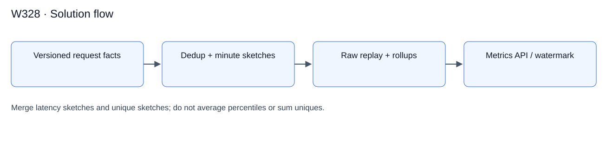

# W328. Design an Analytics Metrics Dashboard for ChatGPT / LLM Service

**Priority group:** Fourth 100 — role-dependent depth

**Category:** SQL, data modeling and pipelines

**Study position:** 328 of 547

[Group list](../FOURTH_100.md) · [All categories](../ALL_CATEGORIES.md) · [Chapter guide](../README.md)

## Question

An LLM-based chat service already exists and emits a record for every request. Design the back-end data pipeline for an analytics dashboard that turns those raw events into queryable metrics.

What to design
1. Ingestion of the event stream.
2. Aggregation of events into metrics (streaming and batch parts).
3. Storage and the serving layer the dashboard queries, including how long each granularity is kept.
4. Computing percentiles and unique counts incrementally and with bounded memory.
5. Correctness: late or missing events, duplicates, and backfilling a missed window.

### Requirements

Inputs: the service emits a stream of per-request events with at least (timestamp, user_id, request_id, latency_ms, tokens_in, tokens_out, status, model_version). Volume is about 1e5 to 1e6 events per second at peak.
Outputs: a dashboard that supports:
DAU / MAU over rolling windows.
p50 / p95 / p99 latency per model, per minute / hour / day.
Token-count totals and per-user rollups for cost and quota.
Error-rate breakdown by status code or error type.
Ad-hoc time ranges (for example the last 24 hours) and history up to the last 90 days.
Out of scope: the LLM service itself and the dashboard's frontend UI.
Follow-ups
Follow-up 1: compute percentiles incrementally.
Follow-up 2: bound storage cost as volume grows.
Follow-up 3: backfill a missed window.
Follow-up 4: migrate to a new model_version while the pipeline is running.

## Worked solution

### Preserve mergeable summaries and an auditable exact-cost path

Accept versioned request-completion facts `(timestamp,user_id,request_id,latency_ms,tokens_in,tokens_out,status,model_version)` plus ingestion time and tenant. If lifecycle updates share a request ID, define one canonical final record or revision; blindly counting start and finish as independent requests doubles volume. Collectors append to a partitioned durable log, retain raw compressed object partitions, then stream validated/deduplicated events into minute aggregates and user token ledgers. Batch jobs reconcile/backfill partitions into the same serving schema.

At the high-end 1M events/s and an assumed 200 bytes/event, raw ingress is 200 MB/s ≈ 17.28 TB/day sustained, 1.56 PB/90 days before compression/replication. Peak is not daily average; size from both. For example, keep raw hot log 24 hours, compressed raw object data 90 days, minute aggregates 7 days, hourly 90 days and daily longer if policy permits. Retain enough minute data or raw-query capability to meet requested arbitrary-range precision; hourly aggregates cannot exactly answer a 12:17-to-13:23 range without finer edge buckets.

For each `(model_version,time_bucket,status)` keep counts, latency DDSketch/t-digest, token sums and user HLL/bitmap sketches. Merge sketches to get p50/p95/p99 over hours/days; averaging minute p99 values is wrong. HLL supports approximate unions over rolling windows, not subtraction of expired users; retain daily/hourly sketches and merge the relevant buckets. Exact DAU or per-user quota requires exact dedup/presence/accounting storage, because approximate distinct counts are not a billing authority. Keep per-user rollups separate from low-cardinality model dashboards to avoid a giant model × status × user cube.

Serve `GET /metrics?from&to&model&granularity` through an OLAP store with bounded query ranges and a result cache keyed by data revision. Return metric definition, approximation/error and watermark. A missed window is replayed from raw input into a new aggregate partition using the same schema/model attribution, validated against counts/checksums, then atomically replaces the old revision. Do not replay additively into live counters. Late events update provisional windows; events beyond retention require explicit correction rather than silent loss.

New model_version values create new dimension rows while old versions remain queryable; schema evolution uses defaults and dual-read/dual-write periods when needed. Monitor missing-event sequence/volume anomalies, duplicate rate, ingest/processing lag, invalid latency/token values and provider billing reconciliation. A dashboard zero is not proof of zero traffic if the pipeline is late. Test out-of-order duplicates, a backfilled window, mixed model versions and sketch merge accuracy against exact small fixtures.

### Follow the diagram

Read left to right: Versioned request facts → Dedup + minute sketches → Raw replay + rollups → Metrics API / watermark. Merge latency sketches and unique sketches; do not average percentiles or sum uniques.

### Further study

- [F067: Build an LLM evaluation harness.](../07_evaluation_and_data.md#f067)
- [F169: Explain backpressure in a multi-stage data pipeline.](../17_distributed_systems_depth.md#f169)
- [F179: Define label windows for click-through-rate analysis.](../18_data_and_sql.md#f179)
