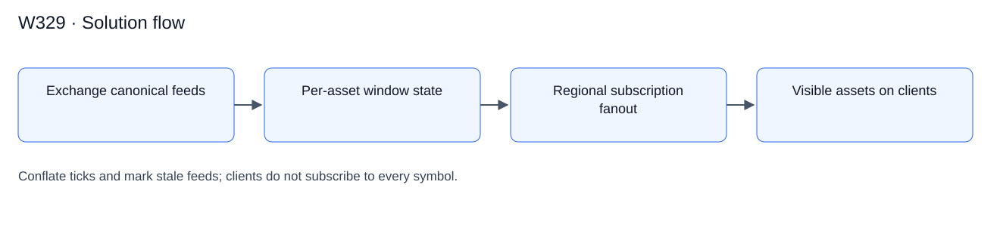

# W329. Design Coinbase Explore Real-Time Price Dashboard

**Priority group:** Fourth 100 — role-dependent depth

**Category:** SQL, data modeling and pipelines

**Study position:** 329 of 547

[Group list](../FOURTH_100.md) · [All categories](../ALL_CATEGORIES.md) · [Chapter guide](../README.md)

## Question

Design the backend for the Coinbase Explore page, which streams real-time prices for hundreds of thousands of crypto assets to every visitor.

Functional goals: (1) Browse/search all assets (~20K visible, up to ~1M upstream symbols). (2) Stream near-real-time price updates to clients. (3) Aggregate stats over fixed windows (1m, 5m, 30m, 1h, 1d). (4) Sort by price change %, market cap, volume. (5) Resilience — keep working if an exchange feed fails; mark data stale. No long-term historical storage.

Performance targets: tick-to-client &lt; 1s p95; snapshot API &lt; 250ms p95; 99.95% availability; eventual consistency (1-2s). Scale: ~1M upstream tickers, ~1M events/s (~120 MB/s ingress), ~2M concurrent clients. Data comes from external exchange feeds. The discussion centers on push vs pull delivery, fan-out to millions of subscribers, cache layering, and graceful degradation.

## Worked solution

### Fan out only subscribed visible assets

Normalize exchange symbol IDs to canonical asset/quote IDs, sequence/timestamps and a versioned source policy. Multiple exchanges' last trades are not interchangeable prices: define a selected source or volume-weighted/consolidated price and reject stale/outlier feeds. The flow is exchange adapters → partitioned tick log/normalizer → per-asset rolling stats → regional latest-state caches → subscription fan-out gateways → clients. REST `GET /assets?sort&cursor` returns a snapshot/sequence; WebSocket subscriptions carry `{asset_ids,last_seq}` and receive conflated latest updates plus sequence gaps/resync instructions.

1M ticks/s×120 bytes≈120 MB/s ingress as given. Two million connected clients cannot each receive all 20K visible assets every second. Assume each watches 20 assets at one update/s and ~80 bytes/update: 40M delivered updates/s≈3.2 GB/s before protocol overhead, plus connection/replication cost. Batch/delta encode and conflate intermediate ticks; browse pages subscribe only visible rows, inactive clients reduce cadence, and shared asset channels reuse fan-out work. The million upstream symbols are catalog/feed scope, not a million subscriptions per visitor.

Keep per-asset ring buckets for at least the largest required window (1 day plus lateness), storing open/high/low/close/volume and source freshness. Percent change needs the boundary reference price, not mean prices. A million symbols×1,440 minute buckets×48 bytes≈69 GB raw, before shorter buckets and replicas. No long-term history means discard after the defined horizon; retain only operational replay buffers needed for recovery. Precompute sorted sets/materialized top lists for change, market cap and volume with stable tie-breaks and snapshot cursors; market cap needs supply/reference data beyond trade ticks.

A subsecond tick-to-client budget might reserve 150 ms ingest/normalize, 200 ms aggregation/pubsub, 200 ms gateway batching and 450 ms network/margin; benchmark p95 end-to-end separately from a <250-ms snapshot API. Partition by asset ID and replicate hot channels across gateway groups; isolate slow consumers with bounded buffers and disconnect/resync rather than retaining infinite tick history. Exchange failure marks source/derived values stale, falls back only under the declared source policy and never rewrites a price timestamp to now. Regional cache/fan-out replicas target the stated 1–2-second eventual consistency; a reconnect starts from a fresh snapshot if replay has expired. Track lag, sequence gaps, outliers, subscription load, fan-out bandwidth and stale-asset coverage.

### Follow the diagram

Read left to right: Exchange canonical feeds → Per-asset window state → Regional subscription fanout → Visible assets on clients. Conflate ticks and mark stale feeds; clients do not subscribe to every symbol.

### Further study

- [F067: Build an LLM evaluation harness.](../07_evaluation_and_data.md#f067)
- [F169: Explain backpressure in a multi-stage data pipeline.](../17_distributed_systems_depth.md#f169)
- [F179: Define label windows for click-through-rate analysis.](../18_data_and_sql.md#f179)
