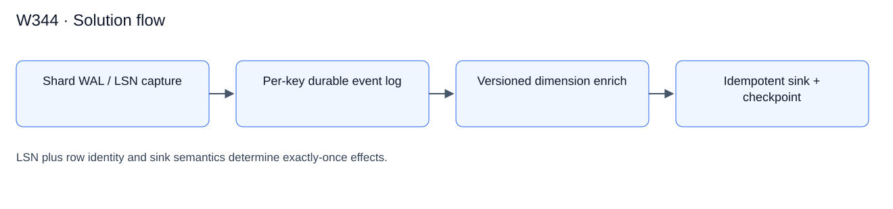

# W344. WAL Log Enrichment CDC Pipeline at 1M writes/sec

**Priority group:** Fourth 100 — role-dependent depth

**Category:** SQL, data modeling and pipelines

**Study position:** 344 of 547

[Group list](../FOURTH_100.md) · [All categories](../ALL_CATEGORIES.md) · [Chapter guide](../README.md)

## Question

Design a Change-Data-Capture (CDC) pipeline that reads Write-Ahead Log (WAL) entries from a sharded source database at 1M writes/sec, enriches them (raw IDs → full records with names/regions via a Redis-fronted lookup), and delivers them to a target database (e.g. ClickHouse) in per-key order with exactly-once semantics.

### Requirements

1. Capture all WAL entries immediately.
2. Enrich: turn an ID-only log row into a full record (e.g. user_id → name + location).
3. Deliver to the target in correct per-key order.
4. Tolerate source schema changes without breaking.
5. Replay: re-read old data to fix errors.

Targets: 1M events/sec, &lt;5s end-to-end latency, per-key ordering, no data loss, 99.99% uptime. Raw event ~1KB, enriched ~2KB → ~1GB/s in, 2GB/s out, ~86TB/day.

Cover checkpointing (LSN), dedup, DLQ, and replay.

## Worked solution

### Exactly-once effects need a sink contract, not only WAL checkpoints

Capture each source shard's ordered WAL with `(source_shard,commit_lsn,transaction_id,row_ordinal,key,schema_version,operation,payload)`. Commit LSN alone is not globally unique and a transaction can contain several rows. Snapshot bootstrap records a consistent per-shard starting LSN; retain WAL until the capture offset is durably replicated, and alert before retention exhaustion. Append to a partitioned durable log keyed by the target entity so its changes remain ordered; maintain source-shard offsets and fence a failed consumer before reassignment.

Enrichment is the hard time question: a current Redis lookup gives today's name/region during replay, not necessarily the value at the original event. Choose event-time enrichment using versioned dimension changes/temporal state, or explicitly label “latest at processing time” and retain the enriched result for reproducibility. Cache by `(dimension_id,version)`, batch misses, and fail/retry with bounded queues rather than emit a silently partial record. A dimension update and fact arriving out of order requires a watermark/version wait or later correction.

At 1M/s ×1KB, input is roughly1 GB/s≈86.4 TB/day; enriched2KB means2 GB/s≈172.8 TB/day before replication, so the prompt's86TB/day describes raw volume only. With 256 partitions, mean load is3,906 events/s/partition before skew/headroom. A Redis GET per event at that rate is a major dependency, so batch/collocate dimension state and cache by version. Target <5s might budget .5s capture, .5s transport,1s enrichment,1s sink batch and2s margin, verified under failures and compaction, not assumed from averages.

The sink must atomically associate consumed offsets/dedup IDs with applied changes, or use deterministic `(entity,source_version)` idempotent upserts and a verified latest-version query. A ClickHouse-style replacing table may retain duplicate physical rows until merge; downstream queries must select the highest version/dedup semantics explicitly, and limited insert-dedup windows are not an infinite exactly-once guarantee. Checkpoint only after durable sink success; unknown acknowledgment retries the same IDs, never fresh IDs. Per-key sequence/version guards prevent old replay overwriting new data.

Schema registry compatibility handles additive changes with defaults; incompatible renames/type changes need explicit adapters and versioned backfills. A DLQ preserves raw event, schema, error and sequence position. Skipping a bad event can break per-key order, so block/quarantine that key or emit an ordered error placeholder under policy while unrelated keys continue. Replay writes a new sink generation with original IDs/enrichment versions, validates counts/checksums and atomically switches readers; it must not append a second unversioned copy into live totals. Observe per-shard LSN lag, gaps, enrichment misses, sink latency, DLQ age and reconciliation deltas.

### Follow the diagram

Read left to right: Shard WAL / LSN capture → Per-key durable event log → Versioned dimension enrich → Idempotent sink + checkpoint. LSN plus row identity and sink semantics determine exactly-once effects.

### Further study

- [F086: Design a feature platform with online/offline consistency.](../09_ml_system_design.md#f086)
- [F177: Design an ETL job that can safely rerun.](../18_data_and_sql.md#f177)
- [F179: Define label windows for click-through-rate analysis.](../18_data_and_sql.md#f179)
