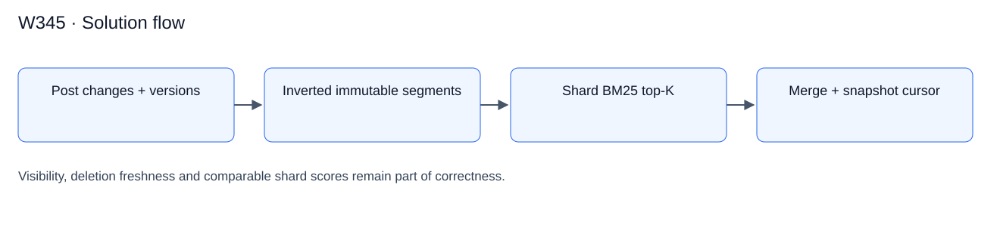

# W345. Design a Post Search Engine (Mini Elasticsearch)

**Priority group:** Fourth 100 — role-dependent depth

**Category:** Search and retrieval systems

**Study position:** 345 of 547

[Group list](../FOURTH_100.md) · [All categories](../ALL_CATEGORIES.md) · [Chapter guide](../README.md)

## Question

Design a post search engine: given query terms, return relevance-ranked top-K matching posts — essentially 'build a mini Elasticsearch.'

Cover the inverted index, ranking, sharding strategy, real-time ingestion, and caching. Scale ~10B posts indexed, ~10K QPS peak, &lt;200 ms p95. Be ready for 'how do you rank?' and 'how fresh is fresh?'

## Worked solution

### Inverted postings with bounded top-K search

Define `Post(id,author,visibility,version,text,created_at)` and an index schema with normalized term dictionary, postings `(term -> sorted docIDs,term_frequency,positions)` plus document length/stored metadata. Ingestion is durable post-change log → tokenize/language normalization → per-shard in-memory segment → immutable compressed segments → atomic reader refresh, with versioned tombstones for edits/deletes. State a freshness target, for example p95 under five seconds; durable ingestion does not mean an unrefreshed segment is searchable.

`GET /search?q&k&cursor` parses supported AND/OR/phrase syntax and filters, fans to document-ID shards, retrieves local top candidates and merges global top-K. BM25 is a concrete baseline: sum IDF-weighted term frequency with saturation/length normalization; choose k1/b on relevance labels, optionally add an explicit bounded recency boost. Phrase queries use positions. Maintain global or consistently approximated term statistics so shard scores are comparable. WAND/block-max upper bounds skip postings blocks that cannot beat the current heap; frequent terms remain the expensive case. Apply visibility/ACL before return and recheck deletes/permissions if cached candidates are used.

At 10B posts and an assumed100 distinct indexed terms/post, there are1T postings. At6 compressed bytes/posting, raw postings are6 TB before positions/dictionary/stored text; 500-byte average text adds5 TB. With2× index overhead and2 replicas, plan tens of TB and, for example, hundreds of document shards sized from measured segment memory/query rates rather than one huge machine. At10K QPS, naive fan-out to500 shards is5M shard queries/s, so use search routing/time tiers where semantics permit and benchmark all-shard popular queries. Do not claim latency solely from storage arithmetic.

A <200-ms p95 budget might give20ms gateway/cache,120ms shard work,20ms merge and40ms margin. Cache normalized query+filters+index generation, including visibility scope; invalidate by generation/tombstone policy. A failed shard produces an explicitly partial result or fails the query, never a complete-looking ranking. Replicas serve during rebuild, backfills build a new generation, and snapshot/search-after cursors stabilize pagination across refresh. Evaluate NDCG/recall, freshness, deletion lag, hot-term p99 and shard-skew under real queries.

### Follow the diagram

Read left to right: Post changes + versions → Inverted immutable segments → Shard BM25 top-K → Merge + snapshot cursor. Visibility, deletion freshness and comparable shard scores remain part of correctness.

### Further study

- [F073: When should you combine lexical retrieval, embeddings and reranking?](../08_rag_and_agents.md#f073)
- [F147: Build bag-of-words similarity search from scratch.](../15_clustering_and_retrieval_depth.md#f147)
- [F150: Choose between exact and approximate nearest-neighbor search.](../15_clustering_and_retrieval_depth.md#f150)
