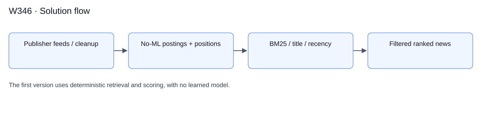

# W346. Design Apple News Search (No ML, V1)

**Priority group:** Fourth 100 — role-dependent depth

**Category:** Search and retrieval systems

**Study position:** 346 of 547

[Group list](../FOURTH_100.md) · [All categories](../ALL_CATEGORIES.md) · [Chapter guide](../README.md)

## Question

Design the first version of search for Apple News (no ML). A user types a free-form query (e.g. "tesla earnings", "wildfires california") and expects back a ranked list of news articles drawn from tens of thousands of publishers.

## Worked solution

### A useful first search version requires no ML

Scope to keyword/phrase queries over authorized published articles, with language, date and publisher filters. Use publisher feeds/crawlers → canonical URL/content dedup → safe HTML/text extraction → language-specific tokenization → versioned inverted index. Store `Article(id,publisher,canonical_url,title,body,language,published_at,updated_at,rights,version)` and postings with title/body term frequencies and positions. Tens of thousands of publishers means inconsistent formats, duplicate syndication and corrections, not automatically billions of requests.

`GET /search?q&from&language&publisher&cursor` parses tokens/quoted phrases, searches document shards and merges top results. Rank with BM25 plus explicit title-field weight and bounded publication recency boost; these are deterministic formulas, not learned models. A simple rule such as exact-title/phrase bonus can improve news intent, but do not let freshness make irrelevant new articles outrank all relevant older ones. Normalize case/Unicode and stem only where appropriate; entity names like Tesla and multilingual tokenization need careful analysis. No embeddings, LLM query rewriting or neural ranker belongs in this no-ML V1.

Assume100M retained articles,50 indexed terms/article and8 compressed bytes/posting: about40 GB postings before positions/stored text, plausibly hundreds of GB total with replicas. Choose, for example,16 primary shards only after benchmarking query/ingest rates. A hypothetical200-ms p95 budget includes gateway, shard search, merge and network, and a few-second refresh target is an explicit product choice. Small catalogs may need far fewer shards.

Use immutable segments/readers, event versions and deletion/rights tombstones. Cache public query results by normalized query/filter/index generation; invalidate corrections and revoked publisher content quickly. Search-after cursors reference a point-in-time index or openly accept result drift. On publisher outage retain existing articles with timestamps; on shard outage return partial status or error. Evaluate hand-labeled query relevance, phrase correctness, duplicate suppression, time-to-searchable and tail latency. Start with this transparent baseline before adding personalization/ML, which is outside the requested version.

### Follow the diagram

Read left to right: Publisher feeds / cleanup → No-ML postings + positions → BM25 / title / recency → Filtered ranked news. The first version uses deterministic retrieval and scoring, with no learned model.

### Further study

- [F147: Build bag-of-words similarity search from scratch.](../15_clustering_and_retrieval_depth.md#f147)
- [F073: When should you combine lexical retrieval, embeddings and reranking?](../08_rag_and_agents.md#f073)
