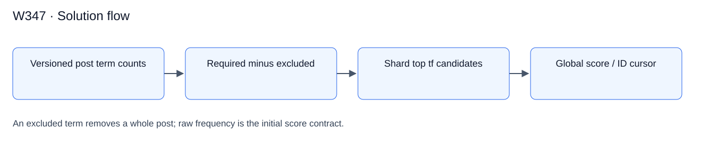

# W347. Design Post Search with Keyword Exclusion and Frequency Ranking

**Priority group:** Fourth 100 — role-dependent depth

**Category:** Search and retrieval systems

**Study position:** 347 of 547

[Group list](../FOURTH_100.md) · [All categories](../ALL_CATEGORIES.md) · [Chapter guide](../README.md)

<span class="practice-page"></span>

## Question

A social network wants a search box for posts: type a word and see the posts that use it, with the posts that use it most often at the top, and optionally leave out every post that mentions a second word. Design the service behind that box so that it answers in a fraction of a second over billions of posts and shows new posts within seconds.

What to deliver
Query input: one required term, optional excluded terms, a page size and a cursor.
Query output: a page of post identifiers with their scores, and a cursor for the next page.
Design:
1. The data structures and the storage layout.
2. The indexing pipeline from post creation to searchability.
3. The query path, including how the work is split across machines.
4. Capacity estimates for index size, shard count and machines.
5. Failure behaviour and how you would evolve the ranking.

### Requirements

1. Search: given a keyword, return the posts that contain it. Results arrive within a few hundred milliseconds at the 95th percentile.
2. Exclusion: a query can combine terms, for example posts that contain apple but do not contain banana.
3. Ranking: order the returned posts by the number of times the keyword appears in each post, most frequent first. Pagination is required.
4. Freshness: a new or edited post becomes searchable within a few seconds; a deleted post disappears quickly.

### Examples

The query apple returns the posts that contain apple. A post that uses apple three times is listed above a post that uses it once.
The query apple with banana excluded returns only the posts that contain apple and never mention banana, in the same order.
Constraints (assumed for this exercise)

```text
2 billion posts in total, about 500 bytes of text each.
20 million new posts per day.
```

An average of 20,000 queries per second.
Follow-up 1: find the posts that contain a keyword quickly

How do you decide which posts contain a keyword without reading every post?

Follow-up 2: exclude a keyword

How do you implement the exclusion of a keyword, and what does it cost when one term is far more common than the other?

Follow-up 3: rank by keyword frequency

How do you rank by keyword frequency, and what are the weaknesses of ranking by raw frequency?

## Worked solution

### Store term frequency and exclusions in the postings index

`Search(required_term,excluded_terms,page_size,cursor)` tokenizes all terms under one versioned analyzer; output is ordered `(post_id,score)` plus next cursor, where score is exactly the required term's raw occurrence count. Fix ties by post_id ascending. Index `(term -> docID,tf)` in compressed document-ID order for membership/difference, with block-max tf or frequency-ordered auxiliary lists for top scoring. Maintain post version, visibility and deletion tombstones. An excluded term removes the entire post even if it appears once.

Query flow is gateway → parse/auth/cache → document shards → required postings minus union(excluded postings) → local top-K heap → coordinator merge → stable page. Intersect/difference sorted lists or use bitmaps. If the required term is rare and excluded term common, iterate required candidates and test excluded membership/gallop rather than scan the entire common list. If both are common, block/bitmap operations help, but worst-case work remains large. Top-K tf upper bounds skip blocks that cannot win; fetching only K candidates before exclusion is unsafe because all K might be filtered.

For pagination use a point-in-time index generation and `search_after=(-tf,post_id)` with query/filter hash; carry per-shard continuation/state as needed. Deep pages still cost work; cap cursor lifetime and page size. A live index without snapshot can duplicate/skip results after edits change tf. The stored posting contains frequencies, so ranking does not reread all post text. `apple` three times beats once; the three-time post is completely excluded if it contains banana.

**Capacity assumptions.** 2B×500-byte text≈1 TB raw. At50 distinct terms/post and6 compressed bytes/posting,100B postings≈600 GB before dictionary/skip structures; a2× working overhead and2 replicas puts postings around2.4 TB, plus text/metadata. With64 primary shards, raw postings average9.4 GB/shard; choose machines from measured memory/IO and provision2 replicas on separate hosts. 20K QPS all-shard fan-out is1.28M shard requests/s, so benchmark hot terms, cache frequent public queries and partition/routing only when it preserves required coverage. 20M new posts/day≈231/s average, with peak/edit/delete multipliers; batching and near-real-time segment refresh can meet a few-second visibility target.

A post-change log drives idempotent versioned segment updates; old edits cannot resurrect deleted posts. Replicas continue serving during rebuild. Failed shards return partial status or fail, and visibility/deletion checks remain authoritative. Raw tf rewards long posts, repetition and spam; a future BM25/length-normalized or learned ranker needs a new score/cursor version and relevance evaluation, but must not silently replace the requested initial frequency ranking.

### Follow the diagram



Read left to right: Versioned post term counts → Required minus excluded → Shard top tf candidates → Global score / ID cursor. An excluded term removes a whole post; raw frequency is the initial score contract.

### Further study

- [F073: When should you combine lexical retrieval, embeddings and reranking?](../08_rag_and_agents.md#f073)
- [F147: Build bag-of-words similarity search from scratch.](../15_clustering_and_retrieval_depth.md#f147)
- [F150: Choose between exact and approximate nearest-neighbor search.](../15_clustering_and_retrieval_depth.md#f150)
