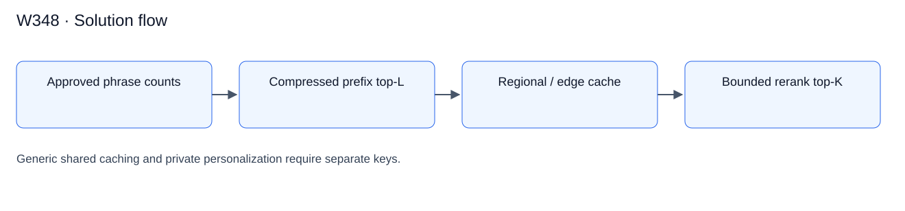

# W348. Design Search Autocomplete / Typeahead

**Priority group:** Fourth 100 — role-dependent depth

**Category:** Search and retrieval systems

**Study position:** 348 of 547

[Group list](../FOURTH_100.md) · [All categories](../ALL_CATEGORIES.md) · [Chapter guide](../README.md)

## Question

Design a low-latency prefix-search service that powers a search bar's typeahead suggestions.

Functional

Given a user-typed prefix, return the top K most relevant suggestions in &lt; 100 ms.
Suggestions ranked by frequency / recency / personalization.
Index updates on a moderate cadence (minutes to hours).

Non-functional

Read-heavy (every keystroke is a query): 10K–100K QPS at the edge.
p95–p99 latency &lt; 100 ms.
Same-day suggestion freshness is fine; trending topics may need faster updates.

Cover index choice, ranking signals, sharding, the update path, and edge caching.

## Worked solution

### Precompute a small candidate list for each prefix

`GET /suggest?prefix&k&locale` validates length, Unicode-normalizes under a language-specific rule and returns suggestion ID/text/score/index_version. Build a compressed trie/radix tree or weighted finite-state transducer over approved phrases. Store top-L candidates at popular prefix nodes; query traverses O(prefix length) then returns/reranks a bounded list rather than enumerating an entire subtree. A sorted phrase array with prefix-range binary search is a simpler baseline but needs an efficient range top-K structure for common prefixes.

Aggregate phrase frequency/recency from deduplicated eligible search events, remove sensitive/offensive/private terms, apply minimum support, then build immutable index generations every hour. A small streaming trending overlay can update within minutes; merge/dedup its candidates with the stable index using comparable scores. Frequency×decay is a transparent baseline. Personalization reranks a cached generic L using authorized recent history/locale; keep generic public cache separate from user-specific responses and provide a nonpersonalized fallback.

Assume100M phrases averaging20 bytes: raw strings alone2 GB; node objects and top-L lists can multiply this manyfold, so measure compressed representation instead of storing Python dictionaries per character. At100K QPS, most traffic is short prefixes: replicate hot prefix partitions at the edge and shard long tails by prefix ranges/hash with a routing directory. A naive first-character split creates skew. Client debouncing/cancellation reduces obsolete keystroke requests, and response sequence IDs prevent old replies overwriting newer input.

A100-ms tail budget might allocate20ms client/edge,10ms cache,20ms index/rerank and50ms network/margin; multi-region local reads avoid a primary-region RTT on every keypress. The control plane publishes checksummed index generations atomically; replicas retain the prior generation on failed downloads. Explain freshness as minutes/hours with a watermark, not instant global write visibility. Track prefix coverage, selected-suggestion rate, harmful/private leakage, index lag and p99 for hot/empty prefixes. Cache keys include locale,policy,index_version and K; private histories are never shared across users.

### Follow the diagram

Read left to right: Approved phrase counts → Compressed prefix top-L → Regional / edge cache → Bounded rerank top-K. Generic shared caching and private personalization require separate keys.

### Further study

- [F073: When should you combine lexical retrieval, embeddings and reranking?](../08_rag_and_agents.md#f073)
- [F147: Build bag-of-words similarity search from scratch.](../15_clustering_and_retrieval_depth.md#f147)
- [F150: Choose between exact and approximate nearest-neighbor search.](../15_clustering_and_retrieval_depth.md#f150)
