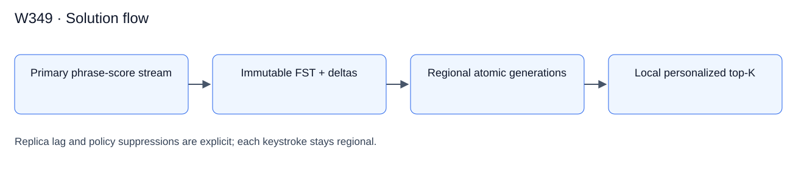

# W349. Type-Ahead / Autocomplete Suggestions

**Priority group:** Fourth 100 — role-dependent depth

**Category:** Search and retrieval systems

**Study position:** 349 of 547

[Group list](../FOURTH_100.md) · [All categories](../ALL_CATEGORIES.md) · [Chapter guide](../README.md)

## Question

Design a type-ahead service that returns the top-K most relevant completions for a query prefix in &lt; 100 ms.

Functional: rank completions by a learned score (frequency-weighted at the simplest level); updates from a phrase-and-frequency stream propagate within minutes; personalization on user features (recently searched, role, region) when available.

Non-functional: P99 &lt; 100 ms end-to-end; hundreds of millions of phrases; multi-region read replicas with writes from a single primary region.

Follow-ups: personalization, multi-region freshness, tail-latency budget.

## Worked solution

### Single-writer index generations with local regional reads

Use `Phrase(id,text,locale,policy_state)` and versioned score events `(phrase_id,frequency_delta,event_id,event_time)`. A primary-region pipeline deduplicates updates, computes recency/frequency or a learned ranking score, and publishes immutable compressed trie/FST generations with top-L candidate IDs per prefix. For hundreds of millions of phrases, build partitioned compressed indexes, not one mutable per-character object graph replicated by ad hoc writes. A minutes-fresh delta overlay covers changes between full compactions.

Regional replicas download/checksum new generation manifests and atomically switch readers; lag/watermark is visible and the old version remains a rollback. Single primary writes simplify ordering but a disconnected region serves stale approved suggestions under a declared TTL, then degrades if policy freshness is unsafe. Urgent suppression/deletion uses a fast deny overlay rather than waiting hours for a rebuild. A failover primary needs an epoch/lease fence to prevent split-brain score updates.

`Suggest(prefix,k,user_context)` traverses local prefix index, retrieves generic top-L plus recent/trending candidates, then runs a bounded personalization reranker using permitted recent searches, role and region. The learned model is optional but its features must be available within budget; do not call a remote feature store hundreds of times per keystroke. Training labels from accepted suggestions have position bias, so use randomized/exposure-aware evaluation and include safety/coverage constraints. Generic candidates cache by prefix, locale, index version; personalized responses key by user/session or remain uncached.

Assume 300M phrases×24 bytes ≈ 7.2 GB raw text; weighted arcs, IDs, top-L and scores can bring compressed serving state into tens of GB before replicas. Partition by balanced prefix ranges and replicate hot short prefixes. A p99<100-ms budget might reserve 40 ms network, 10 ms edge/cache, 15 ms local index, 10 ms bounded rerank and 25 ms margin. Measure the full tail, including region failover and cold cache, rather than adding only average component times. Clients debounce and discard stale sequence responses. Evaluate suggestion relevance, acceptance, long-tail/language coverage, privacy/policy blocks and cross-region freshness; a fast stale offensive suggestion is not success.

### Follow the diagram

Read left to right: Primary phrase-score stream → Immutable FST + deltas → Regional atomic generations → Local personalized top-K. Replica lag and policy suppressions are explicit; each keystroke stays regional.

### Further study

- [F073: When should you combine lexical retrieval, embeddings and reranking?](../08_rag_and_agents.md#f073)
- [F147: Build bag-of-words similarity search from scratch.](../15_clustering_and_retrieval_depth.md#f147)
- [F150: Choose between exact and approximate nearest-neighbor search.](../15_clustering_and_retrieval_depth.md#f150)
