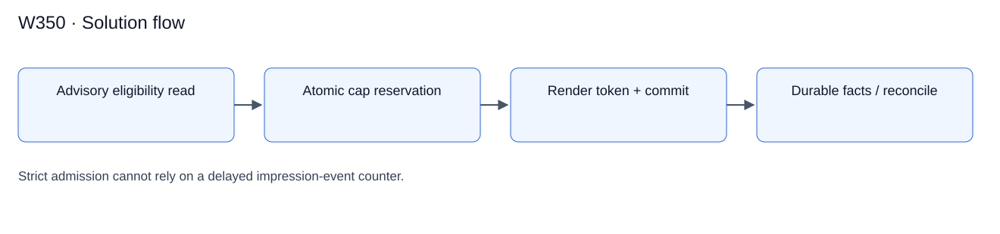

# W350. Ads Frequency Cap and Limiter System

**Priority group:** Fourth 100 — role-dependent depth

**Category:** Streaming counters and top-K

**Study position:** 350 of 547

[Group list](../FOURTH_100.md) · [All categories](../ALL_CATEGORIES.md) · [Chapter guide](../README.md)

## Question

Design a system that enforces per-user / per-campaign ad frequency caps, with special handling for strict caps and budget smoothing. Expect a deep dive into Redis atomicity, queue keying, read/write path separation, and offline aggregation.

### Requirements

Support caps like 'no more than N impressions per user per campaign per window.'
Read path answers ad-serving eligibility with low latency.
Write path records impressions/clicks and updates counters reliably.
Handle a strict cap variant (user must see at most one ad).
Support offline reconciliation for delayed events and counter correction.
Discuss budget pacing / smooth delivery.

## Worked solution

### Eligibility reads are advisory until an atomic reservation

Define the window first: choose exact trailing24h N impressions per `(user,campaign)` for illustration, with a separate lifetime-once variant. Store event IDs and accepted/reserved impression timestamps under that key. `CheckEligibility` can read a cache for candidate pruning, but `ReserveImpression(user,campaign,request_key)` atomically expires old entries, counts committed+active reservations, conditionally adds one and returns a short-lived token. `CommitImpression(token,event_id)` records exposure idempotently; cancellation/expiry releases only an uncommitted reservation. All serving regions for the same key route to an owner/shared atomic store.

A Redis sorted-set Lua script can prune/count/reserve under one lock; use unique reservation/event IDs for equal timestamps, server time and a durable/replicated recovery policy. Bare GET then INCR races. A strict “at most once ever” cap needs durable SETNX/unique `(user,campaign)` reservation, not an expiring daily counter. Reserve before display; if the client times out after display but before commit, retaining an uncertain reservation is conservative. Expiring it blindly may show a second ad. Exactly knowing whether a disconnected client displayed pixels is impossible without a chosen acknowledgment/attribution policy, so define whether strictness limits authorized displays or confirmed impressions.

The flow is candidate read filter → atomic admission reservation → render token → durable impression event → commit and aggregate. Queue events by `(user,campaign)` when ordering affects that cap, not only campaign; salting hot campaign aggregate keys is fine only for derived totals. Split read caches from authoritative writes, but never let a delayed write permit two concurrent final admissions. Async reconciliation handles late/retried events with event-ID dedup and replays counter state; it cannot undo an already shown excess impression.

Assume100K impression admissions/s and10M active user/campaign keys, each with at most5 recent timestamps: 50M timestamps at16 packed bytes≈800 MB before Redis keys/sets/replicas, so measure overhead and TTL/eviction carefully. Losing authoritative keys during failover can violate strict caps; use stronger durability or fail closed/bounded conservative fallback. Noncritical frequency caps may accept an explicit small error budget instead.

Budget pacing is separate: campaign target spend/impressions over time controls participation/token refill, while the user cap remains a hard boundary. Offline aggregates compare durable exposure facts with reservations, correct provisional counts, detect missing acknowledgments and audit policy versions. Monitor reservation leak/expiry, duplicate event rates, admission latency, cap violations, hot keys and regional divergence. Clicks feed engagement/billing but do not themselves increment an impression cap unless the product explicitly defines that alternative.

### Follow the diagram

Read left to right: Advisory eligibility read → Atomic cap reservation → Render token + commit → Durable facts / reconcile. Strict admission cannot rely on a delayed impression-event counter.

### Further study

- [F166: Design a token-bucket rate limiter.](../17_distributed_systems_depth.md#f166)
- [F168: Design a state-wide temperature ingestion and query system.](../17_distributed_systems_depth.md#f168)
