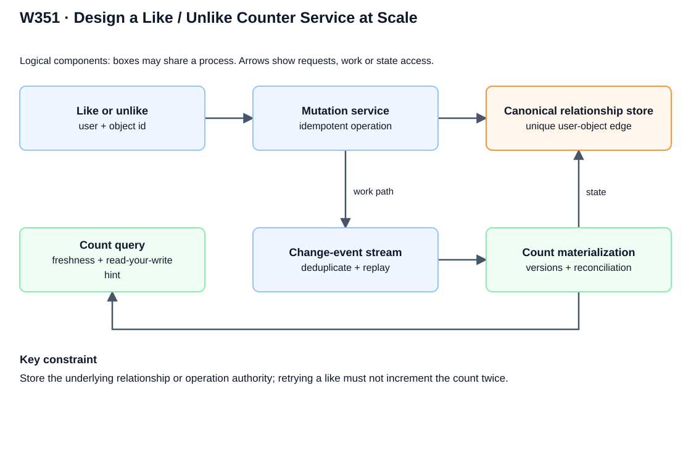

# W351. Design a Like / Unlike Counter Service at Scale

**Priority group:** Fourth 100 — role-dependent depth

**Category:** Streaming counters and top-K

**Study position:** 351 of 547

[Group list](../FOURTH_100.md) · [All categories](../ALL_CATEGORIES.md) · [Chapter guide](../README.md)

## Question

Design a like / unlike service that supports:
1. Per-user, per-item like state (has user X liked item Y?).
2. The list of items a user has liked.
3. An approximate or exact total like count per item.

Scale: hundreds of millions of users, hot creator experiences pushing billions of likes/day. Focus on schema design, idempotency under retry, hot-shard handling, and the read-vs-write trade-off on the counter path.

## Worked solution

<!-- architecture:W351:start -->
### Architecture and request flow

[Open the diagram at full size](../diagrams/W351_architecture.svg). This is a baseline component diagram for this question. The boxes describe responsibilities; they do not require a separate microservice for every box.

- **Request and state:** Like or unlike — user + object id → Mutation service — idempotent operation. That component consults or updates **Canonical relationship store — unique user-object edge** under the required access and consistency rules.
- **Work and result:** the work path passes through **Change-event stream — deduplicate + replay** and **Count materialization — versions + reconciliation**, producing **Count query — freshness + read-your-write hint**. Bound waiting and retries where a slow dependency can stall this path.
- **Correctness point:** Store the underlying relationship or operation authority; retrying a like must not increment the count twice.

When explaining the drawing, trace one normal request first, then a duplicate request, an unavailable dependency and recovery from saved state. If the question requires stricter guarantees or a different scope, state the change explicitly rather than treating this baseline as the only possible design.
<!-- architecture:W351:end -->

### The edge is authoritative; the total is a projection

Expose `PUT /items/{id}/like` with desired `{liked:true|false,operation_id,expected_version?}`, `GET /items/{id}/like-state`, `GET /users/me/likes?cursor`, and `GET /items/{id}/count`. Authenticate the acting user; do not accept an arbitrary user id as authorization. Desired-state PUT makes repeated likes naturally idempotent. Store `LikeEdge(user_id,item_id,liked,version,updated_at)` with unique(user, item), plus a user/time or user/item listing index, operation-result dedup records and transactional outbox. Partition edges by user hash to serve personal state/list reads; an item-centric secondary projection supports counting without a single celebrity write partition.

Within one edge transaction, lock/CAS the row: false → true emits +1, true → false emits-1, same-state emits0. Increment edge version and commit event `(user,item,version,old_state,new_state)` with the edge. Two concurrent likes cannot both emit+1. A stale unlike arriving after a newer like needs expected-version/client-sequence semantics; an idempotency key alone deduplicates retries but does not define user-intended operation order. Retry the same operation id returns its prior result; conflicting payload reuse is 409.

### Hot counters, reads and reconciliation

Consume accepted transitions into `(item,counter_shard)` partial counts, choosing shard by hash(user) or transition identity. Dedup by edge/version or process offsets/state atomically; maintain tombstoned edge versions so old events cannot resurrect state after unlike. A viral item with 1M transitions/s can use1,000 shards at roughly 1,000/s each, a chosen sizing example requiring benchmarks. Microbatch updates and periodic aggregation prevent one item key from receiving every raw event. Summing shards costs read fanout; materialized cached totals make display reads cheap at a stated lag.

Return `{count,mode,as_of,projection_version}`. For display, choose near-real-time eventual counts and merge a caller's pending edge transition as a scoped read-your-write hint, never blindly add it to a snapshot that already contains it. An exactly current total linearized with all edge mutations requires a transactional/coordinated count path or snapshot barrier across edge/counter partitions; a cached sharded sum cannot promise that for free. Exact-at-watermark is easier: publish sums from a consistent committed stream boundary. Offer the intended mode explicitly.

Assume 5B likes/unlikes/day=57.9k/s average and 10× peak ≈ 579k/s, with hot items above average. At 100 bytes/transition, log input ≈ 500 GB/day before replicas/indexes. 100M users averaging 200 active likes yields 20B edges; at 32 bytes logical edge payload ≈ 640 GB before storage overhead. Use pagination, count replicas/cache and tenant/rate-abuse controls; do not replicate every user's full list into every item record.

If DB succeeds but response is lost, retry returns one edge version. If consumer fails after applying a delta, state+offset/dedup prevents replay doubling. If projection is lost, replay its durable checkpoint/log or recount authoritative active edges, then swap a versioned snapshot. Monitor edge/count divergence, consumer lag, duplicate/stale transitions, hot-shard load and count freshness. Reconciliation fixes drift; negative-count clamping alone hides errors. The diagram's relationship store → transition log → counter materialization is the exact authority/read trade-off above.

### Further study

- [F166: Design a token-bucket rate limiter.](../17_distributed_systems_depth.md#f166)
- [F168: Design a state-wide temperature ingestion and query system.](../17_distributed_systems_depth.md#f168)
