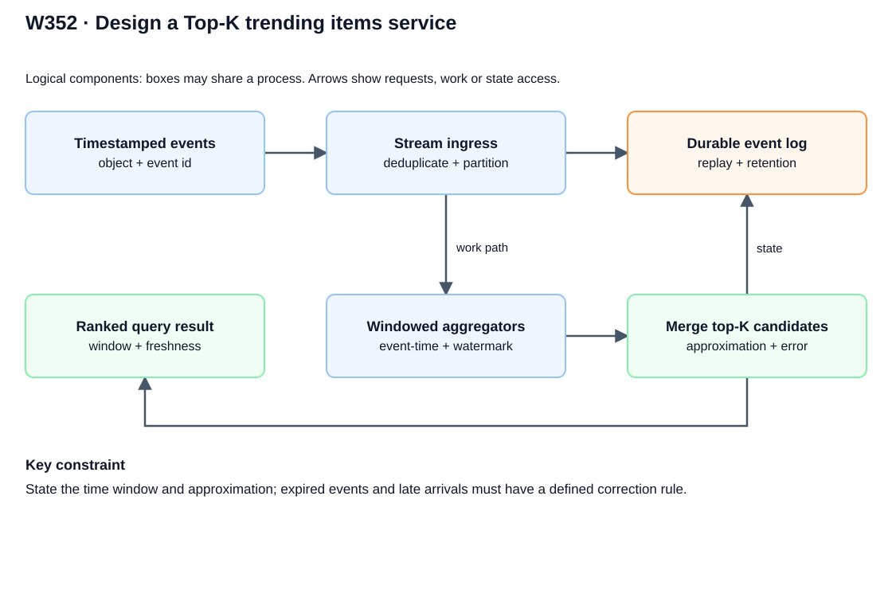

# W352. Design a Top-K trending items service

**Priority group:** Fourth 100 — role-dependent depth

**Category:** Streaming counters and top-K

**Study position:** 352 of 547

[Group list](../FOURTH_100.md) · [All categories](../ALL_CATEGORIES.md) · [Chapter guide](../README.md)

## Question

A social platform needs continuously refreshed lists of the items receiving the most engagement in recent time windows. Design the streaming and serving system for hashtags, videos, or posts while keeping the result fresh under bursty global traffic.

### Requirements

Ingest 10 billion interaction events per day, with peaks of 2 million events per second. Each event contains event_id, item_id, event_type, event_time, and region.
Return the top K items globally and per region for K from 1 through 100 over 10-minute, 1-hour, and 24-hour sliding windows.
Define an item's score as the sum of event weights inside the selected window: view = 1, like = 3, comment = 4, and share = 5. Duplicate event_id values count once, and events arriving up to five minutes late (event_time at most five minutes behind the watermark) must be incorporated. Events later than that are dropped from every window and counted in a late_dropped metric.
Publish refreshed results within 10 seconds of accepted events. The read API must sustain 1 million requests per second globally with p99 latency below 100 ms.
Retain enough durable data to recover window state after a processor failure without double counting.
Design tasks
1. Specify the ingestion API or event contract, partitioning strategy, stream-processing stages, state stores, and read API.
2. Explain an exact sliding-window implementation and how expired buckets, late events, duplicates, and hot items are handled.
3. Compare exact aggregation with an approximate heavy-hitter design. State the approximation's memory/error guarantees and how candidates become a final top-K list.
4. Show when merging shard-local top-K lists is exact and when it can miss a globally popular item.
5. Estimate capacity (log bandwidth, raw storage, window state, deduplication state, snapshot and read bandwidth), describe multi-region serving, and cover checkpointing, replay, backpressure, resharding, and degraded operation.
Example scenarios
For K = 2 in a 10-minute window, scores {a: 30, b: 17, c: 22} produce [a, c]. The ordering follows score, with item_id ascending as the deterministic tie-breaker.
An event whose event_time is seven minutes behind the watermark is not applied; it only increments late_dropped.
If a share for item c arrives two minutes late but is still within the window and lateness allowance, its weight is added and the next published snapshot reflects the new ranking.

### Constraints

Event IDs are globally unique strings; item and region IDs are opaque strings.
Window boundaries are exact to the bucket: 10 seconds for the 10-minute window, 1 minute for the 1-hour and 24-hour windows.
Event time, rather than processing time, determines window membership.
A design may be exact, approximate, or hybrid, but the API must disclose which mode produced a response and the snapshot timestamp.

## Worked solution

<!-- architecture:W352:start -->
### Architecture and request flow

[Open the diagram at full size](../diagrams/W352_architecture.svg). This is a baseline component diagram for this question. The boxes describe responsibilities; they do not require a separate microservice for every box.

- **Request and state:** Timestamped events — object + event id → Stream ingress — deduplicate + partition. That component consults or updates **Durable event log — replay + retention** under the required access and consistency rules.
- **Work and result:** the work path passes through **Windowed aggregators — event-time + watermark** and **Merge top-K candidates — approximation + error**, producing **Ranked query result — window + freshness**. Bound waiting and retries where a slow dependency can stall this path.
- **Correctness point:** State the time window and approximation; expired events and late arrivals must have a defined correction rule.

When explaining the drawing, trace one normal request first, then a duplicate request, an unavailable dependency and recovery from saved state. If the question requires stricter guarantees or a different scope, state the change explicitly rather than treating this baseline as the only possible design.
<!-- architecture:W352:end -->

### Event and API contract

Accept batches of `{event_id,item_id,event_type,event_time,region}` into a replicated durable log only after validation; weights are view1, like3, comment4, share5. Reject unknown types/invalid future timestamps under a declared clock-skew policy. `GET /trending?scope=global|region&region=&window=10m|1h|24h&k=1..100` returns ordered `(item_id,score)` plus mode, snapshot timestamp, watermark, window bounds and staleness. Ties use item_id ascending. Serve immutable top100 snapshots from regional caches/edge caches; a request for smaller K slices the same version.

Use event-id partitioning first for authoritative dedup, then repartition accepted weighted events by item for full global totals and by `(region,item)` for regional totals. A duplicate id with conflicting payload is quarantined, not counted as a new event. Dedup persistence must cover replay/retry horizon; a short cache alone is not exact. Each processor atomically commits dedup/window state with input offsets or an equivalent idempotent transaction.

### Exact bucketed sliding windows and lateness

Define snapshot time T on its required bucket boundary and membership `[T-W,T)`. Maintain10-second buckets for 10m (60 active buckets) and 1-minute buckets for 1 h/24 h (60/1440). “Exact” means exact to these bucket boundaries, as permitted. Add accepted arrivals to their event-time bucket and corresponding rolling totals, expire whole old buckets by subtracting their stored per-item contributions, and update an ordered score index `(negative_score,item_id)` for each scope/window. Keep buckets through needed lateness/recovery horizon; do not expire history merely because processing wall time advanced.

Define a coordinated monotone watermark M from healthy source-partition progress with explicit idle-source handling. The question's lateness rule is **event_time<M-5min → drop from every window and increment late_dropped**, even if that event would fit 24 h. At exactly M-5min accept under this chosen inclusive allowance. Otherwise apply it only to windows containing event_time; old accepted events outside10m need not alter10m. An event7 minutes behind M is dropped; a share for c2 minutes late adds 5 and is reflected in the next≤10 s publish. Do not first apply24 h then discover it was too late. Revisions to already published snapshots carry a new version/as_of.

Key-owned items let each shard maintain its complete score; hot items can be salted into subshards with mini-batch `(item,bucket,region)` deltas, then a second keyed reducer reconstructs the **full item total before ranking**. Dedup remains global by event id. Partition timers expire buckets even during no new events, so quiet items leave rankings on time. For a 30, b17, c22 snapshot, K2 is[a, c]. Delete zero scores and never serve an expired heap entry as current.

### When local top-K merging is exact

If each item belongs wholly to exactly one ranking shard, any global topK item must be in that shard's topK under the same total order; otherwise K items on that shard already outrank it globally. Thus union/sort local top100 is exact for K≤100. If an item is split across shards, local topK can miss it: shard1 has a 60, x61, shard2 has a 60, y61; local top1 gives x/y but a's global120 wins. Aggregate split-item totals first, use provable candidate upper bounds/threshold algorithms, or label a heuristic merge approximate. The same warning applies when merging regional lists into a global ranking.

### Approximate/hybrid option with a real error contract

For nonnegative weighted events, Count-Min Sketch with width ceil(e/epsilon), depth ceil(log(1/delta)) gives for a fixed key $f\le\hat f\le f+\epsilon F$ with probability≥1-delta, F total weight, using O((1/epsilon)log(1/delta)) counters. It cannot enumerate keys: add a Space-Saving/Misra–Gries-style candidate tracker or exact candidate dictionary. Space-Saving with m counters has count error bounded by F/m and retains sufficiently heavy items; distinguish its overestimation from Misra–Gries undercounts. Keep per-time-bucket sketches/candidates and combine only live buckets; arbitrary expiration subtraction without preserving the required sketch/update guarantees is unsafe. Positive-only insert bucket sketches are simplest.

Use sketches to nominate candidates, then fetch exact bucket totals for the candidate union and sort, disclosing candidate-recall uncertainty. Exact candidate scores do not make topK exact if a missing candidate could beat them. When count intervals overlap the cutoff, expand candidates or return approximation/error bounds. Late accepted events update their bucket sketch; dropped events never enter any bucket. False-positive Bloom dedup would undercount and invalidates an exact claim, so use it only before an authoritative id check or label the approximation.

### Capacity and recovery

10B/day=115,741/s average; peak2M/s. At a chosen100 bytes/event, raw log ≈ 1 TB/day, average 11.6 MB/s and peak200 MB/s; replication3 is 3 TB/day before headers/indexes. Retain at least 24 h+5m plus operational replay margin; seven days chosen is 7 TB raw/21 TB replicated. Exact event-id dedup at 32 bytes/entry is 320 GB/day logical, or 2.24 TB for seven days before indexes/replication; compact durable id partitions or a bounded upstream retry contract is essential. Exactly-once guarantees beyond that retention horizon require an archival identity authority or a documented limit.

Window state depends on **nonempty item-region-bucket pairs**, not just event count. A pessimistic one-record/event representation at 24 bytes and 10B active-day events is 240 GB before extra10m/1 h indexes; millions of items/regions and repeated hot keys change sparse compression dramatically. Sum state, dedup and sorted indexes before sizing. A chosen100 GB checkpoint every 60 s needs1.67 GB/s aggregate write bandwidth plus replicas; incremental checkpoints reduce it, but measure actual state. Every10 s, P ranking shards publish 100 candidates per scope/window; at 100 shards, 3 windows, 101 scopes and 32 bytes/candidate this is ~97 MB/snapshot, 9.7 MB/s before regional fanout. Adjust region cardinality explicitly.

At 1M reads/s and an assumed 4 KB result, global response bandwidth is 4 GB/s; edge/regional caching amortizes origin reads but not client egress. Publish versioned snapshots atomically per window/scope, with short cache refresh and last-good fallback. Reads can survive a processor outage but must reveal stale timestamp/mode; never call it fresh after lag exceeds10 s.

Checkpoint processor state/offsets/watermark and immutable snapshot versions; recovery replays without duplicate application. On resharding move keyed state and offset ownership under a barrier/epoch so two reducers cannot publish competing totals. Backpressure buffers in the log, autoscale and throttle/quarantine bad sources; if capacity cannot catch up, disclose lag or switch to an explicit approximate mode, not silent event loss. Monitor accepted/duplicate/late_dropped, watermark/source skew, hot-key load, checkpoint duration, recovery and observed snapshot age/p99. Test boundary expiration, exactly5min/7min late, replay, hot-item salting and the split-item counterexample.

### Further study

- [F168: Design a state-wide temperature ingestion and query system.](../17_distributed_systems_depth.md#f168)
- [F169: Explain backpressure in a multi-stage data pipeline.](../17_distributed_systems_depth.md#f169)
