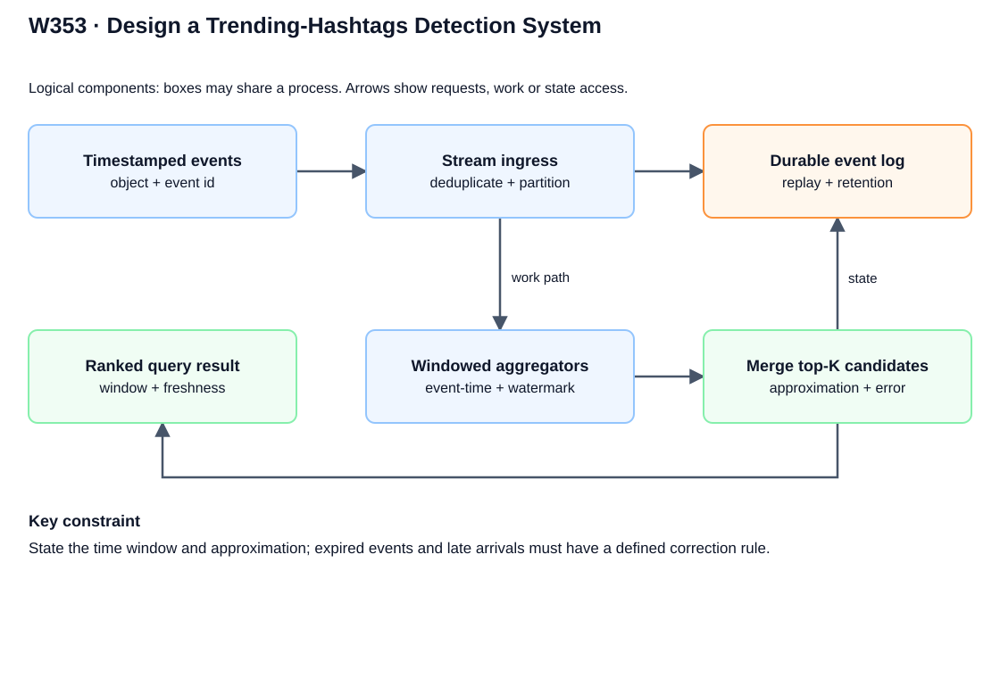

# W353. Design a Trending-Hashtags Detection System

**Priority group:** Fourth 100 — role-dependent depth

**Category:** Streaming counters and top-K

**Study position:** 353 of 547

[Group list](../FOURTH_100.md) · [All categories](../ALL_CATEGORIES.md) · [Chapter guide](../README.md)

## Question

Design a backend that detects and serves trending hashtags from posts. Requirements: surface trends while the real-world event is still happening (target ~1-minute end-to-end freshness), score posts from the last 24 hours with recency weighting, reflect broad community interest (not one small cluster spamming), require novelty (a new topic or a sharp spike vs its own baseline), and serve the ranked list with low read latency.

The hard part is combining recency, popularity, and novelty without letting stale evergreen tags dominate.

## Worked solution

<!-- architecture:W353:start -->
### Architecture and request flow

[Open the diagram at full size](../diagrams/W353_architecture.svg). This is a baseline component diagram for this question. The boxes describe responsibilities; they do not require a separate microservice for every box.

- **Request and state:** Timestamped events — object + event id → Stream ingress — deduplicate + partition. That component consults or updates **Durable event log — replay + retention** under the required access and consistency rules.
- **Work and result:** the work path passes through **Windowed aggregators — event-time + watermark** and **Merge top-K candidates — approximation + error**, producing **Ranked query result — window + freshness**. Bound waiting and retries where a slow dependency can stall this path.
- **Correctness point:** State the time window and approximation; expired events and late arrivals must have a defined correction rule.

When explaining the drawing, trace one normal request first, then a duplicate request, an unavailable dependency and recovery from saved state. If the question requires stricter guarantees or a different scope, state the change explicitly rather than treating this baseline as the only possible design.
<!-- architecture:W353:end -->

### Define a score that measures new broad interest

Assume posts supply post_id, author_id, event_time, hashtags, language, region and an abuse-quality signal. Normalize hashtag case/Unicode under a versioned policy, resolve aliases cautiously and deduplicate a tag within a post. Use a durable post stream with update/delete corrections. `GET /trends?region=&language=&k=` returns rank, score components, topic label, as_of and freshness; a minute-level snapshot cache keeps reads cheap.

Popularity is recency-weighted distinct contribution over 24 h: for tag h use $P_h(t)=\sum_{author\ a}\min(c,\sum_{posts\ p\in(a,h)}q_p e^{-(t-t_p)/\tau})$ with no contribution beyond24 h, chosen tau perhaps 2 h and author cap c. This reduces one author's spam but not an organized cluster; additionally require minimum independent authors and community spread (for example effective communities exp(entropy) or a maximum share from one trusted community cluster), plus platform-integrity filters. Community inference is noisy and must not suppress a real small-region event automatically; tune scope-specific thresholds with human audits.

Estimate the tag's expected current rate from older same-hour/day-of-week data, excluding the current spike, using a smoothed robust baseline b_h. Novelty can be log((recent_rate+alpha)/(b_h+alpha)) with a minimum absolute-volume gate and uncertainty correction. A tag with 1 mention after 0 must not outrank a large real event merely due to an infinite ratio. Rank a bounded combination such as log1p(P)·max(0, novelty)·breadth after eligibility checks; coefficients/tau/gates are product hypotheses calibrated against editorial/user relevance labels, not universal constants.

### Stream computation and freshness

Partition by tag and maintain minute buckets for counts, capped author contributions and community distribution; decay aggregates incrementally and expire24 h-old state. Keep a separate longer-baseline history. Exact distinct authors need expiring per-author/tag state; sketches lower memory but cannot exactly undo arbitrary deletions/expiry, so use per-bucket sketches with disclosed error or exact candidate refinement. Extremely hot tags salt partial buckets, then merge full tag features before ranking; local fragment topK is insufficient.

Budget roughly 10 s intake/dedup, 20 s aggregation/feature update, 10 s rank/abuse checks and 10 s snapshot publication within a chosen60 s target, leaving10 s slack; measure the joint tail. Handle lateness with a stated watermark/correction horizon and versioned snapshots. Ranks refresh even when no posts arrive because recency decays. Persist state/offset checkpoints and raw permitted posts for replay; deletion/abuse decisions retract contributions and invalidate cached snapshots.

### Worked comparison and evaluation

An evergreen tag with 100k/day but stable recent activity has large P and near-zero novelty, so it can be in “popular” without being “trending.” A new regional earthquake tag with 10k recent independent authors across communities and a large baseline spike passes both novelty and breadth. Ten thousand repetitions by ten coordinated accounts fail cap/spread checks despite raw volume. Cold-start b uses a prior and absolute-volume threshold, not division by zero.

Evaluate event-detection delay, human-labeled trend precision/recall, novelty, community diversity, spam resistance and regional fairness, plus latency/cost/freshness. Compare to raw24 h count and recent-rate baselines with historical replay, using holdout events and attack simulations. Monitor stale evergreen leakage, bot share, accepted/retracted volume and model/score versions; canary rank changes and serve last-good snapshots labeled stale during outages. The diagram's bucket/merge path now computes these concrete recency/baseline/breadth features, rather than an unexplained generic count.

### Further study

- [F168: Design a state-wide temperature ingestion and query system.](../17_distributed_systems_depth.md#f168)
- [F169: Explain backpressure in a multi-stage data pipeline.](../17_distributed_systems_depth.md#f169)
