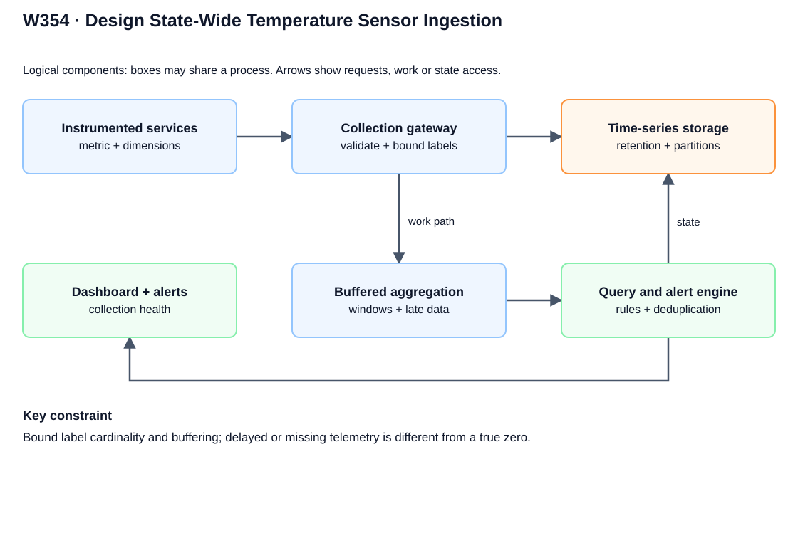

# W354. Design State-Wide Temperature Sensor Ingestion

**Priority group:** Fourth 100 — role-dependent depth

**Category:** Streaming counters and top-K

**Study position:** 354 of 547

[Group list](../FOURTH_100.md) · [All categories](../ALL_CATEGORIES.md) · [Chapter guide](../README.md)

## Question

Design an ingestion pipeline for a temperature sensor every N square miles across a state. Serve three queries: the latest temperature per sensor, the global top-K hottest sensors, and a real-time heat map of the entire state.

### Requirements

Functional: ingest sensor readings (sensor_id, lat, lon, temperature, timestamp); answer getLatest(sensor_id) -&gt; reading; answer topK(K) -&gt; list of (sensor_id, temperature); render a heat map over the state at a configurable spatial resolution.
Non-functional: ingestion sustained at thousands to tens of thousands of readings per second; queries served with sub-second latency; the heat map should be smoothly refreshable in a browser without re-ingesting raw points.
Data model: SensorRegistry (sensor_id, lat, lon, geohash, last_seen); hot store keyed by sensor_id (last reading); cold time-series store (sensor_id, ts) -&gt; temperature; pre-aggregated heat-map tiles keyed by (zoom_level, tile_x, tile_y).
Notes
The three queries point at three different storage layouts; the right answer separates them explicitly rather than forcing one store to serve all three.

## Worked solution

<!-- architecture:W354:start -->
### Architecture and request flow

[Open the diagram at full size](../diagrams/W354_architecture.svg). This is a baseline component diagram for this question. The boxes describe responsibilities; they do not require a separate microservice for every box.

- **Request and state:** Instrumented services — metric + dimensions → Collection gateway — validate + bound labels. That component consults or updates **Time-series storage — retention + partitions** under the required access and consistency rules.
- **Work and result:** the work path passes through **Buffered aggregation — windows + late data** and **Query and alert engine — rules + deduplication**, producing **Dashboard + alerts — collection health**. Bound waiting and retries where a slow dependency can stall this path.
- **Correctness point:** Bound label cardinality and buffering; delayed or missing telemetry is different from a true zero.

When explaining the drawing, trace one normal request first, then a duplicate request, an unavailable dependency and recovery from saved state. If the question requires stricter guarantees or a different scope, state the change explicitly rather than treating this baseline as the only possible design.
<!-- architecture:W354:end -->

### Solution outline

Different query patterns often need different materialized views of the same event stream.

1. Ingest readings with sensor id, event time, position and value; validate duplicates and late events.
2. Maintain a latest-reading store, a top-K view and spatially aggregated heat-map tiles rather than forcing one layout to serve everything.
3. Define freshness, retention and late-correction rules, with replayable raw events for rebuilding views.

### Understand why the approach works

#### Define membership in the window precisely

Before selecting a data structure, choose event time or processing time, interval boundaries and duplicate semantics. For a window $[t-W,t)$, an event at its left boundary may be included while one at the right boundary is not; the contract must match the expiration logic.

Maintain durable event ids or idempotent state transitions, plus enough time-indexed information to expire contributions. A cumulative counter cannot answer an exact rolling query without remembering when contributions leave. Buckets reduce state at a chosen resolution; a watermark and correction policy determine how late events affect published values.

For top-$K$, update counts and an ordered score index consistently. Specify ties and whether reads are exact or approximate. A sketch gives a different error contract from an exact count, while an exact algorithm may require state proportional to active cardinality.

A practical trace is: receive event, check identity, update its key's state, advance the time boundary, expire old contributions, then publish a versioned result. Replay must not increment twice. Compare update cost, query cost and storage separately, and test an item that leaves and reenters the window rather than only monotonically increasing counts.

### Work a small example

A heat-map tile cache avoids resending every raw sensor point whenever a browser refreshes the map.

### Edge cases and common mistakes

Letting an old out-of-order event overwrite a newer latest-reading record.

### Further study

- [F168: Design a state-wide temperature ingestion and query system.](../17_distributed_systems_depth.md#f168)

### Explain it back

Close the answer. State the main invariant or equation, work the example with changed inputs, and explain which assumption would make your solution fail. For a design, walk through a retry or partial failure; for a derivative, check a shape and a finite-difference case.
