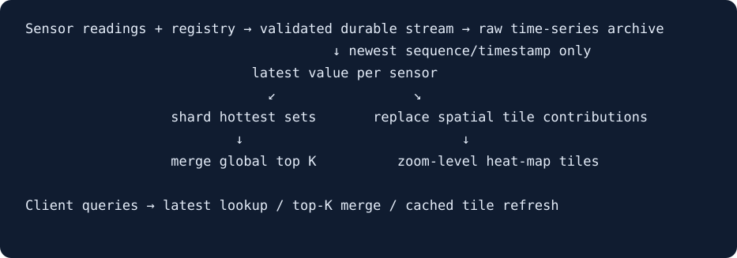

# W354. Design State-Wide Temperature Sensor Ingestion

**Priority group:** Fourth 100 — role-dependent depth

**Category:** Streaming counters and top-K

**Study position:** 354 of 547

[Group list](../FOURTH_100.md) · [All categories](../ALL_CATEGORIES.md) · [Chapter guide](../README.md)

## Question

Design an ingestion pipeline for a temperature sensor every N square miles across a state. Serve three queries: the latest temperature per sensor, the global top-K hottest sensors, and a real-time heat map of the entire state.

### Requirements

Functional: ingest sensor readings (sensor_id, lat, lon, temperature, timestamp); answer getLatest(sensor_id) -&gt; reading; answer topK(K) -&gt; list of (sensor_id, temperature); render a heat map over the state at a configurable spatial resolution.
Non-functional: ingestion sustained at thousands to tens of thousands of readings per second; queries served with sub-second latency; the heat map should be smoothly refreshable in a browser without re-ingesting raw points.
Data model: SensorRegistry (sensor_id, lat, lon, geohash, last_seen); hot store keyed by sensor_id (last reading); cold time-series store (sensor_id, ts) -&gt; temperature; pre-aggregated heat-map tiles keyed by (zoom_level, tile_x, tile_y).
Notes
The three queries point at three different storage layouts; the right answer separates them explicitly rather than forcing one store to serve all three.

## Worked solution

<!-- architecture:W354:start -->
### Architecture and request flow

[Open the diagram](../diagrams/W354_final_architecture.svg). The ingestion stream feeds three access paths: latest-by-sensor, ranking over current sensor values, and spatial tiles. Replacing a reading removes its old contribution before applying the new value. The raw time-series archive supports replay; it is not scanned for every browser refresh.
<!-- architecture:W354:end -->

### Use three views for three different questions

Let state area be A square miles and density one sensor/N square miles: sensor count ≈ A/N, not a fixed number without A, N. As a chosen illustration100k sensors reporting every 10 s produce10k readings/s. Ingest `{sensor_id,sequence,event_time,lat,lon,temperature,unit}` through authenticated batched gateway → durable log partitioned by sensor. Validate registry location/calibration, plausible ranges, unit conversion, timestamp skew and duplicate sequence; quarantine suspect readings rather than silently distorting the heat map.

Persist `SensorRegistry(id,location,geohash,calibration,last_seen)`, append-only cold `(sensor,event_time,sequence)->reading`, hot `Latest(sensor)->(time,sequence,temp,quality,version)` and spatial `Tile(zoom,x,y,version)->cells(sum,count,min,max,freshness)`. APIs are `GET /sensors/{id}/latest`, `GET /hottest?k=&as_of=`, and `GET /tiles/{z}/{x}/{y}?version=` plus a lightweight tile-version update stream. Define topK as **latest valid nonstale temperature per sensor**, not all-time maximum; choose a stale threshold and deterministic sensor-id ties.

### Conditional latest, topK replacement and tiles

Compare `(event_time,sequence)` before overwriting Latest, so an older late arrival stays in cold history and cannot roll current temperature backward. For each accepted latest transition, update an ordered per-partition set by removing the old sensor score and inserting the new. Each sensor belongs to one owner shard, so union of local topK lists is sufficient for global topK under a consistent snapshot; asynchronously salt-free latest ownership avoids double membership. On stale timeout remove the sensor from active topK, label missing data and preserve last-observed time.

Heat-map materialization updates the sensor's spatial cell by **subtracting its previous current contribution then adding its new one**, not averaging every historical measurement and overweighting chatty sensors. Produce a zoom pyramid of cached raster/vector tiles; each cell stores sum/count and freshness, with interpolation only under a declared method/density/uncertainty mask. A cell with no fresh sensors is missing, not 0degrees. If sensor coordinates change, retract its old tile contribution before inserting the new. Publish tile versions/deltas so browser pan/zoom/refresh fetches changed tiles rather than every raw point.

### Size, failures and evidence

At 10k/s and 64B logical reading, raw volume ≈ 55.3 GB/day (before metadata/replicas); 100k latest rows at 64B are 6.4 MB logical. Tiles grow with chosen resolution/zoom, so cap zoom and cache hot views; point reads and small topK snapshots can stay subsecond independently of cold analytics. Do not send all sensor points to every browser just to redraw a heat map.

Commit state/offsets or idempotent transition versions so replay cannot double-add tile sums. Checkpoint latest/topK/tile views and rebuild from cold/log history; during failure serve last-good versions with explicit age. Degraded sensor health/clock skew/data gaps are separately monitored. Test late readings, equal timestamps, location changes, negative temperatures, stale expiry, no-data cells and a duplicate replay. The corrected diagram should branch one reading stream into latest KV, latest-temperature score index and spatial tile aggregation; a generic alerting chart does not answer these three APIs.

### Further study

- [F168: Design a state-wide temperature ingestion and query system.](../17_distributed_systems_depth.md#f168)
