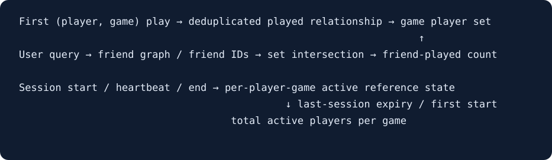

# W355. Near-Real-Time Friend-Played-Game Counter

**Priority group:** Fourth 100 — role-dependent depth

**Category:** Streaming counters and top-K

**Study position:** 355 of 547

[Group list](../FOURTH_100.md) · [All categories](../ALL_CATEGORIES.md) · [Chapter guide](../README.md)

## Question

Design a service that, for a given (user, game) pair, surfaces near-real-time signals: how many of the user's friends have played the game, plus the total active-player count for the game.

Targets: ~10M users and ~100k games. The core challenge is the fan-out from a play event to every friend of the player without overwhelming the storage layer during peak hours.

## Worked solution

<!-- architecture:W355:start -->
### Architecture and request flow

[Open the diagram](../diagrams/W355_final_architecture.svg). A permanent played relationship and a currently active session are different facts. Friend-played queries intersect friends with the game's played set, with selective cached/materialized results where needed. Session heartbeats refresh activity rather than repeatedly fan out a new friend counter increment.
<!-- architecture:W355:end -->

### Define “played” and “active” separately

Choose “friend has played” as a distinct user–game relation within a declared horizon (all-time by default), while “active player” means at least one live session/heartbeat in the last5 minutes, a chosen product definition. If product wants24 h players or simultaneous connections, change the state/expiry contract explicitly. 10M users and 100k games do not imply a 10¹²-cell dense matrix: store sparse `(player,game,last_played)` edges, social friend sets with versions/privacy, active session state and per-game active totals. APIs return `GET /users/me/games/{g}/signals` with friend_distinct_count, total_active, as_of and horizon.

### Avoid writing to every friend on every heartbeat

A raw session heartbeat updates only its player's session/expiry state. A player–game transition from never-played to played (or inactive to active if that is the desired friend metric) is the only potential fanout trigger; repeated plays do not increment a distinct count. For normal-degree users, fan out a deduplicated relation transition to friends' cached `(viewer,game)` materializations. Batch/coalesce updates by viewer/game and shard destination ownership. For high-degree/celebrity users or cold viewers, use read-time set intersection: current friend ids ∩ game player set, with compressed bitmaps/hash sets. Maintain a hybrid threshold based on measured degree, event rate and read heat, not a universal fixed degree.

For example, 1k play events/s with mean 200 friends implies200k writes/s if naively fanned out; a 10k-friend user produces10k writes for one event, and heartbeat-driven repetition makes it worse. Coalescing to one first-play transition and computing high-degree/cold cases on read limits amplification. Cache common viewer/game queries, but authorize the viewer and include social/privacy/version changes so an unfriended/blocked player does not remain exposed. Edge add/remove events update cached intersections or invalidate/rebuild; do not assume the friend graph is static.

### Total active users needs refcounts and expiry

Store per `(player,game)` active session refcount or latest accepted heartbeat expiry; multiple devices/sessions contribute **one** active player. On 0 → 1 increment a game counter shard, on 1 → 0 after the last session expires decrement. Timer/version checks prevent an old timeout expiring a newer heartbeat. Dedup session/event ids and use stable transitions; negative clamping does not repair replay. Shard hot game totals by player hash, periodically sum and publish cached near-real-time counts. Distinct all-time played edges do not expire merely because a current session ends.

Use durable logs/outbox plus versioned projection state/offsets and reconcile against canonical relations/session snapshots after failures. At a chosen average 20 games/user, sparse played edges are 200M; at 24B logical payload ≈ 4.8 GB before indexes/replicas, while graph/storage overhead can dominate. Friend count and total active may have different freshness; return timestamps rather than pretend one atomic global instant. Monitor fanout amplification, degree skew, projection lag, cache invalidation, active expiry and privacy failures. Test duplicate play, two sessions/one user, last-session expiry, friend removal and hot-user fallback. The diagram must show play/session and social relation sources, not like/unlike API labels.

### Further study

- [F166: Design a token-bucket rate limiter.](../17_distributed_systems_depth.md#f166)
- [F168: Design a state-wide temperature ingestion and query system.](../17_distributed_systems_depth.md#f168)
