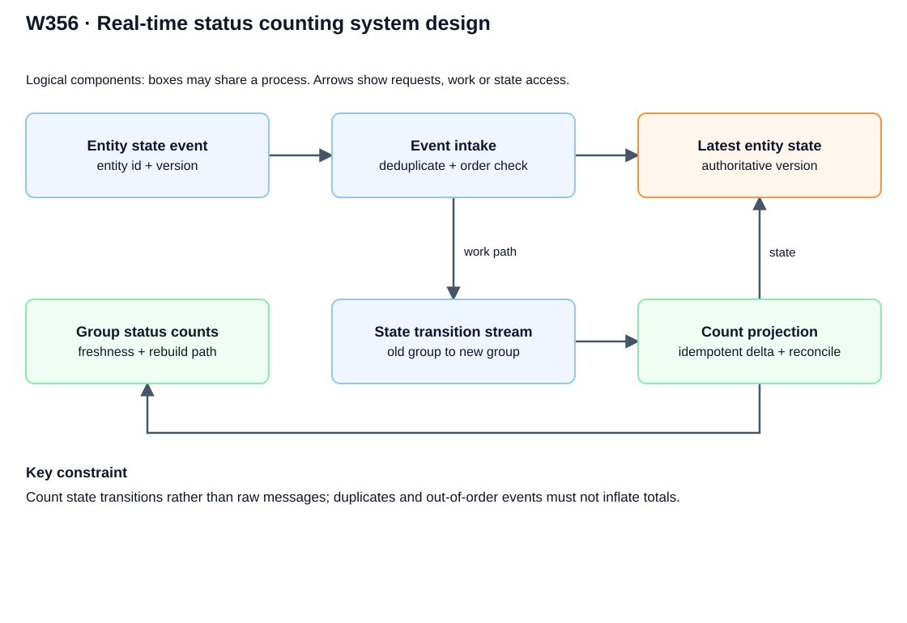

# W356. Real-time status counting system design

**Priority group:** Fourth 100 — role-dependent depth

**Category:** Streaming counters and top-K

**Study position:** 356 of 547

[Group list](../FOURTH_100.md) · [All categories](../ALL_CATEGORIES.md) · [Chapter guide](../README.md)

## Question

Real-time status counting system design

Assume there are one million devices that send a heartbeat and a status (out of 10 possible statuses) every minute. You need to design a system that can compute the count of devices for each status from the previous minute in real-time.

*A generic Python 3 code stub was provided in the editor (boilerplate def solution(): ... # Read data from standard input with an if __name__ == "__main__": block), but the task is an open-ended system design question rather than a testable coding exercise.*

## Worked solution

<!-- architecture:W356:start -->
### Architecture and request flow

[Open the diagram at full size](../diagrams/W356_architecture.svg). This is a baseline component diagram for this question. The boxes describe responsibilities; they do not require a separate microservice for every box.

- **Request and state:** Entity state event — entity id + version → Event intake — deduplicate + order check. That component consults or updates **Latest entity state — authoritative version** under the required access and consistency rules.
- **Work and result:** the work path passes through **State transition stream — old group to new group** and **Count projection — idempotent delta + reconcile**, producing **Group status counts — freshness + rebuild path**. Bound waiting and retries where a slow dependency can stall this path.
- **Correctness point:** Count state transitions rather than raw messages; duplicates and out-of-order events must not inflate totals.

When explaining the drawing, trace one normal request first, then a duplicate request, an unavailable dependency and recovery from saved state. If the question requires stricter guarantees or a different scope, state the change explicitly rather than treating this baseline as the only possible design.
<!-- architecture:W356:end -->

### Define the minute before counting

There are 1M/60 ≈ 16,667 heartbeats/s average, potentially1M/s if devices synchronize at a minute boundary. Add randomized device jitter and provision for measured bursts. Choose a **tumbling previous calendar minute** `[floor(now/60)*60-60,floor(now/60)*60)` in UTC, counting each device once at its latest valid heartbeat/status in that minute. A rolling trailing 60 s or “current latest status with a 60 s TTL” answers different questions; expose those separately if needed. Ten statuses are an enum, and missing devices appear in a separate missing/offline count rather than being assumed to have their last status.

Ingest `{device_id,event_id|sequence,event_time,status}` via authenticated batches into a durable log, partition by hash(device_id), validate status/time skew and retain a declared lateness allowance (for example 10 s). Store `DeviceMinute(device_id,minute,latest_time,sequence,status)` plus partition-local ten-element count vectors. On the first accepted heartbeat for a device/minute increment its status; on a later status in the **same** minute decrement old and increment new; duplicate/stale sequence does nothing. This counts devices, not raw messages. Previous-minute counts remain provisional until watermark passes its end plus the chosen grace rule, then finalized/versioned.

### Query, recovery and checks

Reduce partition vectors under a common minute/snapshot boundary into a cached `MinuteCounts(minute,status_counts,seen_devices,missing,watermark,final)` record; `GET /status-counts?minute=previous` reads it, never scans1M device rows. Heartbeats that are late but within allowance revise that minute; beyond allowance are rejected/dropped with a metric and do not corrupt the current minute. Expire per-device/minute state only after lateness/replay safety; preserve id/sequence dedup long enough for retries.

At a chosen32B/device-minute entry, two active minutes are 64 MB logical state before database overhead; raw64B heartbeats are ~92 GB/day at 1M/min. Checkpoint state with offsets and replay idempotently; preserve last good snapshot with its age if aggregation is unavailable. Replicate intake/log and query cache, cap queues/backpressure and monitor source skew, duplicate/late rates and counts' sum≤registered eligible devices.

Example: a device sends status2 then status3 twice in one minute. The vector ends with one status3 contribution, not three devices; if it sends nothing next minute it is missing there. Test boundary timestamps, reordered statuses, duplicate delivery, failure/replay and a synchronized1M-device burst. The existing state-transition diagram fits this device/minute authority; blind like-counter/frequency-cap policies are unrelated.

### Further study

- [F166: Design a token-bucket rate limiter.](../17_distributed_systems_depth.md#f166)
- [F168: Design a state-wide temperature ingestion and query system.](../17_distributed_systems_depth.md#f168)
