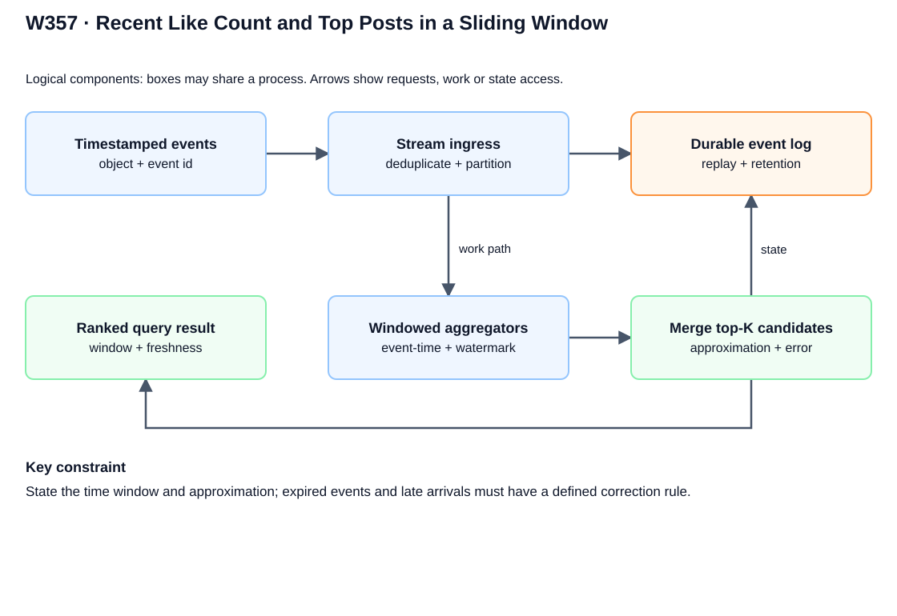

# W357. Recent Like Count and Top Posts in a Sliding Window

**Priority group:** Fourth 100 — role-dependent depth

**Category:** Streaming counters and top-K

**Study position:** 357 of 547

[Group list](../FOURTH_100.md) · [All categories](../ALL_CATEGORIES.md) · [Chapter guide](../README.md)

## Question

Design the last-minute like-count backend: exact count for one post, global top posts over the last minute, and region-based top posts over the same window. Peak ~1M likes/sec, average 100K-300K/sec.

One viable split
Exact point query: Redis hash buckets keyed by post and second; sum the latest 60 buckets at read time.
Top-K: likes through Kafka into a Flink sliding-window job, aggregate by post and region, publish snapshots into Redis sorted sets (trending:global, trending:{region}).
Notes

Exact counts and approximate trending use different paths. Dedup repeated likes; unlike carries negative deltas + late-event handling. Hot-key problem for celebrity posts: partition by post_id, local aggregation, snapshot write frequency.

## Worked solution

<!-- architecture:W357:start -->
### Architecture and request flow

[Open the diagram at full size](../diagrams/W357_architecture.svg). This is a baseline component diagram for this question. The boxes describe responsibilities; they do not require a separate microservice for every box.

- **Request and state:** Timestamped events — object + event id → Stream ingress — deduplicate + partition. That component consults or updates **Durable event log — replay + retention** under the required access and consistency rules.
- **Work and result:** the work path passes through **Windowed aggregators — event-time + watermark** and **Merge top-K candidates — approximation + error**, producing **Ranked query result — window + freshness**. Bound waiting and retries where a slow dependency can stall this path.
- **Correctness point:** State the time window and approximation; expired events and late arrivals must have a defined correction rule.

When explaining the drawing, trace one normal request first, then a duplicate request, an unavailable dependency and recovery from saved state. If the question requires stricter guarantees or a different scope, state the change explicitly rather than treating this baseline as the only possible design.
<!-- architecture:W357:end -->

### Define what a “recent like” means

Choose accepted like-transition **events** in `[T-60s,T)`, with unlike as a signed reversal under a declared policy. This differs from “relationships newly liked during the minute and still active”: that alternative must retract the original like's bucket when it is unliked. To avoid negative/unintuitive trending, a useful product choice is the latter active-recent-like metric: store each active `(user,post)` edge's like timestamp and region; unlike retracts that original live-window contribution, and unlike after it expired adds no negative current contribution. State the choice in the response rather than quietly mixing event flow and state counts.

Mutation API uses desired state/idempotency/version and server-derived user/region; only false → true emits a counted edge event. `GET /posts/{id}/recent-likes?as_of=` returns count/window/watermark; `GET /trending?region=&k=` returns a snapshot with mode/as_of. Authoritative edge update plus outbox prevents retry overcount and allows unlike to name the matching version. Region is fixed at the original event under this chosen event-region metric, not retroactively moved when a user travels.

### Exact point path and ranked projection

Maintain per `(post,salt,second)` contributions and dedup/transition state, using atomic consumer state/offset commits. For second-aligned T, sum seconds T-60 through T-1 across salts; Redis Lua/transaction or a snapshot version makes the multi-bucket read consistent with concurrent expiration. A 60-second bucket design is exact only at **second boundaries**, not arbitrary subsecond cutoffs; if literal continuous-time exactness is required retain timestamped contributions for edge buckets. Include projection watermark: a fast Redis count is not instantly authoritative before its stream event arrives.

Kafka/Flink maintains identical event-time rules and per-post/global/region rolling totals, expiring original buckets and retracting only live contributions. Publish sorted-set or immutable top100 snapshots periodically (say1 s) to Redis and serve cached topK. Exact key-owned full-post totals permit merging local topK; if celebrity posts are salted, first recombine all salts for that post or mark candidate-only results approximate. A current topK-only heap is insufficient when top entries expire: retain all active counts/ordered candidates or rebuild from an authoritative count index.

### Capacity, failure and validation

At average 200k/s choose100B log events: 20 MB/s ≈ 1.73 TB/day raw; peak1M/s is 100 MB/s. A minute contains12M average or 60M peak contributions before aggregation/dedup, motivating sparse buckets, coalesced deltas and hot-post salting. Microbatch per-salt updates, bound late-event grace, preserve event/edge version identity and avoid one Redis increment for every raw request on a celebrity key. Durable logs/checkpoints rebuild both projections; cross-path watermarks explain temporary disagreement.

Test retry, unlike before/after expiration, like → unlike → like versions, second-boundary inclusion, out-of-order events, regional provenance and processor replay. Monitor count/rank path lag, stale snapshots, reconciliation differences, hot-shard load and dropped lateness. During overload preserve log events and disclose stale projections; do not call unprocessed likes exact-current. The given Redis/Flink split is viable only with these metric/consistency contracts.

### Further study

- [F168: Design a state-wide temperature ingestion and query system.](../17_distributed_systems_depth.md#f168)
- [F169: Explain backpressure in a multi-stage data pipeline.](../17_distributed_systems_depth.md#f169)
