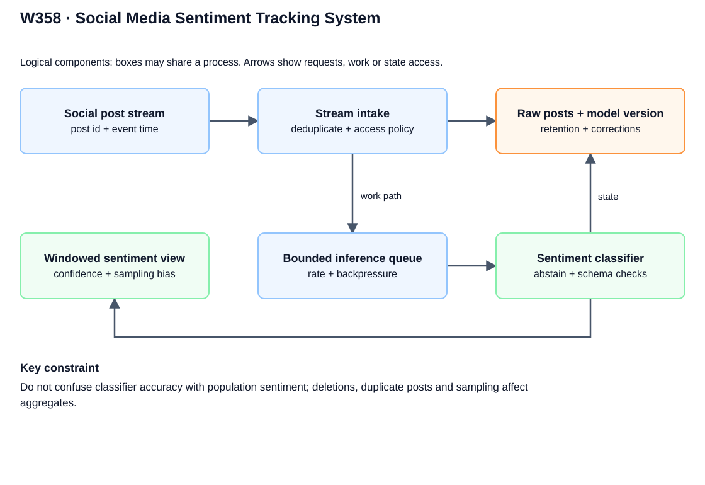

# W358. Social Media Sentiment Tracking System

**Priority group:** Fourth 100 — role-dependent depth

**Category:** Streaming counters and top-K

**Study position:** 358 of 547

[Group list](../FOURTH_100.md) · [All categories](../ALL_CATEGORIES.md) · [Chapter guide](../README.md)

## Question

Design a system that tracks public sentiment toward Netflix on social media over time: ingest posts, classify sentiment, aggregate, and surface trends so the team can see opinion shift around launches or price changes.

### Requirements

Collect posts from social platforms.
Classify sentiment as positive or negative.
Aggregate results and expose trends over time.
Structure the design into ingestion, aggregation, and offline ML.

## Worked solution

<!-- architecture:W358:start -->
### Architecture and request flow

[Open the diagram at full size](../diagrams/W358_architecture.svg). This is a baseline component diagram for this question. The boxes describe responsibilities; they do not require a separate microservice for every box.

- **Request and state:** Social post stream — post id + event time → Stream intake — deduplicate + access policy. That component consults or updates **Raw posts + model version — retention + corrections** under the required access and consistency rules.
- **Work and result:** the work path passes through **Bounded inference queue — rate + backpressure** and **Sentiment classifier — abstain + schema checks**, producing **Windowed sentiment view — confidence + sampling bias**. Bound waiting and retries where a slow dependency can stall this path.
- **Correctness point:** Do not confuse classifier accuracy with population sentiment; deletions, duplicate posts and sampling affect aggregates.

When explaining the drawing, trace one normal request first, then a duplicate request, an unavailable dependency and recovery from saved state. If the question requires stricter guarantees or a different scope, state the change explicitly rather than treating this baseline as the only possible design.
<!-- architecture:W358:end -->

### Ingestion: identify Netflix mentions and coverage

Collect permitted public posts through platform adapters with API quotas/cursors, retry/backoff and durable checkpointed log intake. Use canonical `(platform,post_id,version)` ids, author/time/language/source metadata and retention/deletion policies. Match Netflix/company/product aliases with context so an incidental title or ambiguous word does not become a company opinion automatically. Deduplicate transport retries; decide whether retweets/reposts represent reach or repeated content and report both views if useful.

Assume 100k posts/minute peak for planning: 1,667/s, not a scale supplied by the problem. A 256B normalized record is~.43 MB/s before text/media expansion; model throughput and source quotas determine actual capacity. Protect private identifiers and do not claim provider access is complete public opinion.

### Aggregation: versioned binary predictions with uncertainty

A bounded inference queue batches a versioned classifier and writes `Prediction(post_version,entity,model_version,p_positive,label,confidence,status)`. Required labels are positive/negative; ambiguous/neutral/sarcastic/mixed examples are an audited uncertain bucket or are forced binary **with that limitation reported**, not silently discarded. An abstention policy should preserve denominator counts/coverage. Idempotent prediction keys ensure retries contribute once.

Stream into minute/hour/day UTC counts by source/language/entity, with event-time lateness/correction rules. Store positive, negative, uncertain, error, total counts and optionally sums of calibrated p_positive, never average batch averages without weights. `GET /sentiment?start=&end=&grain=&source=` serves rollups and volume/coverage/freshness. An edit/reclassification retracts the prior contribution then adds the new one; deletion removes permitted derived content and adjusts counts under policy. A model release must recompute a comparison window or show a version discontinuity, not present an artificial opinion shift as news.

### Offline ML and a defensible trend

Build human-labeled samples stratified by source/language/topic/time, with guidelines for entity target, sarcasm and mixed sentiment; measure agreement and adjudicate. Use lexical/logistic or pretrained-text baselines and fine-tuned alternatives; time/source-family splits avoid duplicate leakage. Evaluate per-class precision/recall/F1, calibration, subgroup errors and drift; select threshold/abstention by validated product costs. Active review prioritizes uncertain/drifting and random audit cases, not only model-approved labels.

For a price change, compare a matched pre/post source/language mix, show post counts and confidence intervals clustered by author/day, annotate coverage/model changes and distinguish correlation from causation.100 positive/100 negative among200 posts is a 50% positive classified sample, not “half of customers approve.” Bots and engagement ranking can change sample composition. Use independent surveys/behavior when the decision needs customer population sentiment.

Monitor source outages, lag, classifier error/uncertainty, bot/duplicate share and per-model distribution; checkpoint state/offsets and replay without duplicate aggregates. During failures serve last-good time-stamped trends and explicit missing-source warnings. The requested architecture is intake → classification/aggregation plus an offline labeling/training/evaluation loop; generic rolling-topK mechanics alone do not solve sentiment quality.

### Further study

- [F090: Design a rate-limited LLM classification pipeline.](../09_ml_system_design.md#f090)
- [F065: Distinguish data drift, concept drift and label delay.](../07_evaluation_and_data.md#f065)
