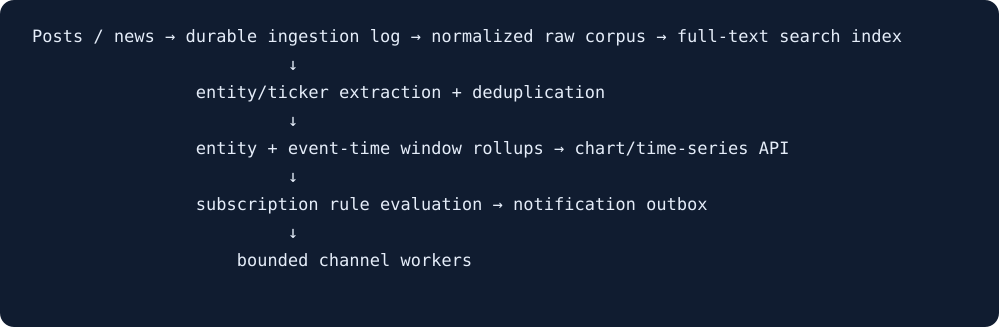

# W359. Streaming Social-Media Mentions and Aggregation

**Priority group:** Fourth 100 — role-dependent depth

**Category:** Streaming counters and top-K

**Study position:** 359 of 547

[Group list](../FOURTH_100.md) · [All categories](../ALL_CATEGORIES.md) · [Chapter guide](../README.md)

## Question

Design a backend that ingests a stream of social posts and news articles, extracts company/ticker mentions, supports windowed visualizations from minutes to days, lets users subscribe to entities and get notifications, and supports high-QPS keyword search across the raw corpus (open-ended Bloomberg onsite).

Functional:

Ingest raw posts/articles from external feeds; extract company/ticker mentions from raw text.
Per-entity mention counts across configurable windows (30-min, hourly, daily, weekly); tumbling by default.
Time-series visualizations; 10–30 min lag acceptable.
Users subscribe to entities with filters (e.g. "mentions &gt; N/hour") and get push notifications.
Full-text keyword search across the raw corpus, arbitrary keyword combinations.
Absorb bursty input (breaking news, meme-stock spikes) without dropping data.

Scale: millions of events/min at peak; ~100k search QPS sustained; raw corpus retained for weeks.

## Worked solution

<!-- architecture:W359:start -->
### Architecture and request flow

[Open the diagram](../diagrams/W359_final_architecture.svg). Raw keyword search and entity-window counts have separate indexes. Entity extraction identifies mentions rather than sentiment. Window versions, late-event handling and rule-trigger deduplication keep chart corrections and notifications explainable; the answer's allowed analytics lag remains explicit.
<!-- architecture:W359:end -->

### Separate raw search from entity analytics and notifications

Choose a planning peak3M events/min=50k/s, 1 KB/event ≈ 50 MB/s or 4.32 TB/day if sustained; weeks of raw retention reaches tens ofTB before replication/indexing. Source-average traffic and compression must replace this peak-based upper planning rate.100k search QPS is a distinct serving workload, so do not send every keyword query to a stream processor or raw object store.

Ingest external article/post batches with source/event/version ids, timestamps, permitted text and checkpoints into a replicated log; archive immutable raw records to object storage. A full-text inverted index is partitioned by time/hash with replicas, analyzers and current-version/delete filtering, supporting boolean keyword combinations and paginated results. Query caches and hot time ranges reduce load, but cache keys include filters/permissions/index version. `GET /search?q=&start=&end=&cursor=` returns id/version snippets; rate-limit expensive wildcard/fuzzy queries rather than let them starve the cluster.

### Entity extraction and time-series state

An entity service resolves company names/tickers using a versioned alias/security master, contextual disambiguation, language and exchange/date metadata. “APPLE” can refer to a company or fruit; store confidence and evidence spans, with an uncertain path/manual audits. `Mention(event_version,entity_id,extraction_version)` is unique per entity/article under a **document-mention** metric; counting every repeated word is another explicit metric. Source edits/deletes retract prior mentions before replacement.

Aggregate event-time tumbling30min/hour/day/week buckets with UTC/market-calendar boundaries declared, lateness/watermark corrections and count/source coverage. Store mergeable counts (and distinct-author sketches only with error contracts) plus immutable historical snapshot versions. `GET /entities/{id}/series?grain=&start=&end=` reads analytical rollups; 10–30min lag allows cost-efficient microbatch extraction/indexing instead of demanding unnecessary millisecond state. Reprocess with new extraction versions without silently mixing series definitions.

### Subscription flow and reliability

`POST /subscriptions` records user, entity/filter, threshold, window, cooldown, destination and policy version. Evaluate subscriptions against closed/revised bucket transitions, e.g. mentions>N/hour with strict equality behavior, and emit a unique `Alert(subscription,bucket,threshold_version)` through an outbox. Notification workers retry under stable provider keys, track delivery and prevent every 1-minute reevaluation from resending the same alert. Hysteresis/cooldown and digest policies reduce spam; a correction dropping below threshold needs an explicit retraction policy.

Partition extraction/analytics by event/entity with hot-key salting followed by full-key aggregation. Independent consumer groups feed search, rollups and notifications; scaling one need not block the others. Raw log buffers breaking-news bursts, with enough retention/disk and backpressure before capacity is exhausted; “Kafka” is not infinite storage. Checkpoint offsets/state, replay idempotently and stage new index versions before alias swap. Preserve per-stage watermarks so a search result and time series can disclose different freshness.

Monitor feed gaps, event lag, extraction precision/recall, ambiguous aliases, search p99/cache/load, rollup reconciliation, notification duplicate/failure rate and storage growth. Failure examples: source retry counts once; updated article changes its company set once; notification timeout reconciles rather than creates a new logical alert; an index outage does not lose raw ingestion. The diagram must show mention extraction, raw full-text search and subscription evaluation branches, not sentiment classification.

### Further study

- [F090: Design a rate-limited LLM classification pipeline.](../09_ml_system_design.md#f090)
- [F065: Distinguish data drift, concept drift and label delay.](../07_evaluation_and_data.md#f065)
