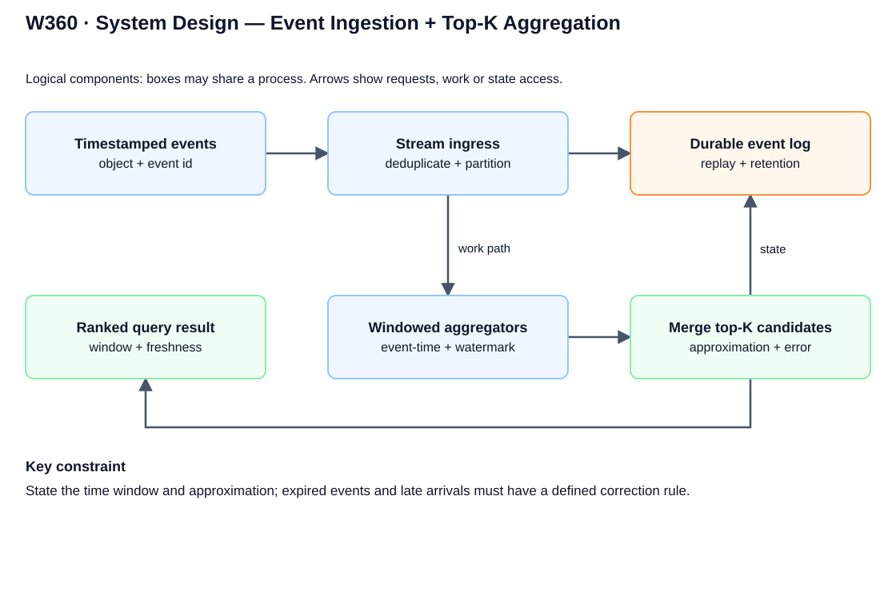

# W360. System Design — Event Ingestion + Top-K Aggregation

**Priority group:** Fourth 100 — role-dependent depth

**Category:** Streaming counters and top-K

**Study position:** 360 of 547

[Group list](../FOURTH_100.md) · [All categories](../ALL_CATEGORIES.md) · [Chapter guide](../README.md)

## Question

An originally-single-server event-reporting system must scale to a much higher request volume, and must additionally compute top-K aggregations across the event stream. OHAI onsite SD round with a heavy emphasis on the scale-up narrative.

### Requirements

Original setup: a single server receiving event reports from clients.
New scale: request volume has grown sharply (orders of magnitude); the single-server bottleneck must be removed.
Additional capability: compute top-K aggregations over the event stream (e.g. top-K event types, top-K clients, top-K resources).
Round time: 45 minutes after a 10-minute behavioural opener.
Notes
Ingestion scale-out: front the system with a stateless load balancer; ingestion nodes are themselves stateless. Events land on a durable log (Kafka / Kinesis / OCI Streaming) keyed by a partition field (event type or client ID). Consumers downstream read the log for aggregation, storage, notification. Back-pressure: the log absorbs upstream bursts; consumers scale independently.
Top-K aggregation: exact top-K -&gt; map-side per-partition counter heaps of size K, reduce-side merge of per-partition heaps for the global top-K. Approximate top-K (sub-linear memory) -&gt; Count-Min Sketch for frequency estimation + a heap of candidates, or the Space-Saving (Misra-Gries / Metwally) algorithm keeping exactly K counters with bounded over-estimation.
Time-windowed top-K (last hour/day): tumbling or sliding-window aggregation (Flink / Spark Structured Streaming); each window emits its top-K snapshot.
Deep dives: exactly-once vs at-least-once delivery; late-arriving events and watermarks; storage of historical top-K snapshots; hot-key handling (one dominating event type forces a per-key partition scheme).

## Worked solution

<!-- architecture:W360:start -->
### Architecture and request flow

[Open the diagram at full size](../diagrams/W360_architecture.svg). This is a baseline component diagram for this question. The boxes describe responsibilities; they do not require a separate microservice for every box.

- **Request and state:** Timestamped events — object + event id → Stream ingress — deduplicate + partition. That component consults or updates **Durable event log — replay + retention** under the required access and consistency rules.
- **Work and result:** the work path passes through **Windowed aggregators — event-time + watermark** and **Merge top-K candidates — approximation + error**, producing **Ranked query result — window + freshness**. Bound waiting and retries where a slow dependency can stall this path.
- **Correctness point:** State the time window and approximation; expired events and late arrivals must have a defined correction rule.

When explaining the drawing, trace one normal request first, then a duplicate request, an unavailable dependency and recovery from saved state. If the question requires stricter guarantees or a different scope, state the change explicitly rather than treating this baseline as the only possible design.
<!-- architecture:W360:end -->

### Evolve the single-server design in stages

Begin by measuring whether the old server is CPU, network, database or disk-bound and preserving its event/ack contract. Choose illustrative new peak100k events/s at 500B=50 MB/s ingress (~4.32 TB/day sustained), then update with measured averages/retention. Add a load balancer and stateless authenticated ingestion replicas; require stable event ids, schema/version, key and event_time. Acknowledge only after durable replicated log acceptance, not merely after placing data in process memory. Migrate clients through the same API/version, compare old/new event accounting, canary and retain replay for rollback.

Partition the log to spread load while maintaining the required per-key order; consumers for raw archival, metrics and notifications scale independently. Queue lag/backpressure and bounded admission absorb bursts up to retained capacity. No finite queue can absorb sustained arrivals faster than processing indefinitely. `POST /events:batch` returns accepted/retryable ids; `GET /topk?dimension=&window=&k=` returns score/order, window, snapshot, exactness and freshness.

### Count completely before selecting exact local leaders

For exact counts, repartition by the **ranked key**, maintain every active key's count and expiration buckets, then a full ordered count index or sizeK selection over complete totals. Local topK merge is exact only when each key's entire score belongs to one shard (same deterministic score/id order). If partitioning by client while ranking event type, a type appears on many shards and can be missed: shard1 a 60/x61, shard2 a 60/y61 gives global a 120 but no local top1 a. Sum all per-type partials before local ranking, or use a candidate/error protocol and label approximation. A sizeK heap alone cannot retain exact counts of arbitrary future heavy hitters or refill correctly after expiration.

For approximate positive streams, Count-Min uses O((1/epsilon)log(1/delta)) counters and estimates fixed-key frequency between f and f+epsilon·total with high probability, but needs a separate candidate enumeration structure. Space-Saving keeps m counters with bounded overestimation and heavy-hitter recall; Misra–Gries is a related **different** undercounting algorithm, not the same update/error sign. Use more than K candidates when cutoff gaps are uncertain and exact-refine from bucket totals if possible. Exact candidate counts do not eliminate missing-candidate error.

### Windows, retries and scale-out failure

Define tumbling versus sliding and bucket precision, event-time watermark/allowed lateness and duplicate horizon. Store per-key bucket contributions, update rolling totals on arrival/expiry and publish immutable snapshots into a replicated cache plus historical store. Late accepted events revise affected snapshots; beyond policy are counted/dropped explicitly. Expiration timers run during idle periods. Salt hot keys into local subaggregates then combine full totals before ranking.

At-least-once delivery plus stable-id dedup/state-and-offset checkpointing yields exactly-once **effects** for the defined retained horizon; an unqualified end-to-end exactly-once promise across arbitrary external sinks is misleading. Recover from checkpoint+log, fence reshard epochs and atomically swap snapshot pointers. Reads use last-good snapshots with as_of during processor failures; ingestion can continue until durable backlog limits. Track end-to-end accepted → snapshot lag, duplicates/late drops, hot partitions, checkpoint/recovery, read p99 and cost. A 45-minute answer can allocate 5min contract/sizing, 10min migration/data path, 15min exactness/windows/hot keys, 10min failures/approximation and 5min trade-offs, adjusting to interviewer priorities.

### Further study

- [F168: Design a state-wide temperature ingestion and query system.](../17_distributed_systems_depth.md#f168)
- [F169: Explain backpressure in a multi-stage data pipeline.](../17_distributed_systems_depth.md#f169)
