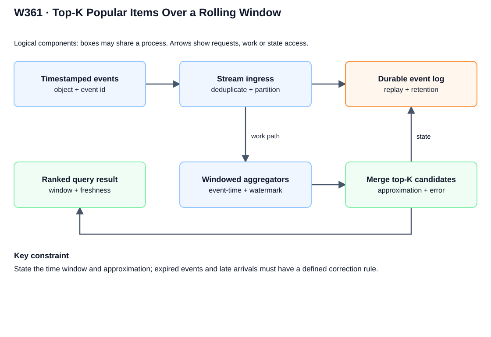

# W361. Top-K Popular Items Over a Rolling Window

**Priority group:** Fourth 100 — role-dependent depth

**Category:** Streaming counters and top-K

**Study position:** 361 of 547

[Group list](../FOURTH_100.md) · [All categories](../ALL_CATEGORIES.md) · [Chapter guide](../README.md)

## Question

Design a service that returns the top-K most popular items over a rolling time window — e.g. food items per restaurant, restaurants per city, or global search queries for Uber Eats. Variants ask for offline batch, near-realtime, or per-restaurant slicing.

Functional: ingest item-view/item-order events at high rate; answer "top K items for restaurant_id over the last N minutes/hours/days"; support city-wide and global query distributions; a sibling framing ranks top-K products by recent click count for a homepage, optionally segmented by market/category/device.

Scale: 1M+ events/sec globally; p99 query latency 100–500 ms; K small (10–100); N ranges 5 min to 30 days.

## Worked solution

<!-- architecture:W361:start -->
### Architecture and request flow

[Open the diagram at full size](../diagrams/W361_architecture.svg). This is a baseline component diagram for this question. The boxes describe responsibilities; they do not require a separate microservice for every box.

- **Request and state:** Timestamped events — object + event id → Stream ingress — deduplicate + partition. That component consults or updates **Durable event log — replay + retention** under the required access and consistency rules.
- **Work and result:** the work path passes through **Windowed aggregators — event-time + watermark** and **Merge top-K candidates — approximation + error**, producing **Ranked query result — window + freshness**. Bound waiting and retries where a slow dependency can stall this path.
- **Correctness point:** State the time window and approximation; expired events and late arrivals must have a defined correction rule.

When explaining the drawing, trace one normal request first, then a duplicate request, an unavailable dependency and recovery from saved state. If the question requires stricter guarantees or a different scope, state the change explicitly rather than treating this baseline as the only possible design.
<!-- architecture:W361:end -->

### Fix the event, slice and window contract

Choose distinct accepted order events as the primary popularity score, with views/clicks a separate metric; do not add them without declared weights. Ingest `{event_id,item_id,restaurant_id,city,market,category,device,event_time,event_type}` with schema, authentication and stable-id dedup. Item/restaurant metadata is captured as-of-event or joined under an explicit current-category policy. `GET /popular?scope=restaurant|city|global&scope_id=&metric=&window=&k=` returns ranked items, score, window bounds, precision, mode, as_of. Menu authorization/availability can filter a serving list without changing historical popularity definition.

### Materialize common windows; make arbitrary windows honest

Partition accepted events by ranked `(scope,key)` ownership and maintain sparse event-time buckets, per-window running totals and a deterministic `(score desc,item_id asc)` score index. Use seconds/minutes for 5min windows and coarser minute/hour/day layers for long history, while retaining fine buckets if the API requires exact endpoints. A 30-day exact arbitrary-second query cannot be answered by summing daily topK snapshots. Precompute popular5m/1 h/1d/30d windows for cache-hot endpoints; for arbitrary N either sum complete per-item bucket counts through a time-indexed store with a higher bounded latency, constrain allowed precision/windows, or use a disclosed approximation. Precomputing every market × category × device combination causes cardinality explosion, so materialize high-value slices and restrict/admit expensive combinations.

A restaurant has a bounded menu, making on-read sum/sort viable for cold restaurants; city/global need streaming full-key aggregation and cached top100. Hot items salt partial updates then recombine totals before ranking. Local topK union is exact only with complete nonoverlapping item ownership under the same scope; an item split by event/client shards can win globally without appearing locally. Retain all active count candidates so expiration can promote a previously lower-ranked item.

### Scale, variants and recovery

At 1M events/s and an assumed 100B/event, peak intake is 100 MB/s; sustained that rate would be 8.64 TB/day raw and 259 TB/30 days, before replicas. Use measured average, sparse bucket cardinality and retention/cold compaction to size state rather than dense items × all buckets. Browser/homepage reads use regional/versioned snapshots, meeting100–500 ms p99 through caches and boundedK, with explicit stale-as_of on backend outage. Event log/offset/state checkpoints, idempotent snapshot commits and reshard epochs prevent replay double counts.

For offline-only delivery, batch the same deduped events into daily/hourly complete counts, then compute rankings with a documented refresh lag; near-real-time adds streaming deltas and periodic reconciliation to batch truth. Late events revise only within the allowed policy and label finalized/provisional results; refunds/cancellations require compensating the original order's live bucket if that is the chosen metric. Test restaurant/city/global scope distinctions, item category changes, duplicate/retraction, boundary expiry and no-events timer progress. Monitor ingest → snapshot lag, per-slice accuracy/cost, hot keys and query freshness.

### Further study

- [F168: Design a state-wide temperature ingestion and query system.](../17_distributed_systems_depth.md#f168)
- [F169: Explain backpressure in a multi-stage data pipeline.](../17_distributed_systems_depth.md#f169)
