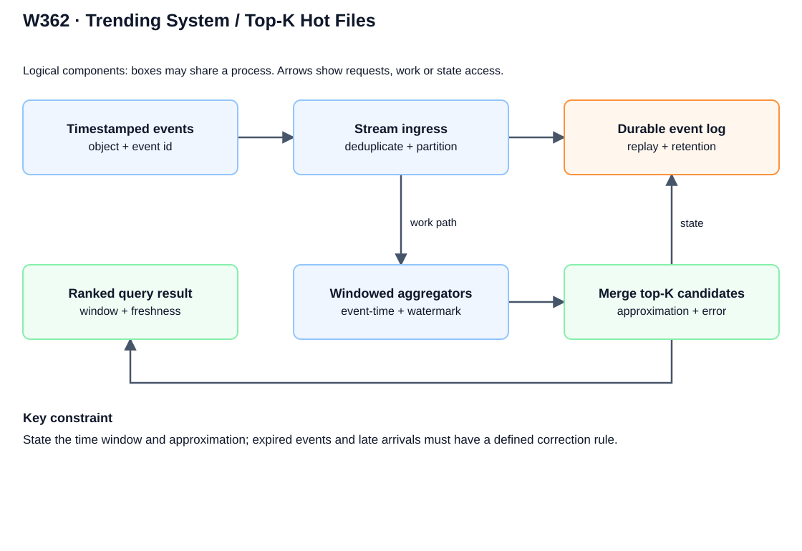

# W362. Trending System / Top-K Hot Files

**Priority group:** Fourth 100 — role-dependent depth

**Category:** Streaming counters and top-K

**Study position:** 362 of 547

[Group list](../FOURTH_100.md) · [All categories](../ALL_CATEGORIES.md) · [Chapter guide](../README.md)

## Question

Trending System / Top-K Hot Files

Design a real-time trending system: ingest a high-volume stream of impression/view events and serve a frequently-updated global top-K list of the hottest items (files, search terms, or articles). Discussion centers on dedup, windowed counting, approximate top-K, and a read path that stays available.

### Requirements

Design a trending / top-K-hot-items service:

Ingest a stream of impression/view events; serve a global (non-personalized) top-K list of the hottest items.
The list refreshes on a short cadence (e.g. minute-level) over a rolling window (e.g. daily).
Discuss dedup (count distinct users per item within the window), high read availability for the list, and how to keep counting tractable at scale.
Notes
A canonical decomposition: serve the top-K list entirely from a distributed cache (no TTL) so reads survive backend hiccups; persist raw events append-only in NoSQL; shard counting via consistent hashing; have each shard report its local top-N each minute and an aggregator merge them into the global top-K.
Approximate-counting structures come up as natural follow-ups for memory bounds: Bloom filters for per-window distinct-user dedup, and Count-Min Sketch for heavy-hitter frequency (be ready to discuss over-estimation bias). Event-frequency-based sampling (sample hot items at a lower rate) is a good optimization to volunteer.
Real QPS for the Figma-specific framing can be low; calibrate to the stated scale and avoid reflexively designing for extreme throughput — over-engineering is penalized. Some interviewers want a particular answer and steer hard, while others reward any well-justified approach once you've hit the expected core.
Has appeared as "top-k hot file," "trending search," and "trending articles" across coding-adjacent and pure design rounds.

## Worked solution

<!-- architecture:W362:start -->
### Architecture and request flow

[Open the diagram at full size](../diagrams/W362_architecture.svg). This is a baseline component diagram for this question. The boxes describe responsibilities; they do not require a separate microservice for every box.

- **Request and state:** Timestamped events — object + event id → Stream ingress — deduplicate + partition. That component consults or updates **Durable event log — replay + retention** under the required access and consistency rules.
- **Work and result:** the work path passes through **Windowed aggregators — event-time + watermark** and **Merge top-K candidates — approximation + error**, producing **Ranked query result — window + freshness**. Bound waiting and retries where a slow dependency can stall this path.
- **Correctness point:** State the time window and approximation; expired events and late arrivals must have a defined correction rule.

When explaining the drawing, trace one normal request first, then a duplicate request, an unavailable dependency and recovery from saved state. If the question requires stricter guarantees or a different scope, state the change explicitly rather than treating this baseline as the only possible design.
<!-- architecture:W362:end -->

### Count distinct viewers, not repeated impressions

Assume a modest file-search deployment first (for example 10k events/s, 1k reads/s) and scale only when measurements require it. Event contract is `{event_id,file_id,user_id,event_time}`; filter unauthorized/deleted files at query time. Popularity is distinct users per file over `[T-24h,T)`, refreshed each minute with deterministic file-id ties. `GET /hot-files?k=` returns counts or estimates, window, as_of, mode. A million views from one user count once; transport dedup and user-distinct dedup are separate.

For exact rolling distinctness, keep `(file,user)->latest_view_time` plus an expiry heap/timing wheel/versioned timers; first live view increments, a repeat refreshes its expiry without increment, and a timeout decrements only if it still matches the latest timestamp. Keep late-event rules and enough previous view history if arbitrary historical queries/corrections are supported; latest-only state answers the current rolling view, not all past snapshots. Partition by file for complete counts, with salted `(file,user)` preprocessing for hot files followed by a full-file reducer. Cache periodic topN and merge only when each file's full count is owned by one shard.

### Approximation has several different error directions

Per-bucket HyperLogLog sketches offer mergeable distinct-user estimates (relative standard error about 1.04/sqrt(m) registers under usual assumptions), union live buckets and expose boundary precision; they do not support exact arbitrary deletions by subtraction. Bloom filters can suppress repeated users compactly, but false positives suppress genuine new viewers, biasing counts **down**, and ordinary filters cannot expire individual entries. Use rotating buckets/counting variants with their retention/error rules or exact checks behind positives. Count-Min estimates nonnegative event frequency **upward** within its epsilon·total bound and cannot by itself compute distinct users or enumerate heavy hitters. Candidate nomination plus exact/estimated distinct counts is a hybrid, not magically exact topK.

Sampling every view from hot files at a lower probability needs recorded inclusion probabilities and a distinct-user estimator consistent with that sampling; naively scaling sampled view counts estimates views, not distinct users. Prefer stable per-(file, user) hash sampling to keep repeat users consistent, then analyze variance/cutoff errors. Use rank stability and human/product validation rather than assuming any sketch's guarantee preserves the exact topK order.

### Read availability and durable recovery

Serve a small complete versioned snapshot from replicated cache, retaining last-good data without automatic TTL deletion to survive backend hiccups. “No TTL” does not mean infinitely fresh: include age, alert/staleness labels and explicitly remove deleted/forbidden files through a separate authoritative filter. Persist snapshots and raw permitted events in append-only durable storage; checkpoint distinct-count state/offsets and replay idempotently. If the cache fails, reload the last complete snapshot, not partially updated sorted-set members.

Example: userA views fileX ten times and userB once; exact score2, while 11 raw impressions is wrong. Refreshing A after 23 h should extend only A's live membership. Test repeated/late views, expiry after a refresh, file deletion, cache/processor outage and sketch-versus-exact sample error. Monitor distinct-state size, lag, estimated error, stale read age and hot-file skew. The performance trade-off is exact per-user state versus bounded sketches/approximate ranking, not whether to keep a blind cumulative counter.

### Further study

- [F168: Design a state-wide temperature ingestion and query system.](../17_distributed_systems_depth.md#f168)
- [F169: Explain backpressure in a multi-stage data pipeline.](../17_distributed_systems_depth.md#f169)
