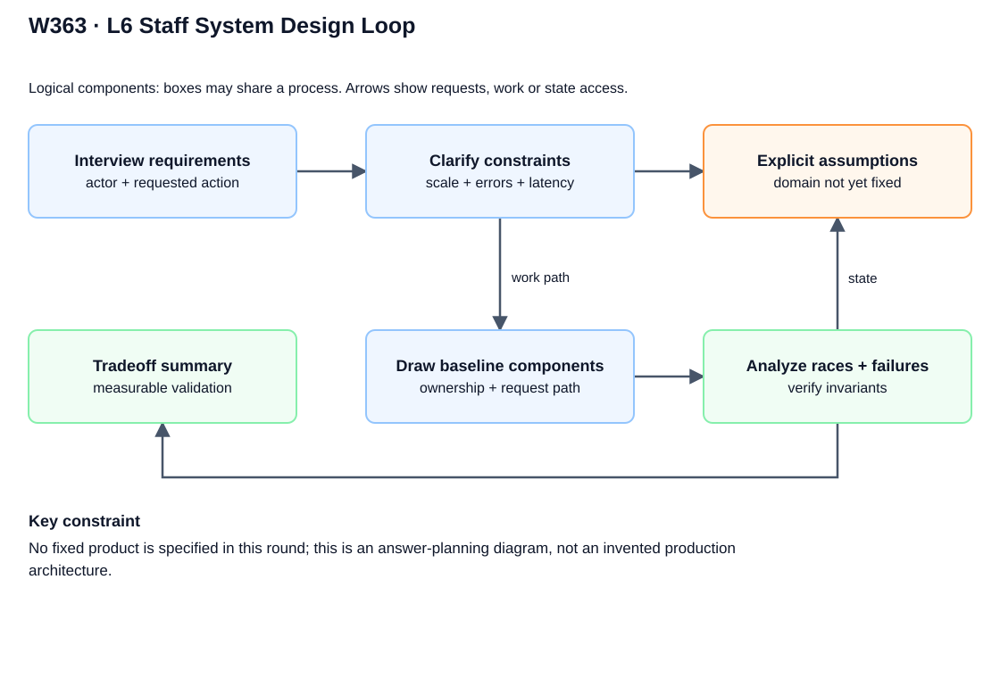

# W363. L6 Staff System Design Loop

**Priority group:** Fourth 100 — role-dependent depth

**Category:** Web services and object design

**Study position:** 363 of 547

[Group list](../FOURTH_100.md) · [All categories](../ALL_CATEGORIES.md) · [Chapter guide](../README.md)

## Question

Google L6 (Staff) onsite includes two 60-min System Design rounds (one infra-leaning, one product-leaning). Common prompts: distributed rate limiter, global real-time notification system, anomaly detection service, Find-My-Device, dictionary range-query store, and global chain-restaurant menu sync. Walk through how you'd structure a Staff-level answer and where the L5→L6 bar actually is.

## Worked solution

<!-- architecture:W363:start -->
### Design scope and component flow

[Open the diagram at full size](../diagrams/W363_architecture.svg). This round does not specify one fixed product. The diagram makes the answer-planning steps explicit; choose the concrete scope before proposing production services.

- **Request and state:** Interview requirements — actor + requested action → Clarify constraints — scale + errors + latency. That component consults or updates **Explicit assumptions — domain not yet fixed** under the required access and consistency rules.
- **Work and result:** the work path passes through **Draw baseline components — ownership + request path** and **Analyze races + failures — verify invariants**, producing **Tradeoff summary — measurable validation**. Bound waiting and retries where a slow dependency can stall this path.
- **Correctness point:** No fixed product is specified in this round; this is an answer-planning diagram, not an invented production architecture.

When explaining the drawing, trace one normal request first, then a duplicate request, an unavailable dependency and recovery from saved state. If the question requires stricter guarantees or a different scope, state the change explicitly rather than treating this baseline as the only possible design.
<!-- architecture:W363:end -->

### Structure the hour around one selected problem

The prompt describes a loop, not a single system or an official published hiring rubric. A useful staff-level answer demonstrates decision quality and scope ownership; exact level assessment depends on interviewers and the actual role. In each 60-minute round spend roughly 0–7min agreeing users/actions/invariants and SLOs, 7–12 quantifying load/state/retention, 12–25 defining API/data/normal request path, 25–45 on the dominant correctness/scaling/failure trade-off, 45–55 on migration/operations/cost and 55–60 on unresolved assumptions and validation. Adjust to probes rather than recite a memorized schedule.

An infra round needs an explicit authority/consistency boundary; a product round also needs user-visible behavior, rollout and product-error costs. For a distributed rate limiter, for example, define hard versus approximate limits, request/token cost, key/window and fail-open/closed behavior before choosing Redis. An atomic token-bucket decrement with idempotency handles same-key concurrency; regional leased budgets improve availability but bound overshoot differently from a global transaction. State those bounds and how degraded operation changes the contract.

### Adapt the deep dive to the actual prompt

| Prompt | A substantive deep dive |
|---|---|
| Global notifications | Durable intent/outbox, subscription fanout, provider idempotency, retries/preferences and duplicates under timeout |
| Anomaly service | Event/feature freshness, seasonal baselines, precision/alert cost, backtesting and delayed labels; no model score equals an incident |
| Find-My-Device | Authenticated owner/device identity, location timestamp/accuracy, privacy/stalking controls, offline device and stale-position semantics |
| Dictionary range store | Ordered-key partitioning, range scans/merge/pagination, skew/splits, snapshot consistency and replication |
| Restaurant menu sync | Versioned menu entities/prices/availability, partial update conflict resolution, offline stores, atomic menu publication and rollback |

Each needs concrete API/schema and a failure trace once selected; this menu is a way to identify the hard subproblem, not a complete substitute design for every product simultaneously. Label assumed scale numbers and recompute when the interviewer changes them.

### Show staff scope through decisions, not more boxes

A solid senior answer often builds a correct service at the requested scale. A staff-strength answer also makes ambiguous cross-team constraints explicit, chooses what **not yet** to build, compares viable alternatives with costs, and owns migration, interfaces, operational risks and failure-domain effects. Explain a phased move from the existing system, compatibility/data backfill verification, canary gates, rollback and owner responsibilities; quantify a decisive trade-off such as global coordination latency versus bounded regional overshoot. Do not assert that all L5 or L6 interviews use one universal checklist.

Walk a normal request, duplicate request, partial failure and recovery against the same invariant. If the fleet/region is partitioned, state which user promise is weakened and why. End with how you would falsify the design using load tests, fault injection and rollout metrics. The retained planning diagram is appropriately an answer-structure diagram here; it must not be mistaken for a specific production architecture absent a selected product.

### Further study

- [F081: Structure an ML system-design answer.](../09_ml_system_design.md#f081)
- [F099: How do you explain a tradeoff under interview pressure?](../10_debugging_and_interview_reasoning.md#f099)
