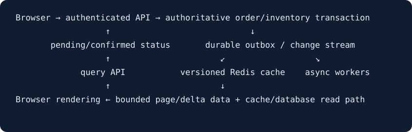

# W364. System Design for Full Stack Applications

**Priority group:** Fourth 100 — role-dependent depth

**Category:** Web services and object design

**Study position:** 364 of 547

[Group list](../FOURTH_100.md) · [All categories](../ALL_CATEGORIES.md) · [Chapter guide](../README.md)

## Question

Design a full-stack application system that requires perfect collaboration between frontend and backend to support large-scale user and data operations. Detail how to handle high-volume data writes and how to optimize frontend performance in large-scale scenarios.

### Requirements

Describe how to efficiently write large volumes of data into a database.
Identify methods to optimize Redis for supporting large-scale data writes.
Explain how the frontend can be optimized in such an environment, including rendering, data fetching, and user interaction.
Note

No specific coding implementation is required, just a comprehensive explanation of the system design strategies.

Example

Consider an e-commerce platform with millions of users purchasing and paying for items simultaneously.

## Worked solution

<!-- architecture:W364:start -->
### Architecture and request flow

[Open the diagram](../diagrams/W364_final_architecture.svg). Authoritative purchase writes commit before derived Redis updates. Redis absorbs appropriate read/derived-state traffic, while batching and partitioning reduce database overhead without bypassing stock or payment correctness. The frontend consumes bounded versioned data and distinguishes optimistic local edits from a confirmed purchase.
<!-- architecture:W364:end -->

### Ground the example in purchase correctness

Use the supplied e-commerce example as a chosen scope: browse/catalog reads, checkout/order/payment writes and UI progress. Assume 100k write requests/s peak and 2 KB/order-intent payload ≈ 200 MB/s raw before indexes/replicas, then replace with measured traffic and average retention. APIs use stable client idempotency keys for checkout/payment, pagination for browsing and server-calculated prices/authorization. Store Order, OrderItem, InventoryReservation, PaymentAttempt and an outbox, with unique logical checkout/payment identities and versioned states. A Redis hit is not authority that a card was charged or inventory was reserved.

### Scale database and Redis writes deliberately

Partition orders by tenant/user/order hash and avoid a hot timestamp-only primary key. Batch independent inserts/events, use prepared statements/connection pools, narrow necessary indexes, append-oriented logs and asynchronous materialized views; WAL/group commit amortizes IO. Keep order creation/reservation invariants in transactions or a documented saga with reconciliation, not an asynchronous queue that claims success before acceptance. An outbox atomically records downstream work with the order. For payment provider timeout, reconcile the same operation id rather than create another charge.

Redis can absorb cache/session/cart/rate state with Cluster hash-slot distribution, hot-key sharding, compact hashes, bounded key sizes, pipelining and batched writes. Pipelining reduces round trips, not the work in one shard; avoid huge blocking commands/scripts and cross-slot multi-key “transactions” that cannot be atomic. Tune expiry with jitter to prevent simultaneous eviction/recompute, use replica/read policy and memory headroom, and measure AOF/replication/durability cost. Write-through preserves cache/DB ordering more simply; write-behind needs a durable queue and recovery because Redis loss must not erase paid orders. Backpressure/quotas and per-shard p99 are more informative than one aggregate ops/s number.

### Make the frontend part of the data contract

Virtualize long product/order lists, paginate/cursor-load server results, lazy-load/code-split routes and images, cache immutable assets via CDN and use appropriately sized images. Keep component state localized, stable row keys and memoization based on measured rerenders; avoid rendering thousands of DOM nodes on each stream event. Debounce search, cancel superseded requests, deduplicate/prefetch bounded requests and invalidate/revalidate caches by resource version. Optimistic cart/like updates can roll back on conflict; payment/order completion waits for authoritative confirmed state, with pending/unknown visibly distinct from success.

Use request ids/revisions to ignore stale out-of-order responses; reconnect progress via cursor rather than resubmit the purchase. Disable duplicate UI submissions as convenience, while server idempotency provides correctness. Show skeleton/progress/error/retry states without a main-thread blocking spinner loop; support accessible interaction and slow networks. Avoid polling every row individually; batch status endpoints or a bounded SSE/WebSocket feed updates only changed records.

### Validate the end-to-end system

Measure click-to-confirmed-order latency, Core Web Vitals/render/main-thread work, network request volume, backend queue/transaction p99, Redis hot-key/eviction/replication lag, payment unknown states and duplicate order/charge rate. Load-test purchase bursts and simulate DB/cache/provider failures. Roll out schema/cache/UI changes with compatibility, canary, reconciliation and rollback. If the cache fails, serve a bounded DB-backed degraded path or shed noncritical reads; never overload the DB with an unlimited cache stampede. The corrected diagram should be browser → API/transactional order DB/outbox with Redis/read views, not a generic interview-planning diagram.

### Further study

- [F081: Structure an ML system-design answer.](../09_ml_system_design.md#f081)
- [F099: How do you explain a tradeoff under interview pressure?](../10_debugging_and_interview_reasoning.md#f099)
