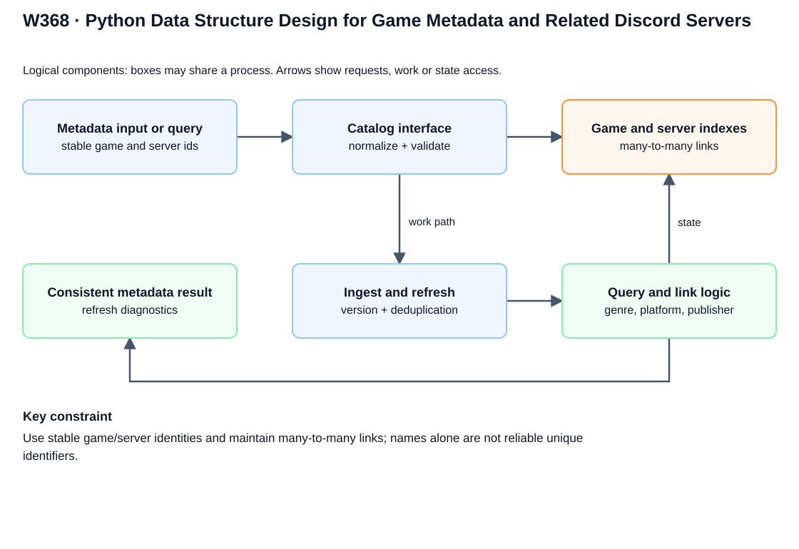

# W368. Python Data Structure Design for Game Metadata and Related Discord Servers

**Priority group:** Fourth 100 — role-dependent depth

**Category:** Algorithms, simulations and geometry

**Study position:** 368 of 547

[Group list](../FOURTH_100.md) · [All categories](../ALL_CATEGORIES.md) · [Chapter guide](../README.md)

<span class="practice-page"></span>

## Question

Python Data Structure Design for Game Metadata and Related Discord Servers

Prompt

Design a data structure (e.g., dictionary/classes/tables) to store game metadata and the corresponding Discord servers relevant to each game.

Game metadata includes (extensible): name, genre, country, release date, platform(s), publisher. The source is external (Wikipedia, etc.).

Explain:

Your data model (keys, dedupe strategy, and how to support queries by name/genre/platform/publisher).
How to link games to Discord servers (many-to-many, primary keys, unique server identifiers).
How you would ingest and refresh from external sources (incremental vs full refresh, missing fields, conflict resolution).

No scraping code required; provide a clear example structure.

## Worked solution

<!-- architecture:W368:start -->
### Architecture and request flow



[Open the diagram at full size](../diagrams/W368_architecture.svg). This is a baseline component diagram for this question. The boxes describe responsibilities; they do not require a separate microservice for every box.

- **Request and state:** Metadata input or query — stable game and server ids → Catalog interface — normalize + validate. That component consults or updates **Game and server indexes — many-to-many links** under the required access and consistency rules.
- **Work and result:** the work path passes through **Ingest and refresh — version + deduplication** and **Query and link logic — genre, platform, publisher**, producing **Consistent metadata result — refresh diagnostics**. Bound waiting and retries where a slow dependency can stall this path.
- **Correctness point:** Use stable game/server identities and maintain many-to-many links; names alone are not reliable unique identifiers.

When explaining the drawing, trace one normal request first, then a duplicate request, an unavailable dependency and recovery from saved state. If the question requires stricter guarantees or a different scope, state the change explicitly rather than treating this baseline as the only possible design.
<!-- architecture:W368:end -->

### Stable identities and a many-to-many relation

Use internal game_id independent of display name and `SourceIdentity(source,external_id)->game_id` for Wikipedia/source ids, with aliases/localizations separated from canonical names. Names alone collide across remakes/platform editions; dedupe by reliable source ids and reviewed release/edition/publisher evidence rather than case-folding titles into one entity. Store unknown country/date as null with source/provenance, not invented defaults. Country may mean development/publisher/release market and needs a declared field meaning.

A clear Python example (all data below is illustrative) is:

```python
games = {
    "g1": {
        "name": "Example Quest",
        "aliases": ["EQ"],
        "genres": {"rpg"},
        "country": None,
        "release_date": "2025-02-03",
        "platform_ids": {"pc", "console-x"},
        "publisher_id": "pub1",
        "metadata_version": 3,
        "sources": {
            "name": ("wiki", "page123", 17),
            "release_date": ("publisher", "release7", 4),
        },
    }
}
servers = {
    "123456789012345678": {
        "name": "Quest Community",
        "invite_url": None,
        "verified_at": None,
    },
    "987654321098765432": {"name": "All RPGs", "invite_url": None, "verified_at": None},
}
# Discord guild snowflake is a stable string id, not an expiring invite URL.
game_servers = {("g1", "123456789012345678"), ("g1", "987654321098765432")}
name_index = {"example quest": {"g1"}, "eq": {"g1"}}
genre_index = {"rpg": {"g1"}}
platform_index = {"pc": {"g1"}, "console-x": {"g1"}}
publisher_index = {"pub1": {"g1"}}
assert name_index["eq"] & platform_index["pc"] == {"g1"}
assert {s for g, s in game_servers if g == "g1"} == set(servers)
```

For a database normalize Game, GameAlias, Genre, Platform, Publisher, GameGenre, GamePlatform, DiscordServer and `GameServer(game_id,guild_id PRIMARY KEY)` with indexed join columns. Reverse guild → games supports a server covering many games; one game can have many language/regional communities. In memory maintain both link-direction sets for O(degree) queries rather than scanning every relation. Name search uses normalized exact alias index plus optional full-text matching; filter queries intersect indexed id sets and return canonical records.

### Refresh incrementally with provenance and atomic indexes

Fetch permitted source change feeds/revisions/ETags where available; otherwise periodic scheduled full comparison. Persist source cursor, revision, content hash, fetch time, parser version and field-level provenance. Upsert by stable external identity, ignore duplicate/older revisions and rederive secondary indexes atomically from the old/new record. A platform change must remove obsolete index membership as well as add new membership. Reconcile periodic full manifests to catch missed deletes; an absent optional field is not necessarily an instruction to erase a more authoritative value.

Choose per-field source precedence/effective dates (for example publisher announcement for date, curated moderation for official guild status), retain conflicting candidates and route consequential identity conflicts for review. Never merge guilds because names match or delete all links merely because an invite expired. Model tombstone/delist and manual overrides separately; rechecks flag inaccessible/mismatched guilds. APIs list/search games, read linked servers and authorized admin refresh/link changes with versions. Test duplicate titles across editions, many-to-many links, missing fields, stale revisions, source deletion and index removal. No scraping implementation or live-source result is required by this prompt.

### Further study

- [F100: How do you practice an unfamiliar ML coding problem?](../10_debugging_and_interview_reasoning.md#f100)
- [F175: Compute cumulative time after deduplicating overlapping intervals.](../18_data_and_sql.md#f175)
