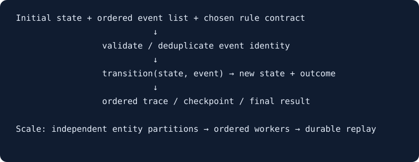

# W369. Simulation-style coding problem with scaling follow-up (mini system design)

**Priority group:** Fourth 100 — role-dependent depth

**Category:** Algorithms, simulations and geometry

**Study position:** 369 of 547

[Group list](../FOURTH_100.md) · [All categories](../ALL_CATEGORIES.md) · [Chapter guide](../README.md)

<span class="practice-page"></span>

## Question

Simulation-style coding problem with scaling follow-up (mini system design)

Implement a simulation-style program: given an initial state and a sequence of events/operations, update the system state in order and output the final result and/or per-step outputs.

### Requirements

First, state and justify your assumed input format (initial parameters, event list, fields per event).
Clearly define the output.
Provide time/space complexity.

Follow-up (scale up): if the number of events and data size grow significantly, or the system must support high concurrency/distributed processing, describe how you would evolve the design:

Algorithm/data-structure optimizations;
Batch vs streaming;
Concurrency control and consistency;
Sharding, queues, caching, fault tolerance, and observability.

Note: since the original prompt is missing, present your solution as a reusable simulation framework with pluggable rule interfaces.

## Worked solution

<!-- architecture:W369:start -->
### Architecture and request flow



[Open the diagram](../diagrams/W369_final_architecture.svg). The unspecified game/domain rules stay in an injected transition function. The executable inventory fixture is one labeled demonstration, not a guessed hidden original problem. Sharding is safe only across independent state owners; events touching shared state still need an explicit common order/transaction.
<!-- architecture:W369:end -->

### A reusable executable contract, with rules injected

The original simulation domain is explicitly missing. Define input as initial JSON-like state plus an already ordered event iterator of dictionaries with string id; the injected pure rule `transition(state,event)->(new_state,output)` defines domain legality. Preserve list order as authoritative; if timestamps are used, require a documented tie order before calling this framework. Return the final state and one result per input occurrence, labeling duplicate replay. A duplicate id with different payload is a conflict. The example rule below is a declared inventory fixture, not an invented original exercise.

```python
from copy import deepcopy


def simulate(initial_state, events, transition):
    """Input events are ordered dicts with unique string id; rules are injected.
    transition(state,event) -> (new_state,output). A duplicate id/payload reuses
    the original output without applying the transition twice.
    """
    state = deepcopy(initial_state)
    seen = {}
    outputs = []
    for index, event in enumerate(events):
        if not isinstance(event, dict) or not isinstance(event.get("id"), str):
            raise ValueError(f"event {index}: string id required")
        identity = event["id"]
        if identity in seen:
            previous, result = seen[identity]
            if event != previous:
                raise ValueError("conflicting duplicate event id")
            outputs.append(
                {"id": identity, "duplicate": True, "result": deepcopy(result)}
            )
            continue
        # Isolated candidate prevents a failing rule from partially mutating state.
        candidate, result = transition(deepcopy(state), deepcopy(event))
        state = candidate
        seen[identity] = (deepcopy(event), deepcopy(result))
        outputs.append({"id": identity, "duplicate": False, "result": deepcopy(result)})
    return {"state": state, "outputs": outputs}


def inventory_rule(state, event):
    # Chosen demonstration only; original domain rules are not supplied.
    item = event["item"]
    quantity = event["quantity"]
    if type(quantity) is not int or quantity <= 0:
        raise ValueError("positive integer quantity required")
    if event["type"] == "receive":
        state[item] = state.get(item, 0) + quantity
    elif event["type"] == "ship":
        if state.get(item, 0) < quantity:
            return state, {"accepted": False, "reason": "insufficient"}
        state[item] -= quantity
    else:
        raise ValueError("unknown event type")
    return state, {"accepted": True, "remaining": state[item]}


if __name__ == "__main__":
    start = {"book": 2}
    events = [
        {"id": "a", "type": "receive", "item": "book", "quantity": 3},
        {"id": "b", "type": "ship", "item": "book", "quantity": 4},
        {"id": "c", "type": "ship", "item": "book", "quantity": 2},
    ]
    result = simulate(start, events + [events[1]], inventory_rule)
    assert (
        result["state"] == {"book": 1}
        and result["outputs"][2]["result"]["accepted"] is False
    )
    assert result["outputs"][3]["duplicate"] and start == {"book": 2}
    assert simulate(start, [], inventory_rule) == {"state": start, "outputs": []}
    try:
        simulate(start, [events[0], dict(events[0], quantity=8)], inventory_rule)
    except ValueError:
        pass
    else:
        raise AssertionError("conflicting id reuse accepted")
    print(
        "W369: final state book=1; rejected shipment, duplicate replay, empty and conflict checks passed"
    )
```

### Example and complexity

Starting book stock2, receive3 gives 5, ship4 gives 1, ship2 is rejected, then a duplicate ship4 reuses its prior result and leaves stock1. Invalid syntax/rule exceptions abort the run; a valid but infeasible business operation can return a rejected output without mutation. Copies isolate caller input and protect current state from a partially mutating failed rule. Tests cover the final result, rejection, exact duplicate, conflict and empty stream.

Let E events, S state size, P event/output payload and R rule cost. This safe generic copy-based reference costs O(E(S+P+R)) time, O(S+E·P) retained state/output/dedup storage, not a falsely claimed O(E) independent of state size. For large data use immutable/persistent structures or transactional write sets, compact state-specific indexes and optional streamed output rather than deep-copying everything. A domain rule that schedules future work uses a priority queue with `(time,tie_id)`; an already ordered input stream needs no heap.

At scale partition by independent entity key and preserve per-key ordering through a durable log. A single-threaded owner or versioned DB transaction linearizes updates; cross-entity invariants need transactions/coordinated saga, not arbitrary partitioning. Atomically checkpoint state+cursor+dedup or replay idempotently; use outbox/stable operation ids for external effects, fencing for stale workers and snapshots to bound recovery. Batch reduces overhead; streaming reduces latency, with backpressure and bounded buffers. Cache only versioned query views, and monitor rejected/duplicate/conflict counts, lag, state size and deterministic replay hashes. Without actual original rules no framework can claim original hidden tests passed.

### Further study

- [F100: How do you practice an unfamiliar ML coding problem?](../10_debugging_and_interview_reasoning.md#f100)
- [F175: Compute cumulative time after deduplicating overlapping intervals.](../18_data_and_sql.md#f175)
