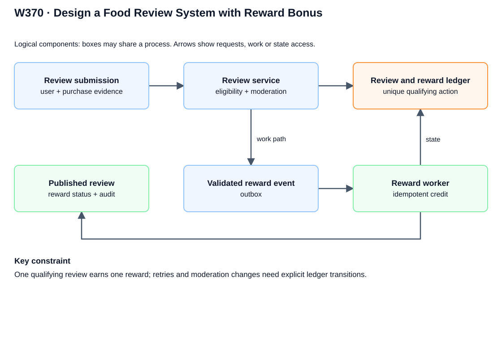

# W370. Design a Food Review System with Reward Bonus

**Priority group:** Fourth 100 — role-dependent depth

**Category:** Business rules and transactional services

**Study position:** 370 of 547

[Group list](../FOURTH_100.md) · [All categories](../ALL_CATEGORIES.md) · [Chapter guide](../README.md)

## Question

Design a food-review system on top of DoorDash orders. A user who completed an order submits one review per item (text, 1-5 star rating, optional photos/video). The system aggregates per-item ratings as a 5-point average + count, lists reviews with like counts (like/unlike), and rewards reviews reaching 100+ likes with DoorDash credit. A variant pairs this with a monthly driver-payout subsystem.

Non-functional: read-heavy (per-item rating reads dominate — cache aggressively); bursty writes (a viral item attracts thousands of reviews); reward credit must be idempotent (rewarded exactly once at the 100-like crossing); multimedia served via CDN with size/type validation and moderation.

## Worked solution

<!-- architecture:W370:start -->
### Architecture and request flow

[Open the diagram at full size](../diagrams/W370_architecture.svg). This is a baseline component diagram for this question. The boxes describe responsibilities; they do not require a separate microservice for every box.

- **Request and state:** Review submission — user + purchase evidence → Review service — eligibility + moderation. That component consults or updates **Review and reward ledger — unique qualifying action** under the required access and consistency rules.
- **Work and result:** the work path passes through **Validated reward event — outbox** and **Reward worker — idempotent credit**, producing **Published review — reward status + audit**. Bound waiting and retries where a slow dependency can stall this path.
- **Correctness point:** One qualifying review earns one reward; retries and moderation changes need explicit ledger transitions.

When explaining the drawing, trace one normal request first, then a duplicate request, an unavailable dependency and recovery from saved state. If the question requires stricter guarantees or a different scope, state the change explicitly rather than treating this baseline as the only possible design.
<!-- architecture:W370:end -->

### Validate purchase eligibility before accepting a review

`POST /orders/{id}/items/{line_id}/review` accepts rating1..5, text, uploaded-media refs and client idempotency key. Check authenticated ownership and completed order/line server-side; choose one review per **order line** with unique(order_id, line_id, author), clarifying whether repeat purchases allow another item review. Store Review(id, order, line, item, author, rating, version, moderation, status), Media(asset, type, size, scan_status), LikeEdge(review, user, liked, version), RatingAggregate(item, sum, count, version), RewardGrant(review UNIQUE, threshold_policy, grant_id, status, credit_ref) and outbox. Read APIs return rating average+count and paginated approved reviews/like state; creator reward status is separate.

Media uploads use scoped signed URLs with declared size/type checks, malware/content moderation and CDN delivery only after approval; untrusted client MIME is insufficient. Review text/rating is pending until moderation passes. An edit/rejection/deletion retracts the old approved rating contribution and adds the new approved one under versioned events. Average is total_sum/total_count, never average of per-shard averages; zero reviews returns no rating. Cache per-item sum/count/average and invalidate/version on changes, with hot-item sharded/coalesced projection updates. Writes remain durable before cached success is advertised.

### Exactly one reward at the qualifying crossing

A review like is desired state with unique(review, user), so duplicates don't increment. Define reward eligibility as first **accepted canonical like-count transition old<100≤new** while review is approved and anti-abuse eligibility holds. In one serialized per-review transaction/CAS, apply the edge transition/count and insert RewardGrant plus outbox under unique(review, policy). A retry or 101 → 99 → 100 re-crossing cannot create a second grant. An eventually consistent display counter is not the sole authority for a monetary threshold; use a correct per-review transition owner or reconcile it against unique accepted edges.

Credit worker sends stable grant_id to the credit ledger's idempotent posting API, records pending/granted/unknown and reconciles timeout with the same id. A local DB row alone cannot guarantee no duplicate external credit if the ledger lacks idempotency/status query. Choose that downstream contract; a crash after credit-before-ack must not retry under a new grant id. At 99 likes two concurrent valid likes lead to count 101 but one grant. Like removal/moderation after a grant needs an explicit versioned reversal/abuse policy, not silently issuing another credit when eligibility returns. Reward amount was not supplied, so configure/report it rather than invent currency values.

### Scale, failure and optional payout variant

Assume 1M reviews/day and 50M review reads/day ≈ 579 reads/s average with large hot-item skew; size caches/CDN and peak rates from measured bursts, not only averages. Partition reviews by item for reads with author/order eligibility indexes; likes by review/user and notification/reward workers have bounded queues/retries. Monitor rating drift, duplicate grants, threshold reconciliation, media backlog, review abuse and cache freshness. Test duplicate review/like, concurrent99 → 100, credit timeout, edited ratings, rejected media and aggregate rebuild from canonical reviews.

A monthly driver payout subsystem is a distinct ledger workflow: freeze eligible completed-delivery/adjustment line items by driver/month, calculate minor-unit amounts using versioned rules, create one payout id, reconcile provider settlement and support audited adjustments. Do not reuse a review-like counter as payable balance. The prompt gives no driver compensation formula, so the architecture can share idempotency/outbox/ledger discipline but cannot compute payouts without those inputs.

### Further study

- [F165: Design idempotency for an order or booking API.](../17_distributed_systems_depth.md#f165)
- [F069: Audit human-labeled training data before scaling it.](../07_evaluation_and_data.md#f069)
