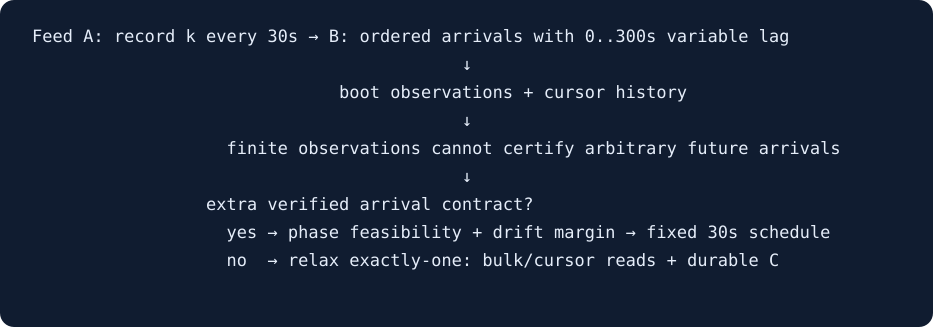

# W372. Design a Polling Schedule with a Boot State and a Live State

**Priority group:** Fourth 100 — role-dependent depth

**Category:** Coding, concurrency and application structure

**Study position:** 372 of 547

[Group list](../FOURTH_100.md) · [All categories](../ALL_CATEGORIES.md) · [Chapter guide](../README.md)

<span class="practice-page"></span>

## Question

A live feed produces one record every 30 seconds. The records pass through two stores before they reach a database you control, and the second hop is slow and of unknown shape. Design the procedure that reads them with a fixed schedule, so that every scheduled read returns exactly one new record and the copy in your database stays as fresh as possible.

Setting
1. The feed writes record k (k = 0, 1, 2, ...) into store A at time 30k seconds. Every record has an integer id equal to k and a data field.
2. A is a black box: it cannot be read or changed.
3. A is copied into database B. Record k becomes readable in B at time b_k = 30k + d_k, where the lag satisfies 0 &lt;= d_k &lt;= 300 seconds. Records reach B in id order (b_k never decreases with k) and none is lost. Nothing else is promised about the pattern of the lags: they may be constant, jittery, or arrive in batches.
4. B can be read but not changed. B stores no timestamps. A read can ask for all records with id greater than a given id, or for one record by id.
5. You fully control database C and the process that fills it. A poll reads B once, instantly and at no cost. C keeps a cursor, the highest id it has stored. A poll at time T returns every record with id above the cursor that is readable in B at T; C stores them and moves the cursor. C only knows its own clock, not A's.
6. The copy behaviour of B is the same in the test environment and in production. In the test environment C runs the same polling code against a copy of the feed.
States
1. Boot state (test environment): the polling rate may change freely and polls that return the wrong number of records are ignored. It exists to learn about B.
2. Live state (production): polls run on a fixed schedule with interval x seconds. A poll fails when it returns 0 records or 2 or more records. No failure is acceptable.
3. Freshness: the staleness of a record is the time from b_k until the first poll that returns it. In the live state the worst-case staleness should be as small as possible.
What to decide
1. What C does in the boot state, and what it measures.
2. The exact condition under which C moves from boot to live.
3. The live poll interval x and the times at which live polls run, with a justification that no poll fails and that staleness is as small as that allows.
4. What C does when the boot state shows that no live schedule can avoid failures.

The phase of a live schedule is the time of its first poll, taken modulo the interval x. Two schedules with the same interval and the same phase poll at the same moments of every cycle.

### Examples

1. Every record reaches B exactly 47 seconds after it was written (d_k = 47). Any interval of 30 seconds is failure free at every phase, because each 30 second window then holds exactly one arrival. Polling at 30j + 48 seconds keeps each record 1 second stale.
2. Even records reach B 10 seconds after they were written and odd records 25 seconds after. A 30 second schedule is failure free only for phases in [25, 40) seconds modulo 30. Starting at phase 25 seconds leaves the earliest-arriving record 15 seconds stale.
3. Records reach B in pairs, records 2m and 2m+1 together at time 60m + 50 (record 2m has a lag of 50 seconds and record 2m+1 a lag of 20). Every poll that sees one record of a pair sees both, so no interval and no phase avoids failures.

### Constraints

The feed rate is exactly 1 record per 30 seconds and the lag bound is 300 seconds.
The boot state may run for several minutes but not for ever. Polls need not be rate limited in the boot state.
Clocks on the machines running C run at a rate within 50 parts per million of the feed's clock.
Follow-up 1: arrivals that no schedule can poll cleanly

Take the case of example 3, or any pattern whose arrivals are spread over 30 seconds or more. Define a read contract and a schedule for which no poll ever fails, say what it costs in staleness, and say what C can do if boot never gets to observe the pattern at all.

Follow-up 2: staying failure free for weeks

The live schedule must keep working while the clocks drift. State how long a schedule lasts without correction, how to schedule the polls so that errors do not add up, and what the live process does when its own assumptions stop holding.

## Worked solution

<!-- architecture:W372:start -->
### Architecture and request flow



[Open the diagram](../diagrams/W372_final_architecture.svg). Boot can estimate observed arrival phases, but finite observations cannot prove a forever-correct schedule under the original arbitrary-lag assumptions. With an additional valid arrival envelope, choose a feasible phase and account for drift. Otherwise change the read contract, rather than claim adaptive backoff guarantees exactly one result.
<!-- architecture:W372:end -->

### Under the stated assumptions, finite boot cannot certify a failure-free live mode

Write arrivals in one idealized clock as $b_k=a+30k+d_k$, with unknown feed epoch a and 0≤d_k≤300. If a fixed live interval x returns exactly one new record forever, cumulative arrivals and polls differ only by a bounded startup amount. Bounded lag gives arrival rate1/30, while the polls consume1/x, so **x=30 seconds** is necessary in feed-clock time. A different interval eventually runs out or accumulates records.

Let its poll assigned to record k be $p_k=a+30k+\theta$. Because a poll includes records readable at that instant, exactly one requires $p_{k-1}<b_k\le p_k$, equivalent to $d_k\le\theta<d_k+30$ for every k. Hence a known entire pattern permits a phase iff

$$\boxed{\sup_k d_k\le\theta<\inf_k d_k+30},\qquad \boxed{\sup d-\inf d<30}.$$

For an infinite pattern where sup/inf endpoints are not attained, write the individual strict inequalities rather than carelessly discard endpoint subtleties; the robust positive-slack condition above is the useful operational one. Worst staleness is sup(θ-d_k). With a known attained max and no drift, choose θ=max d and achieve range(max d−min d); any earlier phase misses that max-lag arrival, and a later phase only increases every staleness.

### What boot actually measures, and why the transition condition is missing

Poll frequently and track id-specific last-absent/first-present times, giving intervals for each b_k, then subtract30k (in calibrated clock units) to estimate aligned arrival offsets without reading A. Detect duplicates/batches and maintain an uncertainty-aware feasible phase intersection. A finite observed range≥30 or a simultaneous pair proves no phase fits those observations. An observed range<30 only shows a phase fits **the past**: any finite fixed-lag boot prefix can be followed by the allowed batch pattern, with the same copying behavior in test and production interpreted as one unknown process. “Same behavior” does not promise a known finite period, stationarity envelope or that rare failures have already appeared.

Thus there is **no exact finite-data-only boot → live condition guaranteeing the original no-failure requirement**. Remain in boot/reject that strict mode unless an independently justified future arrival envelope/periodic contract and clock-phase bound are supplied. A finite boot timeout returns “uncertifiable/unsupported,” not a guessed safe phase. Transfer from a test clock to production also needs a production epoch/rate calibration; shared lag behavior alone does not transfer absolute clock phase.

The helper below computes only the **observed** feasible interval and demonstrates the counterexample; it must not be called a future guarantee.

```python
def feasible_phase(arrivals, period=30.0):
    """Observed indexed arrivals only; cannot certify unobserved future lags."""
    if not arrivals:
        raise ValueError("observations required")
    aligned = [time - period * index for index, time in arrivals]
    lower = max(aligned)
    upper = min(aligned) + period
    return (lower, upper) if lower < upper else None


def poll_counts(arrivals, first, period, polls, cursor=-1):
    counts = []
    for j in range(polls):
        now = first + j * period
        ready = [i for i, t in arrivals if i > cursor and t <= now]
        counts.append(len(ready))
        if ready:
            cursor = max(ready)
    return counts


if __name__ == "__main__":
    fixed = [(k, 30 * k + 47) for k in range(100)]
    assert feasible_phase(fixed) == (47, 77)
    assert poll_counts(fixed, 47, 30, 100) == [1] * 100
    jitter = [(k, 30 * k + (10 if k % 2 == 0 else 25)) for k in range(100)]
    assert feasible_phase(jitter) == (25, 40)
    assert poll_counts(jitter, 25, 30, 100) == [1] * 100
    pairs = [(k, 60 * (k // 2) + 50) for k in range(100)]
    assert feasible_phase(pairs) is None
    assert poll_counts(pairs, 50, 30, 4) == [2, 0, 2, 0]
    # Same finite boot prefix, incompatible future: an allowed batching suffix.
    boot = [(k, 30 * k + 10) for k in range(10)]
    assert feasible_phase(boot) == (10, 40)
    future = boot + [(10, 350), (11, 350)]
    assert feasible_phase(future) is None
    print(
        "W372: phase intervals, exact boundaries, batched impossibility and finite-boot counterexample passed"
    )
```

### Apply the examples and relax the contract when necessary

Constant d47 yields θ∈[47, 77), all phases modulo30, and θ47 gives zero ideal staleness (θ48 gives the example's1 s). Alternating10/25 yields θ∈[25, 40), modulo30 the union[25, 30)∪[0, 10), with θ25 worst15 s. Paired arrivals yield no phase: any poll sees either0 or 2 from a pair, and changing x cannot separate simultaneous arrivals.

The freshest robust alternative is to allow a poll to return **zero or more** new records and store the batch idempotently. Poll every chosenδ (e.g.1 s), so staleness after availability is at mostδ plus scheduling/clock error, and batches are not failures. It works even if boot never observes the rare pattern. If exactly one returned record is indispensable, change B's read contract to `get(cursor+1)` and deliberately delay to the latest guaranteed availability: with known feed epoch, poll record k at a+30k+300, giving staleness300−d_k≤300 s. With only arrival-derived epoch interval[a_low, a_high], schedule at a_high+30k+300, yielding bound300+(a_high−a_low), up to 600 s before better calibration. Buffering a batch in C and releasing one record/30 s also changes “scheduled read of B” into a different contract and must be named as such.

### Clock drift and weeks of operation

At 50ppm, phase error can grow4.32 s/day against the feed; two independently bounded C clocks can differ by up to 100ppm when transferring calibration. Schedule absolute deadlines t0+n·30 on a monotonic clock, not `sleep(30)` after work, to avoid extra accumulated execution-time error. Absolute scheduling does not remove oscillator-rate drift.

For a certified envelope with spread R<30 choose θ=max d+g, 0<g<30−R. Initial phase slack is min(g, 30−R−g); with drift bound ρ and initial calibration uncertainty e, guaranteed horizon is at most(slack−e)/ρ. Centering maximizes slack; constant lag permits15 s ideal slack and at 50ppm about 3.47 days without resynchronization. Freshness-optimal θ=max d has zero slack on one boundary and is not robust for weeks. Bound residual clock discipline/resync often enough, preserve cursor across correction and avoid double/skip polls. If the envelope/clock certificate expires or health checks detect violation, leave strict-live mode **before** its guarantee is lost or use the relaxed batch contract; observing a failed poll and retrying cannot retroactively satisfy “no failure.”

### Further study

- [F032: Implement the scheduling core of a dynamic batcher.](../04_serving_and_training_systems.md#f032)
- [F100: How do you practice an unfamiliar ML coding problem?](../10_debugging_and_interview_reasoning.md#f100)
