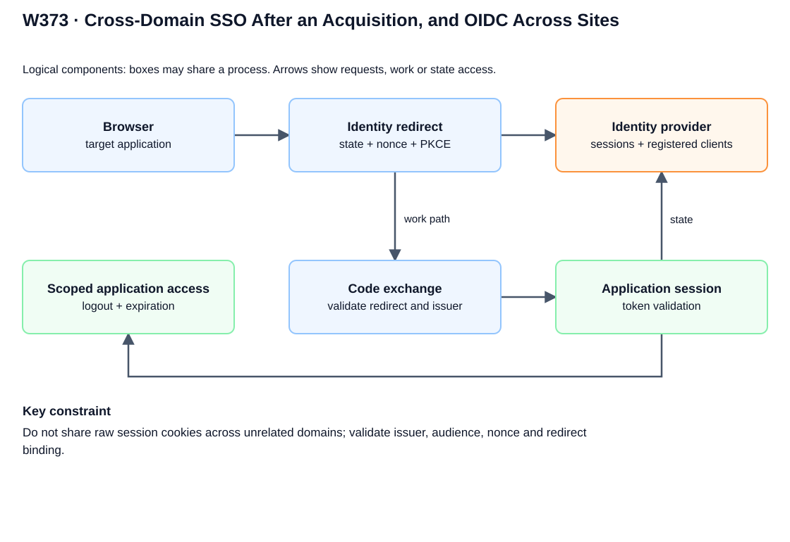

# W373. Cross-Domain SSO After an Acquisition, and OIDC Across Sites

**Priority group:** Fourth 100 — role-dependent depth

**Category:** Configuration, identity and authorization

**Study position:** 373 of 547

[Group list](../FOURTH_100.md) · [All categories](../ALL_CATEGORIES.md) · [Chapter guide](../README.md)

## Question

Design single sign-on across two unrelated domains, then generalise it to OpenID Connect (OIDC) across several sites with delegated access to third-party tools.

Part 1 — Cross-domain single sign-on

A business owns foo.com and has just acquired bar.com. A user who signs in on either domain must be signed in on the other domain automatically, with no second password prompt.
1. Explain why one session cookie cannot cover both domains.
2. Design the sign-in flow. Give every redirect, the request parameters, and where each session is stored.
3. Design sign-out so that signing out on one domain ends the session on both.
4. List the attacks the flow must resist (for example open redirects, token replay and CSRF) and how the design prevents each one.
Part 2 — OIDC across multiple sites

The company now runs several sites that must share one login.
1. Design the architecture: the identity provider, the relying parties and the tokens each one holds.
2. Give the OIDC flow that each site uses, and explain the purpose of the ID token, the access token and the refresh token.
3. Inside the app, a signed-in user must be able to grant the app access to certain third-party tools. Design the authorisation flow, the scopes, and how the app stores and refreshes the third-party tokens.
Output

Sequence diagrams (or numbered message lists) for each flow, and the reason for each security-relevant choice.

## Worked solution

<!-- architecture:W373:start -->
### Architecture and request flow

[Open the diagram at full size](../diagrams/W373_architecture.svg). This is a baseline component diagram for this question. The boxes describe responsibilities; they do not require a separate microservice for every box.

- **Request and state:** Browser — target application → Identity redirect — state + nonce + PKCE. That component consults or updates **Identity provider — sessions + registered clients** under the required access and consistency rules.
- **Work and result:** the work path passes through **Code exchange — validate redirect and issuer** and **Application session — token validation**, producing **Scoped application access — logout + expiration**. Bound waiting and retries where a slow dependency can stall this path.
- **Correctness point:** Do not share raw session cookies across unrelated domains; validate issuer, audience, nonce and redirect binding.

When explaining the drawing, trace one normal request first, then a duplicate request, an unavailable dependency and recovery from saved state. If the question requires stricter guarantees or a different scope, state the change explicitly rather than treating this baseline as the only possible design.
<!-- architecture:W373:end -->

### Cross-domain login uses a common identity authority

A cookie for foo.com cannot be scoped to unrelated bar.com; Domain cookies cover an allowed domain suffix, not arbitrary owners. Put a shared identity provider at `login.company.example` and register foo/bar as separate relying-party clients with exact HTTPS callbacks. Each app stores its own server session and host-only Secure, HttpOnly cookie; IdP has its own login cookie. The browser establishes bar's local session when it visits bar and follows an IdP redirect without another password. Foo cannot directly set bar's cookie, and cross-site iframes/third-party cookies are not a reliable prerequisite.

Numbered authorization-code flow for **each** app:

1. Browser → foo `/login`; foo creates a short-lived login transaction with random state, nonce, PKCE verifier and intended local return path.
2. Foo → browser302 to IdP `/authorize?response_type=code&client_id=foo&redirect_uri=https%3A...foo...callback&scope=openid%20profile&state=S&nonce=N&code_challenge=C&code_challenge_method=S256`.
3. IdP authenticates once (or reuses its existing SSO session), obtains required consent and 302 redirects to foo callback with single-use code and matching state.
4. Foo checks the browser-bound state, then server → IdP token endpoint exchanges code, exact redirect_uri, client authentication and code_verifier overTLS.
5. Foo verifies ID-token signature/trusted issuer, audience/azp, expiry and nonce, maps `(issuer,subject)` to its account, rotates/creates local session and redirects only to an allowlisted local return path.
6. Visiting bar repeats its own transaction/client/callback; IdP's session avoids a second password, and bar receives its own tokens/session, never foo's raw cookie.

ID token is an identity assertion to that relying party; access token authorizes its audience's API; a refresh token, if issued, obtains new tokens and stays server-side. Do not send an ID token as a generic API bearer credential or merge accounts merely by unverified matching email. These distinctions follow [OIDC Core](https://openid.net/specs/openid-connect-core-1_0.html).

### Logout is server invalidation, not cookie magic

A CSRF-protected logout on either app invalidates its local session and initiates IdP end-session. IdP marks the shared session revoked and sends signed back-channel logout tokens to registered apps; each validates issuer, audience, event/subject-or-sid and replay identity, then invalidates matching local sessions. Browser cookies on other domains may remain physically present but no longer map to valid sessions. Use a durable delivery/retry ledger and idempotent logout consumers. The mechanism is defined by [OIDC Back-Channel Logout](https://openid.net/specs/openid-connect-backchannel-1_0.html).

Instant cross-site logout during a partition cannot be guaranteed by asynchronous notifications alone. To require immediate enforcement, apps check a central session/revocation epoch on protected requests and fail closed if it is unavailable; otherwise state the bounded session-cache/token lifetime during which revocation may lag. A self-contained unexpired access token may remain usable unless the resource checks revocation or its short expiry ends; logout does not universally revoke every third-party grant.

### Delegated third-party tools are a separate authorization grant

When a signed-in user selects “connect tool,” create a browser/user-bound OAuth transaction with state, PKCE and exact registered callback to that tool provider. Redirect for consent to only required scopes (read versus send/delete separately); exchange returned code server-side and bind the grant to local user, provider account, scope and token audience. Encrypt refresh/access tokens in a secrets store, keep them out of browser/logs, refresh with concurrency control and rotation/reuse detection where supported, and provide disconnect/revocation. An app SSO session is not consent to every tool. Verify current local permissions before each delegated action and handle expired/revoked grants with reconnection rather than silently widen scopes.

Use short-lived single-use codes, exact redirect matching, state/nonce/PKCE, HTTPS, issuer/key/audience validation and allowlisted local return paths against CSRF, code interception, mix-up, open redirects and replay. Protect sessions from fixation/XSS with rotation/cookie controls; keep user-controlled claims out of authorization decisions. Use least privilege and sender-constrained/rotating tokens when supported, consistent with [OAuth Security BCP](https://www.rfc-editor.org/rfc/rfc9700.html).

### Further study

- [F165: Design idempotency for an order or booking API.](../17_distributed_systems_depth.md#f165)
- [F170: Design a cache without serving incorrect data.](../17_distributed_systems_depth.md#f170)
