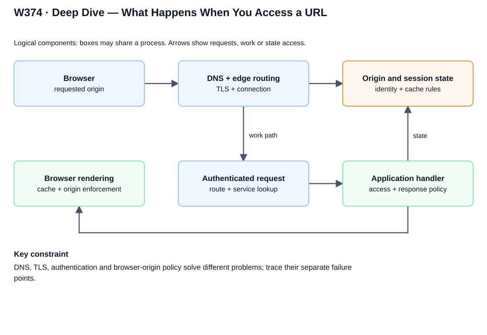

# W374. Deep Dive — What Happens When You Access a URL

**Priority group:** Fourth 100 — role-dependent depth

**Category:** Configuration, identity and authorization

**Study position:** 374 of 547

[Group list](../FOURTH_100.md) · [All categories](../ALL_CATEGORIES.md) · [Chapter guide](../README.md)

## Question

Deep Dive — What Happens When You Access a URL

Open-ended deep-dive round: explain everything that happens when you enter a URL in a browser. The interviewer probes wherever you go — DNS, CDN, service discovery, authentication, inter-service communication protocols — so steer toward areas you can defend in depth.

### Requirements

Open discussion: when you access a URL (e.g. www.example.com) in a browser, what happens end to end? Expect drill-downs into:

DNS resolution and how it works in detail.
CDN / edge caching behavior.
Service discovery and how services locate one another.
Authentication.
Communication protocols between services/components.
Notes
It is a genuinely open round with no fixed script — questions can feel random, and the interviewer will keep digging into whatever you raise. Candidates who opened broad got pulled into details they couldn't answer.
The winning strategy is to deliberately drive the conversation toward subsystems you know cold and go deep there, rather than spreading thin across the whole stack.

## Worked solution

<!-- architecture:W374:start -->
### Architecture and request flow

[Open the diagram at full size](../diagrams/W374_architecture.svg). This is a baseline component diagram for this question. The boxes describe responsibilities; they do not require a separate microservice for every box.

- **Request and state:** Browser — requested origin → DNS + edge routing — TLS + connection. That component consults or updates **Origin and session state — identity + cache rules** under the required access and consistency rules.
- **Work and result:** the work path passes through **Authenticated request — route + service lookup** and **Application handler — access + response policy**, producing **Browser rendering — cache + origin enforcement**. Bound waiting and retries where a slow dependency can stall this path.
- **Correctness point:** DNS, TLS, authentication and browser-origin policy solve different problems; trace their separate failure points.

When explaining the drawing, trace one normal request first, then a duplicate request, an unavailable dependency and recovery from saved state. If the question requires stricter guarantees or a different scope, state the change explicitly rather than treating this baseline as the only possible design.
<!-- architecture:W374:end -->

### Walk one URL all the way to a page

Parse scheme, hostname, port, path, query and fragment; the fragment stays client-side. A bare name needs browser policy to choose a scheme/search; assume `https://www.example.com/`. Browser may upgrade viaHSTS and satisfy the request from a valid cache/service-worker response. Otherwise it reuses a suitable existing connection or resolves the hostname using browser/OS caches and a configured recursive DNS resolver. The resolver follows root → TLD → authoritative delegation on cache misses, obtains A/AAAA (possibly via CNAME/HTTPS records) and caches withTTL. The browser typically races usableIPv6/IPv4 paths; DNS routing can select a CDN edge rather than the origin.

For HTTP/1.1 orHTTP/2 HTTPS, establish TCP thenTLS (or resume), validate certificate chain/hostname/time and negotiate protocol viaALPN; HTTP/3 usesQUIC overUDP withTLS1.3 integrated. TLS protects transport and authenticates the server; it does not prove the application user may access an order. A CDN terminates a declaredTLS boundary, checks cache key/method/headers/freshness and either returns a hit or forwards a miss to the origin/load balancer. Private/personalized responses must not enter a public cache under an incomplete key; respect Cache-Control, Vary and authorization/cookie policy.

The load balancer selects a healthy eligible backend with deadlines/connection limits. The handler authenticates session/token, authorizes the resource, validates input and calls downstream services/data stores. Service discovery maps a logical name to changing endpoints viaDNS, registry or proxy/service mesh; it is not the same as the public domain'sDNS authority. HTTP/JSON, gRPC overHTTP/2 or durable asynchronous messages fit different synchronous/stream/retry needs. Propagate trace/deadline/verified identity, not arbitrary spoofable headers, and retry only safe/idempotent operations.

The response returns status, headers and bytes, possibly compressed/streamed. Browser follows redirects under origin policy, parsesHTML intoDOM andCSS intoCSSOM, executes/defer-loads scripts, fetches subresources, computes layout, paints and composites. Script/layout work can delay interactivity after network completion. Cookies, CORS/CSP and same-origin restrictions govern browser behavior separately from server authorization. Rendering repeats incrementally as resources/scripts arrive.

### Go deep on DNS without conflating caches and truth

A recursive resolver performs recursion for the client; root/TLD/authoritative servers usually give referrals/authoritative records. NS records delegate, MX serves mail, TXT can carry verification, CAA constrains certificate issuance and A/AAAA supply addresses. TTL limits ordinary cache freshness but is not an immediate invalidation broadcast. Negative answers also cache under their rules. DNSSEC authenticates DNS data when correctly validated, not encryption orHTTP user identity; encrypted DNS protects the resolver path under its trust model.

ShortTTLs speed endpoint changes but increase lookup load and do not guarantee every client honors instant failover; longerTTLs improve cache hit/availability but prolong stale routing. GeoDNS can choose based on resolver/client-location hints yet suffers cache granularity, while anycast announces the same IP from many edges and lets routing choose a path that is not necessarily lowest application latency. A failedDNS lookup, TLS validation, erroring origin and blocked browser cross-origin read are different incidents. Instrument DNS/connect/TLS/TTFB/render timings and trace one cache hit, one miss and one authentication failure before expanding the design.

### Further study

- [F165: Design idempotency for an order or booking API.](../17_distributed_systems_depth.md#f165)
- [F170: Design a cache without serving incorrect data.](../17_distributed_systems_depth.md#f170)
