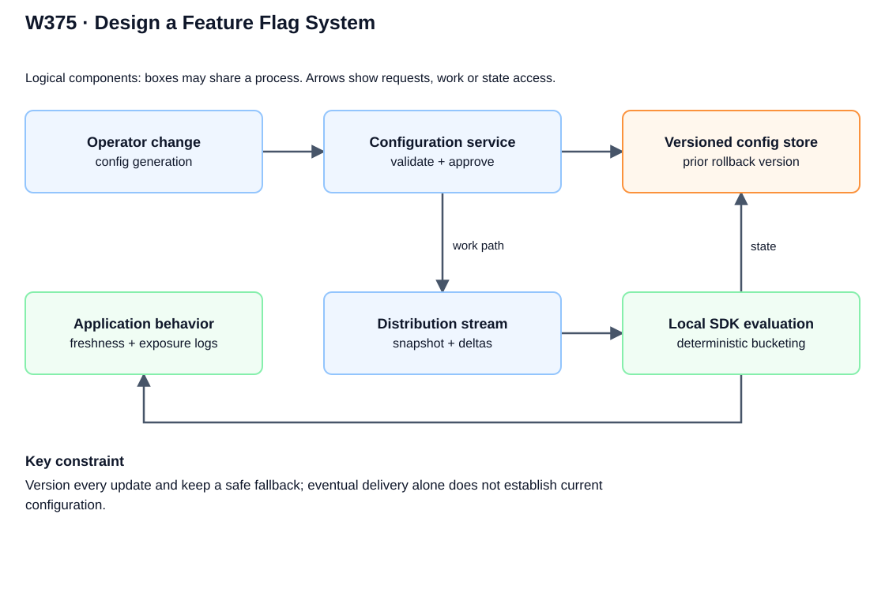

# W375. Design a Feature Flag System

**Priority group:** Fourth 100 — role-dependent depth

**Category:** Configuration, identity and authorization

**Study position:** 375 of 547

[Group list](../FOURTH_100.md) · [All categories](../ALL_CATEGORIES.md) · [Chapter guide](../README.md)

## Question

Build a feature-flag platform that lets engineers roll out flags by percentage or user attribute, evaluated cheaply at scale on the server-side request path.

Functional requirements:

API for defining/updating flag rules (boolean, percentage rollout, attribute-based targeting).
A flag-evaluation API on the hot request path that is sub-millisecond at high QPS — evaluation cannot become a request-path bottleneck.
Consistent percentage rollouts (same user → same answer across requests).
Runtime rule updates that propagate in seconds without rebooting client services.
Audit logs and an emergency kill-switch.

Scale targets: tens of thousands of evaluations/sec per cluster; update fan-out to many services; eventual consistency on the order of seconds is acceptable.

Key decisions to surface: push vs. pull vs. hybrid rule delivery; centralized eval service vs. in-process SDK with cached rules; how percentage rollouts stay stable (hashing strategy and salt); how to bound the blast radius of a bad rule (staging, canary, kill-switch).

## Worked solution

<!-- architecture:W375:start -->
### Architecture and request flow

[Open the diagram at full size](../diagrams/W375_architecture.svg). This is a baseline component diagram for this question. The boxes describe responsibilities; they do not require a separate microservice for every box.

- **Request and state:** Operator change — config generation → Configuration service — validate + approve. That component consults or updates **Versioned config store — prior rollback version** under the required access and consistency rules.
- **Work and result:** the work path passes through **Distribution stream — snapshot + deltas** and **Local SDK evaluation — deterministic bucketing**, producing **Application behavior — freshness + exposure logs**. Bound waiting and retries where a slow dependency can stall this path.
- **Correctness point:** Version every update and keep a safe fallback; eventual delivery alone does not establish current configuration.

When explaining the drawing, trace one normal request first, then a duplicate request, an unavailable dependency and recovery from saved state. If the question requires stricter guarantees or a different scope, state the change explicitly rather than treating this baseline as the only possible design.
<!-- architecture:W375:end -->

### Put evaluation in the process, distribution off the hot path

At tens of thousands evaluations/s, sub-millisecond target favors an in-process SDK reading an immutable compiled rule snapshot, not a network RPC for each flag. Control APIs create/update/publish/rollback flags with expected revision; store `Flag(id,environment,type,default,ordered_rules,rollout_salt,owner,revision,status)` plus audit and immutable snapshot hashes. Validate types, operator/regex cost, bounds, missing-attribute behavior and rule precedence (for example emergency disabled → explicit deny/allow → ordered attribute rules → percentage → default). Keep arbitrary user code out of rules and authorization/security invariants outside optional product flags.

For percentage rollout compute a specified cross-language hash of `(environment,flag_id,stable_salt,unit_id)` mapped to[0, 1), then enable when h<p. Keep the salt stable across **rule revision/percentage** changes; including every new revision in the hash would reshuffle cohorts.20%→30% monotonically adds users whose h is in [.2, .3), with existing cohorts stable. Specify user/account/session unit; missing identity needs an explicit default rather than randomizing each request. Attribute targeting can override percentage under the declared rule order, and changing attributes can legitimately change a result.

### Push notifications plus authoritative pull

SDK starts from a verified snapshot/local last-known-good file, fetches current environment generation, and subscribes to an ordered change/version stream. Push a small generation/digest hint, then pull signed/hashed immutable snapshot/delta; a missed event triggers periodic poll/version-gap recovery. Apply a whole compatible snapshot atomically so one request cannot observe half of two revisions. SDKs report generation/lag/health; rollout stages can canary rule evaluation and shadow comparisons before broad publish. If offline, continue the documented safe default/last-known-good policy, mark stale and reconnect with backoff/jitter.

An emergency kill switch is a high-priority versioned override bypassing normal bake stages, with reserved distribution capacity and short reconciliation polls. It still takes network/SDK propagation time; it cannot instantly alter an isolated process. Critical unsafe actions may need independent fail-closed server authorization rather than a stale local flag. Rollback publishes a **new generation pointing to old immutable rules**, so clients do not reject it as an out-of-order lower generation.

### Scale and verify

Assume 100kSDK instances and 50 KB snapshots: one full fanout is 5 GB; small version hints/deltas and regional cache tiers reduce origin pressure. Evaluation O(number_of_rules_checked) stays bounded through compiled indexes, limited rule count and no per-eval synchronous logs; asynchronously sample exposures/decision reasons by flag/generation while preserving needed experiment semantics. Reject concurrent stale edits with 409, keep actor/reason/audit and test compatibility across SDK versions.

Measure local evalp99, CPU/allocation cost, rule-count worst case, distributionp95/max lag, stale SDKs, kill-switch convergence and error/default rates. Test hash parity across languages, percentage boundaries, missing attributes, invalid rules, lost/duplicate/out-of-order updates, offline bootstrap and rollback. The diagram's config store → distribution → local evaluator expresses this exact separation; eventual notifications alone are not configuration authority.

### Further study

- [F087: Design an online model rollout with rollback.](../09_ml_system_design.md#f087)
- [F170: Design a cache without serving incorrect data.](../17_distributed_systems_depth.md#f170)
