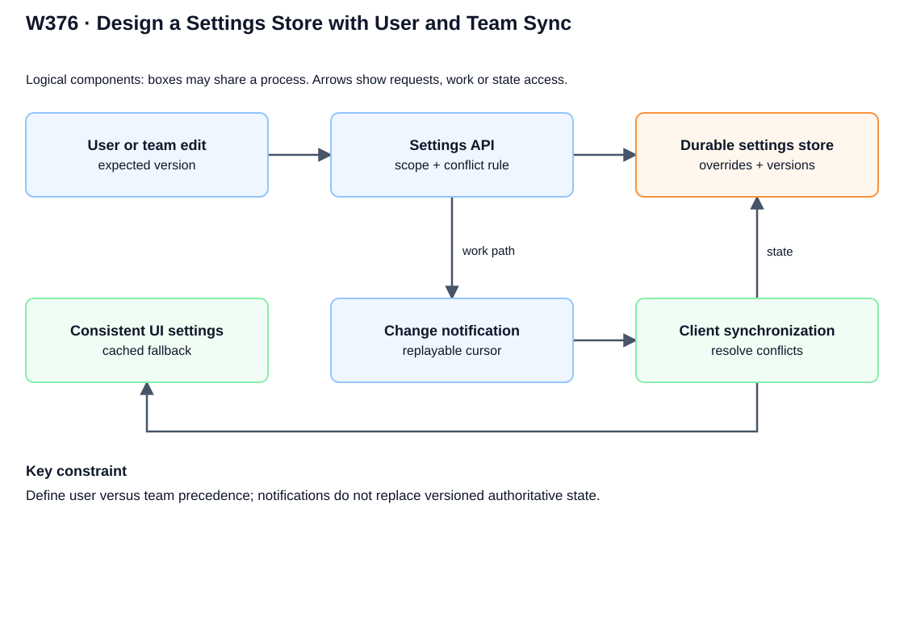

# W376. Design a Settings Store with User and Team Sync

**Priority group:** Fourth 100 — role-dependent depth

**Category:** Configuration, identity and authorization

**Study position:** 376 of 547

[Group list](../FOURTH_100.md) · [All categories](../ALL_CATEGORIES.md) · [Chapter guide](../README.md)

<span class="practice-page"></span>

## Question

Design a service that stores the settings of a code editor and keeps every copy of the editor up to date. A person has personal settings, and a team has shared settings that its administrators can push to every member. The editor must start with the right settings, keep working offline, and converge when it comes back online.

What to design

A settings store and sync system with two entities, User and Team. A user belongs to exactly one team at a time, and each user runs the editor on several devices. Give the data model, the API, the sync protocol between server and device, and the failure behaviour.

### Rules

1. A setting is a key (for example editor.fontSize) with a JSON value. A User has personal settings. A Team has team settings.
2. The settings a device uses are the team settings overlaid with the user's personal settings. Define what happens when both define the same key, and whether a team can mark a key as enforced.
3. When a team setting changes, every device of every member must receive it. A new member receives the team settings on joining, and a member who leaves stops receiving them.
4. A user's own change on one device must reach that user's other devices.
5. A device may be offline for hours or days, and may edit personal settings while offline.

### Examples

A team administrator changes editor.tabSize from 2 to 4. Every online device shows 4 within seconds. A laptop that was closed over the weekend shows 4 within seconds of reconnecting.
A user changes the theme on a desktop while the laptop is offline. When the laptop reconnects it receives the new theme, and a font change made on the laptop in the meantime is not lost.
Constraints (assumptions to state and use in your estimates)

```text
2,000,000 users, 50,000 teams, and 3 devices per user on average.
```

At any moment 30% of devices hold an open connection to the service.
Settings for one scope are about 20 KB. The largest team has 20,000 members.

```text
500,000 setting changes per day across all scopes. An average change is 200 bytes.
```

After a service outage, all connected devices reconnect within a 60-second window.
A newly changed setting should reach online devices within 5 seconds at the 95th percentile.
Follow-up 1: versioning of a setting

How is the version of a setting, or of a whole settings document, defined? What happens when two writers change the same scope at the same time, and how does a stale write get handled? Describe how a version update travels to a device, and how old versions are kept or discarded.

Follow-up 2: a device drops offline and reconnects

Show how a device ends up with the right settings after a disconnect without losing an update, applying one twice, or hitting a version conflict. Cover updates the device missed, updates delivered twice or out of order, edits made offline, and a reconnect storm.

## Worked solution

<!-- architecture:W376:start -->
### Architecture and request flow



[Open the diagram at full size](../diagrams/W376_architecture.svg). This is a baseline component diagram for this question. The boxes describe responsibilities; they do not require a separate microservice for every box.

- **Request and state:** User or team edit — expected version → Settings API — scope + conflict rule. That component consults or updates **Durable settings store — overrides + versions** under the required access and consistency rules.
- **Work and result:** the work path passes through **Change notification — replayable cursor** and **Client synchronization — resolve conflicts**, producing **Consistent UI settings — cached fallback**. Bound waiting and retries where a slow dependency can stall this path.
- **Correctness point:** Define user versus team precedence; notifications do not replace versioned authoritative state.

When explaining the drawing, trace one normal request first, then a duplicate request, an unavailable dependency and recovery from saved state. If the question requires stricter guarantees or a different scope, state the change explicitly rather than treating this baseline as the only possible design.
<!-- architecture:W376:end -->

### Merge scopes by explicit per-key policy

Effective value=team value overlaid by personal override, except a team key marked enforced wins and personal edits to that key are rejected/retained dormant under a clearly shown UI state. Choose reject while enforced. In the example every device sees tabSize4 if there is no personal override or if team enforces it; an allowed personal tabSize2 intentionally continues to win. Store `User(id,team_id,membership_epoch)`, Team,`Setting(scope_type,scope_id,key,value,tombstone,key_revision,enforced)`, ScopeRevision and immutable change log/operation ids. The user belongs to one team via one authoritative membership row, not a collection of independent eventually consistent memberships.

`GET /bootstrap` returns current membership epoch, team/user snapshots and cursors. `PATCH /users/me/settings` carries changed keys, expected **key** revisions and client operation id; team adminPATCH uses team authorization/enforced flags. `GET /changes?scope=&after=` and an authenticated SSE/WebSocket subscription send versioned deltas/cursor hints. Delete override is a tombstone/inherit operation, distinct from settingJSON null. Values are schema-validated by key/app version and responses carry effective value plus source/enforcement for an explainable editor.

### Conflicts and offline reconciliation

Server assigns monotone scope revisions for ordering/audit and per-key revisions for conflict detection. Transactionally compare changed keys' base versions, apply disjoint edits, increment scope revision and append change/outbox. Desktop changes theme while offline laptop changes font: both merge because their key bases still match; uploading an entire old 20 KB document would wrongly erase theme. If two devices changed the same key, return409 with current value/revision and retain the offline local edit for user resolution or an explicitly chosen server-orderLWW policy; do not silently pretend concurrency has a uniquely correct answer. Operation ids return the same applied revision on retry.

Device persists last applied team/user cursor, membership epoch, local base and pending per-key edit queue. On reconnect authenticate → fetch authoritative membership → replay contiguous missed changes or fetch a full snapshot if log retention was exceeded → rebase/retry pending independent edits with their original ids. Ignore duplicate/already-applied revisions; on a gap, out-of-order delta or unknown base, fetch missing range/snapshot rather than apply blindly. Local personal overlays keep the editor usable offline but display pending/conflict state. Atomic snapshot replacement prevents mixed key revisions within one scope; team/user documents need a declared effective-state version pair, not a fictitious cross-scope transaction.

### Membership fanout and real sizing

A team change publishes once to a team topic; connection gateways subscribe on behalf of currently authorized member devices and distribute deltas. New member bootstrap loads its new team; leaving increments membership epoch, revokes old subscriptions and clears old team cache/effective values on connected devices. Recheck membership on reconnect/every authorized stream; an offline device can retain stale old settings until contact, so remote instantaneous erasure is not promised. Personal changes go to that user's devices only. Permissions for team admin updates are server-side, not an editor toggle.

2Musers·3devices=6Mdevices; 30% connected=**1.8Mconnections**. Scope snapshots: 2M·20 KB=40 GB user plus 50k·20 KB=1 GB team logical primary data.500kchanges/day=5.79/s average and 100 MB/day raw delta payload, while fanout dominates. Largest team20k·3·.3=18konline devices: one 200B delta ≈ 3.6 MB outbound versus360 MB sending20 KB to all. After outage, 1.8M/60=**30k reconnects/s**; worst separate user+team40 KB snapshot per connection is 1.2 GB/s, so use version ETags/no-change replies, delta replay, regional gateway caches, jitter/backoff/admission and deduplicated team snapshot fetches. Capacity-plan connection memory separately (e.g.10 KB/connection would be 18 GB before runtime overhead).

### Failure behavior and SLO

Commit settings/change log before notifying; lost notifications recover bycursor reconciliation. Gateways are replaceable, authoritative storage replicated, and local verified state remains usable during server outage. Keep bounded log history/compacted snapshots, tombstone retention beyond offline-replay horizon and migration logic for stale clients. Publish/persist before swapping activeSDK settings, so a crash cannot acknowledge an edit that vanishes. p95online propagation≤5 s needs measured commit → fanout → client-apply timing, not simply a message-bus publish metric. Track offline/conflict/replay rates, stale cursors, membership leaks and reconnect backlog; fault-test duplicate sends, service restart, same-key races and weekend-offline recovery.

### Further study

- [F087: Design an online model rollout with rollback.](../09_ml_system_design.md#f087)
- [F170: Design a cache without serving incorrect data.](../17_distributed_systems_depth.md#f170)
