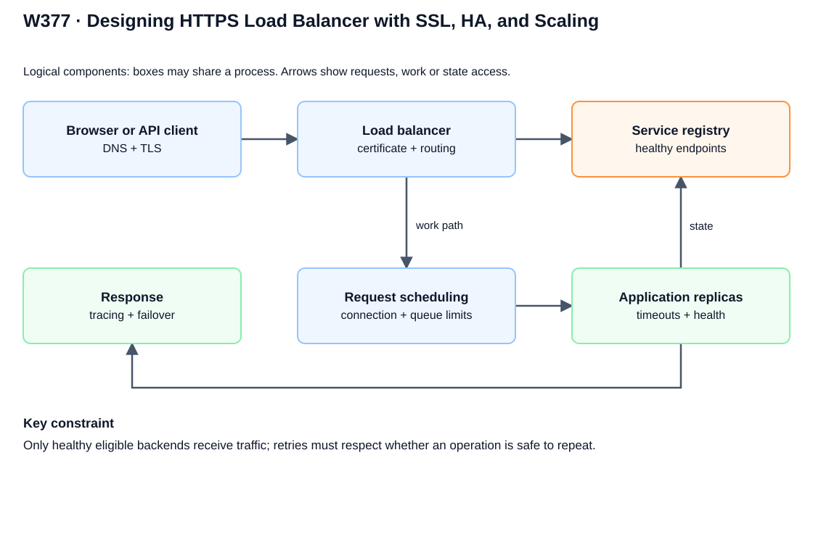

# W377. Designing HTTPS Load Balancer with SSL, HA, and Scaling

**Priority group:** Fourth 100 — role-dependent depth

**Category:** Configuration, identity and authorization

**Study position:** 377 of 547

[Group list](../FOURTH_100.md) · [All categories](../ALL_CATEGORIES.md) · [Chapter guide](../README.md)

## Question

Design a load balancer for HTTPS traffic. Consider the following points:

Load balancing strategies and algorithms (e.g., round-robin, least connections).
Handling SSL/TLS handshakes.
Ensuring high availability and fault tolerance.
Monitoring and scaling the load balancer.
Provide a brief architectural design diagram describing the components and interactions.

Please provide your complete design based on these guidelines.

## Worked solution

<!-- architecture:W377:start -->
### Architecture and request flow

[Open the diagram at full size](../diagrams/W377_architecture.svg). This is a baseline component diagram for this question. The boxes describe responsibilities; they do not require a separate microservice for every box.

- **Request and state:** Browser or API client — DNS + TLS → Load balancer — certificate + routing. That component consults or updates **Service registry — healthy endpoints** under the required access and consistency rules.
- **Work and result:** the work path passes through **Request scheduling — connection + queue limits** and **Application replicas — timeouts + health**, producing **Response — tracing + failover**. Bound waiting and retries where a slow dependency can stall this path.
- **Correctness point:** Only healthy eligible backends receive traffic; retries must respect whether an operation is safe to repeat.

When explaining the drawing, trace one normal request first, then a duplicate request, an unavailable dependency and recovery from saved state. If the question requires stricter guarantees or a different scope, state the change explicitly rather than treating this baseline as the only possible design.
<!-- architecture:W377:end -->

### Architecture and TLS boundary

UseDNS/anycast or a redundantL4 frontend to distribute connections across at least twoL7HTTPS balancers in separate failure domains, then route to healthy application replicas discovered from a registry. The retained diagram's client → TLS/routing balancer → bounded scheduling → backend → response path is the production flow. A versioned control plane supplies routes, backend pools, timeouts and certificate references; data-plane instances keep a validated last-known-good config during control-plane outage.

Terminate TLS atL7 for host/path routing, HTTP/2 multiplexing and request metrics; protect private keys with scoped secret management, rotate certificates atomically with overlap and validateSNI/hostname mapping. Re-encrypt/mTLS to backends across the chosen trust boundary. L4TLS passthrough keeps end-to-end application termination but cannot inspect encrypted HTTP paths without another layer. Use supported TLS policy, ALPN and session resumption; handshake/new-connection rate can bottleneck CPU independently of request rate. TLS0-RTT can replay requests, so do not use it blindly for non-idempotent actions.

### Choose request scheduling by workload

Round-robin is simple for homogeneous short requests; weighted round-robin handles capacity differences; least-connections helps long-lived uneven connections butHTTP/2streams make connection count a poor load proxy. Least-outstanding-requests or power-of-two choices with observed latency/load can fit variable request cost. Consistent hashing supplies affinity/cache locality with hot-key risk; prefer external session state over mandatory sticky routing. Bound per-backend concurrency/queues and preserve total request deadlines.

Use active health checks plus passive error/outlier detection with hysteresis, not immediate eviction on one error. Drain endpoints before removal and respect long-lived WebSocket/SSE connections with graceful deadline/reconnect policy. A failed backend may be retried only when safe: an HTTPtimeout after a paymentPOST is an unknown outcome unless the application supplies an idempotency key. Retry budgets/circuit breakers prevent a brownout amplification loop.

### HA, scale and operational proof

Stateless route handling allows horizontal balancer replicas, but liveTCP/TLS connections are stateful and usually reconnect after instance loss. Replicated VIP/anycast/failover andDNS have different convergence/client-cache behavior; test both zonal and process failures. Scale on connections, new handshakes, requests, bytes, CPU and tail queueing; prewarm before spikes and retainN+1capacity. Admission/rate limits and shed responses protect backends rather than allowing unlimited pending connections.

Measure connect/TLS/TTFB/end-to-endp95/p99, active streams, upstream error/timeout, health flaps, certificate expiry/config lag and per-route imbalance. Example: a small number of 2-minute streams makesleast-connections more sensible than naive round-robin, but a service with many multiplexed cheap streams may need per-request load. Canary config/cert changes, validate syntax/destinations before activation, provide rapid rollback and ensure spoofed Forwarded/identity headers are stripped/replaced at the trusted edge. Load-test certificate rotation, backend drain, slowloris/oversized requests and balancer-node loss.

### Further study

- [F165: Design idempotency for an order or booking API.](../17_distributed_systems_depth.md#f165)
- [F170: Design a cache without serving incorrect data.](../17_distributed_systems_depth.md#f170)
