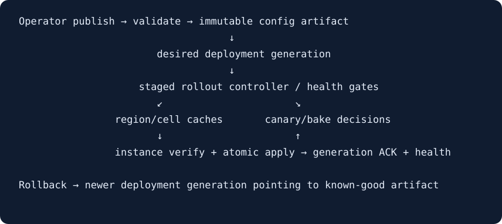

# W378. Global Config Deployment System

**Priority group:** Fourth 100 — role-dependent depth

**Category:** Configuration, identity and authorization

**Study position:** 378 of 547

[Group list](../FOURTH_100.md) · [All categories](../ALL_CATEGORIES.md) · [Chapter guide](../README.md)

## Question

Design a control plane that publishes versioned config, rolls it out progressively by region / cohort with bake times and health gates, and rolls back instantly to a known-good immutable version.

Functional requirements:
1. Operators publish versioned config changes for one or more services.
2. Operators define rollout strategy by region, cluster, service, or percentage cohort.
3. Services fetch or subscribe to the latest approved config for their environment.
4. The system validates and monitors deployments before advancing rollout stages.
5. Operators can instantly roll back to a previous known-good version.

Scale: ~5,000 namespaces, ~200 regions/cells, ~100k instances, ~20,000 read QPS, ~500 publishes/day, ~50 KB avg config. Defer collaborative editing, policy-as-code, cross-namespace transactions.

## Worked solution

<!-- architecture:W378:start -->
### Architecture and request flow

[Open the diagram](../diagrams/W378_final_architecture.svg). Artifact version and deployment generation are separate. Rollback changes desired state to a newer generation referencing an older immutable artifact; stale acknowledgments cannot advance the new rollout. Changing the control-plane pointer can be immediate, while disconnected instances still require bounded fetch/reconnect and convergence handling.
<!-- architecture:W378:end -->

### Immutable versions plus a monotone deployment generation

Model `Namespace,ConfigVersion(id,namespace,digest,blob_ref,schema_version,created_by)`, `Deployment(id,target_version,environment,stages,health_rules,state,generation)` and per-target desired/applied acknowledgments. `POST /namespaces/{id}/versions` validates/stores 50 KB immutable content; `POST /deployments` selects regions/cells/services/cohort strategy; status/pause/promote/rollback APIs use expected generation. Audit publisher, approval, reason, hash and every state transition; do not add deferred collaborative editing, cross-namespace transactions or policy-as-code.

Separate draft validation from rollout. Validate schema/ranges/references/runtime compatibility, run config-specific smoke checks, stage a small stable hashed instance cohort, then one cell/region, and expand only after configured bake time and sufficient representative health evidence. Error/latency/resource/business guardrails compare to current baseline with sample coverage; missing metrics or unhealthy control-plane links pause rather than automatically advance. Cohort hash uses stable deployment identity/instance id so retries do not reshuffle traffic unexpectedly.

### Distribution, client application and rollback

Publish immutable blobs through regional caches/object storage; stream small desired-generation/version hints and periodically reconcile by pull. Client verifies namespace/environment permission, digest/signature/schema and local safety checks, stages then atomically swaps config, acks applied generation and retains prior known-good config. A lost hint recovers by version poll; duplicate/out-of-order hints cannot overwrite newer desired generation. On restart use verified last-known-good disk snapshot then reconcile; do not take down all services because the control plane is unavailable.

Rollback is an immediate **control-plane decision**: create a higher deployment generation targeting the old immutable config and distribute via a priority path, bypassing ordinary bake delays. It is not physically instantaneous on 100k instances or partitions. Keep the prior blob warm/local and bound poll/notification intervals for a stated convergence SLO; offline targets report stale and follow their config-specific fallback. A lower payload version under a higher generation must be accepted, otherwise clients can reject a valid rollback as stale. Compatibility with service code/data still matters: rollback cannot undo an irreversible external schema migration automatically.

### Capacity and failure boundaries

500 publishes/day·50 KB ≈ 25 MB/day new blobs; 5k namespaces' current payload ≈ 250 MB. 100k instances·50 KB ≈ 5 GB for a worst full-fleet rollout, while 20k read QPS·50 KB ≈ 1 GB/s if every read redownloads—use ETags, version hints, delta/snapshot caches and regional fanout. 200 cells average 500 instances, so the control plane sends one cached version per cell then local distribution; skew/hot namespaces need quotas. Per-instance applied state/heartbeats can exceed blob volume, so aggregate telemetry and bound ack frequency.

Replicate authoritative metadata and rollout state, lease/fence controllers so one stage advances once, and reconcile desired/applied state after failover. Validate before commit, make publish idempotent by request id+digest, and retain audit/old versions under policy. Monitor publish → applied p95/max lag, bake gate coverage, bad client rejections, rollback convergence and cell outage. Test simultaneous publish, corrupt blob, old SDK, missed hint, controller crash after advance and isolation. Strong metadata ordering plus eventually delivered config is the chosen contract; no cross-namespace atomicity is claimed.

### Further study

- [F087: Design an online model rollout with rollback.](../09_ml_system_design.md#f087)
- [F170: Design a cache without serving incorrect data.](../17_distributed_systems_depth.md#f170)
